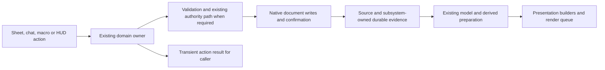

# Architecture and support handbook

This is the current navigation guide for UESRPG operators and maintainers. It describes the checked-in **14.2.0** source after Tasks 01-11, with Task 12 documentation updates. The manifest still declares Foundry minimum/verified **14.368**, maximum **14**. Native acceptance procedures target a backed-up **v14.369+** v14 world; this handbook does not certify a build or module combination.

Start with [support and troubleshooting](#support-and-troubleshooting) for a problem report, [canonical owners](#canonical-owners) before changing code, and the [testing guide](testing.md) for validation. The [Task 12 report](task-reports/12-supportability-accessibility.md) records diagnostic/privacy, accessibility and module-verification gaps. Its native cases are NOT RUN.

## Support and troubleshooting

### Capture the failure before changing the environment

Record the exact Foundry version/build, system version or source checkpoint, browser/version and OS. Add the user's role and ownership context, the sheet/action involved, whether the Token is linked or unlinked, and a short numbered reproduction. Use neutral labels such as Actor A and Token B. Record expected and observed behavior separately; include whether the action was accepted, still pending, completed, partial or awaiting review.

List only module IDs and versions relevant to reproduction. Record whether the same case was tested without external modules in a disposable copy. If it was not tested, say NOT RUN. An installed adapter, a source check or a manifest's existing `verified` declaration is not evidence that a module combination passed.

Use the [bug-report template](../.github/ISSUE_TEMPLATE/bug_report.md). Report the environment that failed; upgrading Foundry or the system is not a prerequisite to reporting. Any later version comparison should be a separate, backed-up test with its exact versions recorded.

### Inspect interrupted work before retrying

If a purchase or managed application is pending, partial or uncertain, stop repeated submissions for that operation. Ask the GM to inspect the existing durable record and its affected documents before retrying. A timeout or an unchanged-looking sheet does not establish whether a resource/effect write occurred.

Use the existing [purchase review procedure](task-reports/02-xp-purchases.md) and [special-action review procedure](task-reports/04-special-action-idempotency.md). Their review permissions and supported dispositions differ. Special-action review is not a universal repair tool for every damage/healing action. Do not erase flags, refund resources, toggle conditions or remove a created Item to make an error disappear. Keep identifiers in private local evidence when needed to trace the operation; replace them with stable aliases in public reports.

For migration issues, inspect the current Migration settings statuses. Known failure metadata keeps a revision pending, and historical failures require explicit manual retry by the selected active GM. `worldDataVersion` is informational. Do not clear or lower revision markers to rerun or reverse transformations. The [Task 06 report](task-reports/06-migration-readiness.md) owns those procedures.

### Reproduce in a copied world

Before tests that can write data, stop the source world and preserve a coherent backup. Use a disposable copy with the same source/build and a recorded module list. Start with external modules disabled, then add relevant combinations deliberately. Compare the same action and fixture state; changing versions, settings and modules together does not isolate a cause.

Restore matching Actor, Item, ActiveEffect, Token, ChatMessage, Combat and settings state as appropriate after stateful tests. A resource snapshot alone may not match a retained receipt or pending purchase. Existing acceptance procedures in the [testing guide](testing.md#lane-b---real-foundry-integration) define the required cases and restoration boundaries.

### Choose focused diagnostics and redact evidence

The existing Debugging settings menu is registered as GM-restricted. Its Save action changes settings; it is not a read-only support-export button. A player should report their own observations and ask the GM for relevant settings or recovery inspection, rather than bypass menu restrictions.

Have the GM or maintainer choose the narrow diagnostic lane for the problem and record the original settings for restoration. The common logger requires the world `debugEnabled` master and the selected lane; client toggles alone do not establish that every lane records. `timePerformanceDebug` has an independent world gate. Broad debug changes can affect other users, volume and timings. See the [diagnostic inventory](task-reports/12-supportability-accessibility.md#diagnostic-inventory-and-privacy-boundaries) before collecting.

Existing performance records, opposed snapshots, drag/drop traces and Feature Inspector clipboard data are **raw diagnostics**, not a general sanitized support export. They may include names, UUIDs, author/speaker information, document flags, formulas, paths or private context. A function named `safeClone`, a compact result or a GM-only inspector is not a redaction guarantee.

Copy only the relevant error text/code and nearby diagnostic facts. Before sharing, remove credentials, session/invitation tokens, server addresses, private chat, notes, names, descriptions and unnecessary user/document identifiers. Crop or redact screenshots and inspect the result. Keep the action sequence, role, exact versions and consistent anonymous aliases so the report remains useful. Configuration/module metadata can still identify an environment; share only what is needed. No automatic upload, telemetry or new exporter is provided here.

An illustrative manual summary is: "Owner player; NPC Token B, unlinked; Apply clicked once; card stayed Processing after reload; no retry; relevant error code retained; GM inspecting the original record." This is an example of reporting style, not an observed incident or an exported data format.

## Data and evidence boundaries

| Layer | Role | Maintenance rule |
| --- | --- | --- |
| Stored document source | Actor/Item fields, owned equipment and the flags owned by their subsystem | Native document writes and current permissions determine persistence. Embedded Items remain equipment state owners. Do not infer stored values from HTML. |
| Model and derived state | TypeDataModel cleaning/defaults and staged Actor/Item preparation | Model defaults, runtime scaffolding and derived values have different roles. They do not authorize rewriting explicit source or running a migration during render. |
| Presentation | Sheet builders, signatures, caches, form/render queues and read-only damage explanations | Prepare views from current document evidence. A render, cache hit or visible control does not prove gameplay completion or permission. |
| Durable operations | Purchase journal, application receipts, saved card identity/status and required provenance | Preserve the existing subsystem's retry/review rules. Do not replace evidence with current resource values or another journal. |
| Transient return result | Task 09's `actionResult` status, commitment and references | Describes the named action scope for its caller. Accepted/pending differs from complete; existing companions preserve native/Boolean/null return signatures. It is not a new persisted ChatMessage schema. |

This is an ownership map, not a claim that every action uses the same command or has an atomic transaction. The [action-result contract](action-results.md) and each subsystem report define their actual boundaries.

## Canonical owners

| Responsibility | Entry owner and existing helpers | Guidance |
| --- | --- | --- |
| Startup and registration | [system.js](../src/system.js), [init.js](../src/hooks/init.js), [hook registry](../src/hooks/_internal/hook-registry.js) | Trace init/setup/ready and the actual await boundaries. Local registration guards do not provide global completion. [Task 11](task-reports/11-startup-combat-event-performance.md) maps deferred work and sibling ready callbacks. |
| Actor derived data | [SimpleActor](../src/core/documents/actor.js), [prepare ownership](../src/core/actors/prepare/README.md), [derived cache](../src/core/actors/derived-cache/actor-derived-cache.js) | Actor preparation delegates to staged humanoid/type helpers and embedded Item aggregation. Preserve ordering, especially finalized characteristics before skill TN preparation. Runtime scaffolding is not migration completion. |
| Item preparation and creation | [SimpleItem](../src/core/documents/item.js), `core/documents/item-prepare/` | Native creation and type helpers retain explicit rank input and equipment behavior. Actor-owned Items are the source for equipment; avoid another sheet-owned copy. See [Task 01](task-reports/01-skill-rank.md). |
| TypeDataModels and seeds | [registry](../src/core/data-models/registry.js), [generated seeds](../src/core/data-models/defaults.generated.js), [seed generator](../scripts/generate-schema-defaults.js) | Manifest/template inheritance and generated defaults have existing drift checks. Four Actor and sixteen Item types are registered. Broader validation is deferred under [Task 07](task-reports/07-typed-data-model-audit.md); ChatMessage subtype adoption is deferred under [Task 10](task-reports/10-typed-chat-outcomes.md). |
| Form intent and writes | [form pipeline](../src/ui/sheets/v2/shared/form-pipeline.js), [sheet runtime helpers](../src/ui/sheets/v2/shared/sheet-runtime-helpers.js) | Preserve per-surface allow-lists, normalization and serialized form updates. Explicit form data is distinct from unrelated live resource changes. Preserve Item purchase failure/skip-submit close behavior. |
| Rendering and UI state | [sheet runtime helpers](../src/ui/sheets/v2/shared/sheet-runtime-helpers.js), [sheet signatures](../src/ui/sheets/v2/shared/sheet-signatures.js), PC/NPC/Item sheets | Reuse the current queue and lifecycle state. Close cleanup, partial/full fallback and focus/scroll have native acceptance cases, not measured guarantees. [Task 05](task-reports/05-appv2-sheet-performance.md) maps caches and invalidation. |
| Damage/healing application | [ApplyDamageService](../src/application/combat/apply-damage-service.js), existing damage resolvers, [post-application owner](../src/core/combat/damage/post-application.js) | Public callers route to the service; calculation, health commitment, aftermath and receipts remain distinct. Do not copy a calculator or call raw writes from presentation. |
| Chat outcomes and special actions | [ChatOutcomeApplicationService](../src/application/combat/chat-outcome-application-service.js), [special-action adapter](../src/core/combat/special-actions-helper.js) | Existing adapters, identity, staged execution and receipts own application. Rendering does not become another executor. [Task 04](task-reports/04-special-action-idempotency.md) owns special recovery; [Task 08](task-reports/08-explainable-combat-calculations.md) owns read-only explanation boundaries. |
| Action results | [action-results.js](../src/application/action-results.js), [contract guide](action-results.md) | Use existing projection/accessor/aggregation helpers. Preserve the distinction between scope completion and accepted deferred work, including compound actions and uncertain acknowledgements. |
| Authority and native writes | [authority intents](../src/utils/authority-intents.js), [authority proxy](../src/utils/authority-proxy.js), [confirmation/lock helpers](../src/utils/authority-proxy/shared.js) | Evaluate original-requester permissions through existing domain commands. Authority selection and owner fallback are workflow-specific. Generic cross-owner update payloads are not a replacement for sealed commands. |
| XP purchases | [purchase service](../src/core/advancement/purchase-service.js), [purchase plans](../src/core/advancement/purchase-plans.js), [Task 02](task-reports/02-xp-purchases.md) | Recalculate domain choices on authority; retain journal identity/revision and explicit partial outcomes. Do not add separate Item/resource deductions or automatically compensate uncertain operations. |
| Migrations | [revisions](../src/core/migrations/revisions.js), [state](../src/core/migrations/state.js), [runner](../src/core/migrations/runner.js), [execution](../src/core/migrations/execution.js) | One 21-key registry and runner; revision truth includes failure metadata. Preserve active-GM authority, startup/manual scopes and explicit retry. No global readiness flag. |
| Automation time | [TimeService](../src/core/time/time-service.js), [combat boundary orchestrator](../src/core/time/combat-boundary-orchestrator.js), [boundary scheduler](../src/core/time/boundary-work-scheduler.js) | Preserve existing time/round orchestration. PC/NPC combat hooks are presentation observers. Do not add another round processor or task runner to optimize an unmeasured cost. |
| Diagnostics | [debug gates](../src/utils/debug.js), [performance API](../src/utils/perf-tracker.js), [Debugging panel](../src/ui/apps/v2/debug-settings.js) | Reuse current gates/APIs. Read-only records, settings writes, mutating maintenance helpers and clipboard/download behavior have different permissions/privacy implications. |
| Public APIs and integrations | [ESM barrel](../src/api/index.js), [runtime registration](../src/api/runtime-registration.js), [HUD adapter](../src/integrations/token-action-hud/api.js) | Preserve public signatures and companions. External macro completion is not proof of arbitrary external effects. An adapter in source is not a tested module matrix. |
| Build and ownership safeguards | [build validator](../scripts/build-release.js), [consolidation checks](../scripts/consolidation-checks.js), [release metadata](../automation/release-metadata.js) | Reuse current source/runtime packaging and version owners. Node tests belong in repository-source handoffs and stay excluded from installable archives. Building, native acceptance and publishing are separate steps. |

## AppV2 and API boundaries

Use the official [Foundry v14 API](https://foundryvtt.com/api/v14/index.html) as API authority. [ApplicationV2](https://foundryvtt.com/api/v14/classes/foundry.applications.api.ApplicationV2.html), [HandlebarsApplication](https://foundryvtt.com/api/v14/classes/foundry.HandlebarsApplication.html) and [DialogV2](https://foundryvtt.com/api/v14/classes/foundry.applications.api.DialogV2.html) are the current UI architecture. Existing sheet subclasses, `PARTS`, tabs and form handlers remain their surface's owners.

Public `render`, `submit` and `close` operations differ from protected subclass lifecycle overrides such as `_prepareContext`, `_onRender`, `_preClose` and `_onClose`. Pre-close work is awaited; post-close work is not awaited by closing. Preserve superclass behavior, existing cancellation and the current form/update queue. Do not call protected/private handlers from an external test merely to bypass normal controls. [Form configuration](https://foundryvtt.com/api/v14/interfaces/foundry.applications.types.ApplicationFormConfiguration.html) documents handler/change/close options; the specific sheet's source determines its actual policy.

Use documented native document updates and embedded-document operations through the existing confirmation/authority helpers. Permission and visibility checks remain required; hiding a button or registering a data model does not authorize a mutation. Chat content can be hidden while its message is visible, as documented by [isContentVisible](https://foundryvtt.com/api/v14/classes/foundry.documents.ChatMessage.html#iscontentvisible). A new payload type is not a privacy boundary.

Register hooks through the existing owner/guard, retain IDs for instance cleanup, and preserve native lifecycle semantics. The public [Hooks API](https://foundryvtt.com/api/v14/classes/foundry.helpers.Hooks.html) supplies registration/removal; source declaration counts do not demonstrate native cleanup or exclusive execution. Unknown or undocumented behavior remains unknown until supported evidence exists.

## Maintaining a change without duplicating ownership

1. Identify the trigger, affected source fields, user role and expected behavior. Preserve originals and hashes before editing, plus a coherent copied-world backup before stateful tests.
2. Search existing callers and exports with `rg` / `rg --files`, starting from the owner table. Follow imports through `src/`, templates, scripts, macros/integrations and public API registration. A compatibility wrapper may delegate to the owner; it is not permission to add a second implementation.
3. Read the relevant task report and source. Separate a source-confirmed observation from a suspected defect and a native reproduction. Preserve field names, operation identity, ordering, permissions and explicit partial/cancellation outcomes.
4. Verify any Foundry API or protected override against the exact v14 entry. Public core APIs do not certify third-party integration calls. Keep changes small, reversible and inside the existing surface/subsystem.
5. Use Node **24.x**, locked dependencies and the [canonical test/validation commands](testing.md#running-and-interpreting-results). `npm test` directly imports portable production functions; it does not construct Foundry Documents. `npm run validate` is source validation, not a native test or a release build. Do not regenerate catalogs/defaults just to conceal a failure.
6. Record command exits/durations and native acceptance separately. Relevant native cases, privacy, keyboard behavior, multiplayer recovery and performance remain NOT RUN until exercised in the backed-up world. Current historical unit evidence is Task 09's 313 tests in twenty suites; Task 12 does not rerun it.
7. Review source hashes, unrelated changes and rollback. Source checks do not authorize deployment, a version bump or a compatibility claim. Follow the separate [release guide](Release.md) only within an explicitly selected release task.

## Which documentation to use

| Document family | Role |
| --- | --- |
| This handbook | Current ownership/navigation and operator support workflow. Update it when an owner or supported workflow changes. |
| [Testing guide](testing.md) | Canonical commands and three evidence lanes; links to task-specific native cases. Avoid competing rules or cloned acceptance calculators. |
| [Action-result contract](action-results.md), [localization guide](Localization.md), [release guide](Release.md) | Current focused consumer/development references within their stated scope. A release command is not an executed release. |
| [Task reports](task-reports/12-supportability-accessibility.md) | Dated scope, source evidence, actual validation ledger, limitations and rollback. Prior reports remain historical records; later reports can supersede their baseline counts without rewriting them. |
| Consolidation, combat/automation, chat-performance and UI-polish records | Earlier implementation/design evidence and useful acceptance cases. Their dates, source metrics, filenames or local visual captures are not current native certification. Consult the testing guide and newer task reports for current boundaries. |
| README and manifests | README entrypoint and declared package metadata. `system.json`, package/version automation and the release owner control declarations; this handbook changes none. |

Earlier documents mentioning planned 14.3.0 work and the bundle's newer reference release do not change the checkout's 14.2.0 version. README's 14.368 floor/verified wording matches the current manifest; no mismatch is corrected by this task. Any later release/version/document-alignment decision belongs to Task 13, which is not performed here.

The broader Task 05/11 optimizations, Task 07 stricter schema, Task 10 typed ChatMessage adoption, and Task 12 exporter/native accessibility/module verification remain deferred under their recorded evidence gates. An unexecuted matrix is a procedure, not a compatibility result.
