# Task 02 - Recoverable XP purchases

**Date:** 24 October 2026.  
**Scope:** the approved Task 02 protocol and all selected integrations, on the existing 14.2.0 source baseline.  
**Result:** all selected source integrations implemented; all five required source checks PASS.  
**Runtime acceptance:** NOT RUN. No Foundry instance, copied test world, or world backup was used. Source checks and isolated fixtures do not establish crash recovery or runtime compatibility.

## Baseline and rollback material

| Field | Evidence |
| --- | --- |
| Workspace | `C:/dev/uesrpg/uesrpg-3ev4-14.0.0` |
| Branch, commit, PR | Unavailable: this checkout's Git metadata is not readable as a repository. No Git repository, commit or PR was created. |
| Source and package version | `14.2.0`; unchanged |
| Compatibility manifest | Minimum and verified `14.368`, maximum `14`; unchanged. Acceptance is intended for a backed-up v14.369+ world. |
| Node | `v24.13.0`; existing development dependencies used |
| Pre-change snapshot | Ignored `release/backups/task-02-xp-purchases-20261024/`: 946 baseline files from source, scripts, templates, languages, documentation and build metadata; `baseline.sha256.json` records their hashes. |
| Task 01 preservation | The snapshot contains Task 01's completed `item.js`, SHA-256 `4a02accce7ec728e1a7ab959dc3c6069d752c6cb820e22c69f763e30fe12f12d`. Its rank-presence logic and its original report remain intact. |
| Excluded work | No release artifact, deployment, version bump, compatibility change, migration, new dependency, or later task. Task 00 runtime fixtures, performance measurements and full world acceptance remain incomplete. |

The bundle is context for implementation; the approved user plan determines this patch's scope. The newer bundle reference version does not replace the workspace baseline. This report supersedes neither the historical Task 01 evidence nor its NOT RUN runtime cases.

## Canonical owners and integration checkpoints

| Checkpoint | Canonical owner and resulting behavior |
| --- | --- |
| Shared planning and protocol | `src/core/advancement/purchase-service.js` owns authority selection, the sealed command, Actor locks, durable checkpoints, receipts and reconciliation. `purchase-projection.js` owns planning-only changes and resource arithmetic. `purchase-plans.js` dispatches ordinary advancement workflows. |
| Existing calculators | Item-sheet planning moved to `core/advancement/item-advancement.js`; the former UI module re-exports it. Combat-style setup's private calculator moved to `core/advancement/combat-style-setup.js`. Characteristic advancement staging and execution share the extracted cost helper in `skill-advancement.js`. Existing skill, Talent and spell validators remain the owners of those rules. |
| Item sheets | `ui/sheets/v2/item-sheet.js` retains its form normalization, allow-list, source diff, validation and queued AppV2 submit flow. PC skill, magic-skill and combat-style advancement goes through the service. Ordinary edits and World/NPC Item behavior keep their existing update path. |
| Purchase menus | Spend XP and Spell Learning preserve draft order and staged choices. The authority rebuilds projected state entry by entry, including prerequisites supplied by earlier entries. Drafts clear only after confirmed completion. Rejected or unconfirmed results preserve them. Completion replays suppress repeated spending notifications. |
| Racial and combat-style flows | The existing racial module retains one set of source lookup, selection, snapshot and rollback guards, now used by a planning-only export. Combat-style setup uses the shared calculator for previews and authoritative execution. Free setup and existing post-chargen GM correction requirements remain. |
| Native Talent creation | `SimpleItem` implements documented static batch overrides, preserves superclass cancellation, prepares enforce-mode learning before persistence, and finalizes it afterward. The Talent hook retains warn-mode feedback; enforcement uses the complete projected batch. Service-managed creation bypasses preparation only when its source and marker match the active journal. |
| Other system XP writers | XP awards, GM XP saves and the existing starting-resource form use the same authority, Actor lock and revision protocol. Awards are recalculated as deltas; staged GM saves carry the opening revision/fingerprint. Original permissions and campaign-rank calculations are retained. |
| Recovery presentation | `ui/advancement/purchase-review.js` uses the existing DialogV2 helper. XP/advancement menus expose review to owners; only a GM can record reconciliation. Purchase failures also offer review when an operation is unfinished. Item sheets retain the existing skip-submit-on-close option. |
| Registration and source guards | `register-core-subsystems.js` registers the purchase command once. Existing consolidation checks now own the shared purchase helpers, reject literal XP patches outside their planners, and reject independent mutation helpers in purchase-only callers. No separate test framework was added. |

The former exported spell/Talent mutation helpers and racial helpers retain their signatures and delegate to the service. Legacy result fields such as `reason`, `spentXp`, `createdSpell`, racial `record`/`error`, and draft `applied` remain available where applicable. The shared outcome adds `status`, `operationId`, authority `code`, confirmed `xpCost`/`wealthCost`, affected Item UUIDs and `replayed`.

## Protocol and additive data

The command is internal `advancement.purchase`. The existing authority-intent transport stores the sealed request on the original requester's User and uses `User.query` to wake the selected authority. The purchase service registers an authority resolver that prefers the active GM and otherwise uses the existing deterministic active-owner helper. Permissions, ritual permission and administrative corrections are evaluated for the original requester, not inherited from the GM processing the command.

Requests contain an Actor UUID, version, operation ID, workflow, domain choices, expected purchase revision/fingerprint and quoted costs. They do not accept arbitrary Actor update payloads. Item form/draft updates still pass their existing form normalization and planning checks. The authority recalculates costs, discounts, prerequisites, campaign gates and available resources against current/projected data.

The new Actor flag is initialized lazily:

```text
flags.uesrpg-3ev4.advancementPurchases = {
  version: 1,
  revision: <monotonically increasing integer>,
  active: null | <operation record>,
  receipts: <latest 50 terminal records>
}
```

An operation record includes its immutable `intent`, requester, processor user/session, timestamps, status, planned XP/Drakes, sparse Actor changes, Actor/Item fingerprints, details and ordered Item steps. Each step records its kind, planned data, target or preceding-create reference, before values/source, status and confirmed document reference/fingerprint. Native creation is marked as started before the pending batch is released for persistence. An uncertain record may also include an error and observed resources.

Created and updated Items receive this additive marker in the same write as their purchase change:

```text
flags.uesrpg-3ev4.advancementPurchase = {
  version: 1, actorUuid, operationId, stepId
}
```

Markers do not grant permissions. The source must match the active operation's create step before bypassing native preparation. Old copied markers are removed from newly planned sources. Updated Item markers identify the last managed step; the Actor journal remains the recovery owner. Deletion cannot leave a marker on a deleted document, so its target/source and started checkpoint are persisted before the attempt.

Terminal records use `complete`, `rejected` or `resolved`. Unresolved `applying`/`needsReview` records have no expiration. Unsupported or malformed journals are rejected without replacement. Receipts retain the latest 50 records; revision checks prevent an old request whose receipt was pruned from executing with its original expected revision. Exact stored intent comparison rejects ID collisions. Validation rejections accepted at the current revision are also receipted; requests rejected before acceptance or for a stale revision need not create a journal.

The purchase fingerprint uses stable serialization and a portable, non-security 128-bit change fingerprint. Native permissions, sealed requester identity and exact immutable-intent comparison provide separate checks. The fingerprint is conservative: it covers resource/prerequisite Actor fields and owned Item source state, while excluding purchase markers and presentation/audit state. It does not imply database compare-and-swap or authenticated document hashes.

```mermaid
stateDiagram-v2
  [*] --> Validating
  Validating --> Rejected: invalid, unauthorized or stale
  Validating --> Applying: confirmed Actor checkpoint
  Applying --> Applying: started / confirmed Item steps
  Applying --> Complete: resources + provenance + receipt in one Actor update
  Applying --> NeedsReview: partial, uncertain or changed state
  NeedsReview --> Resolved: GM manual repair + reason + acknowledgement
  Complete --> Complete: exact replay; no writes
  Rejected --> Rejected: retained rejection replay
  Resolved --> Rejected: old operation cannot execute again
```



Under the existing Actor lock, the authority validates the complete plan and persists `applying` before Item changes. It applies ordered Item steps with supported document APIs and confirms their requested source values. Before resource commitment it verifies authority/session, requester ownership, relevant Actor state, untouched inventory and the last confirmed state of each affected Item. XP, any associated Drakes/characteristic fields, purchase provenance and the completion receipt are written together in one Actor update. Only affected fields are patched.

If Item changes may have persisted and the Actor completion write is rejected, the active evidence remains and later purchases are blocked. A lost acknowledgement can be recognized from the durable completed receipt. A confirmed receipt accompanied by a mismatching Actor result is reopened as `needsReview`, preserving observed values. There is no automatic resource refund, Item deletion, value restoration or continuation by a different processor/session. A query timeout retains the exact intent and inspects available durable evidence before another request; it does not prove failure.

Foundry documents do not provide an assumed atomic transaction across Actor and Item writes. There remains a race with external direct edits or other browser sessions outside this protocol. These are detected where the recorded source comparisons observe them; this patch cannot promise atomic exclusion of arbitrary external writes.

## Racial cost and refund policy

The acquisition preview combines the listed option cost and ordinary learning costs for newly created racial Talents in enforce mode. Existing Talent validation supplies those costs and discounts. Starting racial Talent creation also retains enforce-mode learning costs. Warn/off native learning keeps its existing no-charge behavior; explicit Spend XP purchases continue to follow their explicit purchase rules.

New grant provenance adds `xpBreakdown: { option, talentLearning }` and records the actual combined charge in `xpCharged`. A replacement quote shows any historical refund separately. Refunds use only the recorded `xpCharged`; older grant records are not rewritten to infer additional Talent charges. Existing rollback conflict guards still reject changed grant targets. Resource/refund changes and the new provenance share the final Actor commit.

## Review and reconciliation

Open the Actor's XP or advancement dialog and choose **Review XP Purchases**. Owners can inspect the operation identity, workflow, status, source-backed costs, affected fields, confirmed/planned/started steps, unresolved writes and current resources. A GM must stop the old operation/session, compare the recorded evidence with actual document exports, and manually repair the Actor and Items before recording reconciliation.

Recording reconciliation requires GM permission, a reason of at least three characters, the reviewed revision/fingerprint, and acknowledgement that the processor was stopped and the documents were reconciled. It stores a `resolved` receipt and increments the revision; it performs no repair, refund or charge itself. Owners cannot clear a recovery record. Unknown journal versions require separate investigation rather than resetting the flag.

An interrupted Item sheet offers **Close Sheet Without Retrying** through its existing `uesrpgSkipSubmitOnClose` path. Closing a sheet does not clear or resolve the Actor's journal. Unconfirmed purchase-menu drafts remain in the open application; their existing discard/close controls still apply. Drafts are not claimed to persist through a client reload.

## Official v14 API references

| Reference | Documented use |
| --- | --- |
| [Item._preCreateOperation](https://foundryvtt.com/api/v14/classes/foundry.documents.Item.html#_precreateoperation) | Protected static batch preparation after individual pre-create processing; update pending documents via `updateSource`; preserve `false` superclass cancellation. |
| [Item._onCreateOperation](https://foundryvtt.com/api/v14/classes/foundry.documents.Item.html#_oncreateoperation) | Protected static batch callback after creation; only the selected current authority finalizes a matching native operation. |
| [Item.updateSource](https://foundryvtt.com/api/v14/classes/foundry.documents.Item.html#updatesource), [DataModelUpdateOptions](https://foundryvtt.com/api/v14/interfaces/foundry.abstract.types.DataModelUpdateOptions.html) | Pending source changes and `dryRun`/`fallback: false` validation/confirmation through existing helpers. |
| [Actor.update](https://foundryvtt.com/api/v14/classes/foundry.documents.Actor.html#update), [createEmbeddedDocuments](https://foundryvtt.com/api/v14/classes/foundry.documents.Actor.html#createembeddeddocuments), [deleteEmbeddedDocuments](https://foundryvtt.com/api/v14/classes/foundry.documents.Actor.html#deleteembeddeddocuments) | Existing native document-write helpers; no raw database mutation or cross-document transaction assumption. |
| [User.query](https://foundryvtt.com/api/v14/classes/foundry.documents.User.html#query), [Item.canUserModify](https://foundryvtt.com/api/v14/classes/foundry.documents.Item.html#canusermodify) | Existing authority transport and native permission checks. |
| [Item.constructor](https://foundryvtt.com/api/v14/classes/foundry.documents.Item.html#constructor), [validate](https://foundryvtt.com/api/v14/classes/foundry.documents.Item.html#validate), [DocumentConstructionContext](https://foundryvtt.com/api/v14/types/foundry.abstract.types.DocumentConstructionContext.html) | Prepare detached validation documents with the actual Actor parent and strict/fallback options; validate the ordered projected create/update sequence before persisting a purchase checkpoint. Native hooks and write cancellation still require live acceptance. |
| [DialogV2](https://foundryvtt.com/api/v14/classes/foundry.applications.api.DialogV2.html) | Existing `customDialog` wrapper for recovery and cost confirmation. |
| [expandObject](https://foundryvtt.com/api/v14/functions/foundry.utils.expandObject.html), [getProperty](https://foundryvtt.com/api/v14/functions/foundry.utils.getProperty.html) | Existing flat/nested form preparation; Item preview reads expanded nested data instead of relying on undocumented literal-key traversal behavior. |

Only official v14 documentation was used as API authority. Its currently published page footer/build is not evidence of acceptance on a v14.369+ runtime. No new deprecated API or mixed UI lifecycle was intentionally introduced.

## Validation ledger

Task 01's five source checks passed on the preserved baseline. Final Task 02 checks:

| Check | Result | Evidence / limit |
| --- | --- | --- |
| `npm run lint` | PASS | Exit 0; existing repository configuration |
| `npm run syntax:check` | PASS | Exit 0; 789 JavaScript files |
| `npm run schema:check` | PASS | Exit 0; generated defaults match `template.json`; no generation requested |
| `npm run data:check` | PASS | Exit 0; 30 spell effects and 13 strike enchantments match their catalogs |
| `npm run validate` | PASS | Exit 0; 789 JavaScript files, 105 templates, 18 Markdown files; 778 modules, 3,969 static/literal-dynamic edges and 7,070 import/export bindings; 21 unchanged migration revisions. Extended ownership guards ran; no build/publish option. |
| Isolated protocol fixtures | PASS, 19 cases | Actual service/projection modules with document/authority stubs in a disposable in-memory Node VM; no test file/framework or Foundry world. Cases include completed/rejected replay, collision, exact/insufficient funds, rejected Item/resource writes, lost acknowledgement, final mismatch, stale source, create-then-update, active-owner fallback, native preparation/finalization, changed confirmed Item, 50-receipt pruning, reconciliation, unsupported version, and concurrent workflows. |
| Protected files | PASS | Package/dependency/manifest/schema files and the Task 01 report match the baseline byte-for-byte. Task 01's original rank method is retained. |
| `npm ci`, live Foundry, performance/deprecation capture | NOT RUN | Existing dependencies used; no backed-up test world supplied. |

The release validator reports the same 25 import/export coverage notices as the preserved baseline, separately from failures: computed namespace access, namespaces passed beyond direct binding/access, and dynamic-import promises outside supported static analysis remain limitations. The new ownership checks likewise cannot prove dynamically assembled XP writes, external callers, native database behavior, hook ordering beyond the documented lifecycle, or AppV2 usability. Full final output is retained under the ignored backup directory.

## Reproducible live acceptance - every case NOT RUN

Before execution, copy a complete stopped Foundry v14.369+ world and record the exact Foundry/system build, browser and enabled modules. Use sanitized PC/NPC actors, owner/non-owner accounts, two active owners, a GM, linked/unlinked tokens, suitable skill/Talent/spell compendium sources and separate coherent Actor/Item exports. Start with external modules disabled. Save resource values, source exports, operation IDs, journal revisions, Item markers, notifications and console evidence for each case. Restore a coherent backup between destructive/interruption scenarios.

| Case | Procedure and expected observation | Status |
| --- | --- | --- |
| 02-FUNDS | For every affected workflow, try sufficient XP, exact XP and one less than required; repeat Drakes spell purchases. Complete charges match the quote; insufficient purchases make no consequential Item/resource change. | NOT RUN |
| 02-ITEM | Advance PC skill/magicSkill/combatStyle ranks, specializations, trained equipment and special advantages. Verify Scholar/Lore, Evade restrictions, favored rounding and campaign gates against the existing calculators. | NOT RUN |
| 02-ORDINARY | Save ordinary Item edits and create/edit World and NPC Items. Check unrelated equipment, NPC armor initialization and native ownership restrictions. | NOT RUN |
| 02-DRAFT | Stage mixed characteristics, skills, rank/spec/equipment changes, Talents and spells. Place a prerequisite/discount-providing entry earlier. Confirm in order; reject a later invalid entry before consequential writes; retain drafts on failure. | NOT RUN |
| 02-FREE | Exercise free combat-style setup and GM administrative corrections with/without a valid reason, including low available XP. Verify paid/waived amounts and audit evidence. Try the same request as a non-GM owner. | NOT RUN |
| 02-RACIAL | Acquire a racial option that creates a Talent in enforce mode; confirm the listed option cost plus the normal discounted Talent learning cost before acceptance. Verify starting Talents, an already-owned Talent, option changes, new Combat Style targets and allowed weapon families. | NOT RUN |
| 02-REFUND | Refund a new grant and compare the actual combined `xpCharged`/breakdown. Refund an unchanged historical record and verify only its recorded charge. Modify an affected Item first and verify the existing conflict guard. | NOT RUN |
| 02-SPELL | Buy each supported spell type by each allowed payment, test duplicates and settings gates. Submit a ritual as owner while a GM processes it; verify original-requester ritual permission. Compare wrapper `createdSpell`/cost results. | NOT RUN |
| 02-NATIVE | Create single and batch Talents through native drop/create/copy/import routes in enforce/warn/off modes. Include a batch prerequisite, a bad later Talent, insufficient combined XP, superclass/hook cancellation and unrelated Items in the same batch. Confirm one charge and matching markers; managed purchases must not recurse or double-charge. | NOT RUN |
| 02-CONCURRENT | Submit Item, draft, spell, racial and award requests concurrently from different clients. Repeat with no GM and multiple active owners. Verify one selected authority, serialization, stale rejection and no lost XP updates. | NOT RUN |
| 02-REPLAY | Lose a completion acknowledgement; retry the same immutable operation. Expect the recorded result with no duplicate writes/notice. Reuse the ID with changed choices and expect rejection. After 51 terminal receipts, replay the pruned request with its original revision and expect rejection. | NOT RUN |
| 02-STALE | Change XP, Drakes, prerequisites, Talent mode/discounts, a targeted Item or relevant inventory while a form/draft/quote is open. Verify revalidation/stale rejection. Make unrelated Actor presentation edits and confirm they are not overwritten. | NOT RUN |
| 02-AWARD | Award XP during purchases and save an old GM XP dialog afterward. Verify the award's delta/rank and rejection of a stale absolute save. Verify owner starting-resource permission remains as before. | NOT RUN |
| 02-FAILURE | Reject the initial checkpoint, each Item create/update/delete, each confirmation checkpoint and the final Actor write in a controlled disposable environment. Export evidence at every boundary. No automatic undo or resource refund should occur after uncertainty; further purchases remain blocked. | NOT RUN |
| 02-INTERRUPT | Interrupt after preparation, before/after native Item creation, after each Item step, and after resource commitment before acknowledgement. Reload or change authority/session. Inspect durable evidence before any retry; uncertain operations must not resume automatically. | NOT RUN |
| 02-REVIEW | As owner, inspect but fail to reconcile. As GM, manually repair matching documents, record a reason and stopped-processor acknowledgement, then verify a resolved receipt. Change the reviewed state before recording and expect stale rejection. Do not clear unsupported versions. | NOT RUN |
| 02-TOKEN | Repeat single, batch, retry and interruption cases on linked Actors and supported unlinked token Actors. Confirm UUID/lock/journal/inventory isolation and correct authority permissions. | NOT RUN |
| 02-APPV2 | Trigger a purchase failure on Item submit and on close. Keep the form available; close using Close Sheet Without Retrying and verify the durable record remains. Reopen sheets, discard/retain drafts and verify source-backed UI values. | NOT RUN |
| 02-TASK01 | Repeat Task 01's nested/dotted rankless and all-canonical-rank creation, duplication, copy, compendium import, export/reimport and malformed explicit-value cases. Confirm the rank-preservation fix remains. | NOT RUN |
| 02-RESTORE | Stop all clients and restore matching Actor/Item/world backups after stateful scenarios. Verify journal, markers, grant provenance, resources, ranks and effects describe the same point in time. | NOT RUN |
| 02-CONSOLE | Throughout, record errors, deprecations, unexpected re-renders/layout changes and server/client acknowledgement behavior. No runtime or performance claim follows from source results. | NOT RUN |

## Remaining risks and rollback procedure

The supported batch overrides, real permission enforcement, update cancellation, source cleaning, deletion acknowledgement, all-client callback timing, synthetic Actor persistence, query delivery and DialogV2 interactions remain untested in Foundry. A canceled native batch after preparation can leave an unresolved record with no Items; that evidence deliberately requires manual review. The protocol does not auto-resume after reload or failover. External direct edits are not serialized by this service. Multiple browser sessions using one authority account and very large document payloads require live acceptance; the existing authority transport's size/TTL limits still apply. Fifty receipts can increase Actor flag size, particularly for large source descriptions.

Rollback is a coordinated source/data operation:

1. Stop purchases and disconnect/stop any processor that might still execute an old request. Export the current Actor/Item evidence before repair. Reconcile pending operations manually; do not erase an active flag to bypass the block.
2. Stop the test instance, preserve newer work, and verify `baseline.sha256.json` in `release/backups/task-02-xp-purchases-20261024/`. Restore the changed existing source/script/language files from that snapshot. Remove only the six new Task 02 modules listed in the source change manifest; retain the original Task 01 file/report. Update or remove this report to describe the restored source.
3. If stateful testing occurred, restore a coherent copied-world backup or matching Actor/embedded Item snapshots, including flags, grant records, resources and effects. Restoring source alone does not remove a charged purchase, Item marker or recovery journal. Never combine an old Actor resource snapshot with newer Item snapshots.
4. Verify the restored Item file has Task 01's SHA-256 above, then run the same five source checks. Re-run the appropriate live acceptance in the disposable restored world before any deployment decision.

The ignored backup directory contains `baseline.sha256.json`, `source-changes.json`, `post-change.sha256.json`, a `final-source/` copy, `checkpoints/` review-group manifests and `validation/` command output. There are 23 changed/new files: 16 existing files, six new JavaScript modules and this report. The checkpoint manifests group the final integrations for review; they are not historical commits or separately deployable intermediate builds. Roll back the coordinated task using the baseline, rather than deploying a mixture of old and new purchase paths.

These files are local recovery material, not a release package. No world data was changed while implementing this task.
