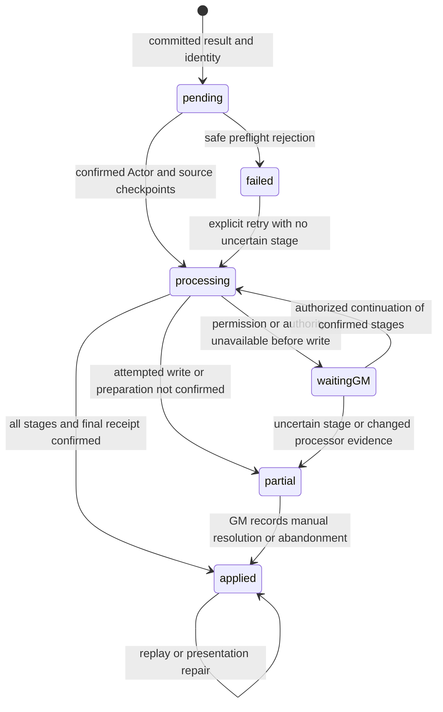

# Task 04 - Special-action operation identity and recovery

**Date:** 24-25 October 2026.  
**Result:** source implementation complete; 151 Node tests and all five source checks PASS.  
**Scope:** complete the approved Task 04 source implementation, preserving Tasks 01-03.  
**Evidence boundary:** deterministic Node decisions and local source validation; every Foundry acceptance case below is **NOT RUN**. No crash-recovery or runtime-compatibility claim follows from these checks.

## Baseline and reversibility

| Field | Recorded baseline |
| --- | --- |
| Workspace | `C:/dev/uesrpg/uesrpg-3ev4-14.0.0` |
| System/package | `14.2.0`; version, compatibility declarations, dependencies and lockfile unchanged |
| Node | `v24.13.0`, Windows |
| Branch / commit | Unavailable: Git metadata cannot be read as a repository in this checkout. No branch, commit, PR, tag or release created. |
| Pre-change snapshot | Ignored `release/backups/task-04-special-actions-20261024-185624/source/`; 974 copied source/development/documentation files, including Tasks 01-03 |
| Baseline checksums | `pre-change.sha256.json` and `baseline.json` in that backup directory |
| Initial tests | Task 03's 79 passing Node tests; preserved without edits |
| Runtime environment | No backed-up Foundry world or multiplayer clients used; live validation NOT RUN |

The approved plan, including its source-only validation selection, determines this patch. Instructions and newer reference versions in the original task bundle do not authorize unrelated updates or world mutation.

The snapshot is the rollback source. `post-change.sha256.json`, `change-manifest.json`, `preservation.json`, `fingerprint-preservation.json` and `validation/` in the same ignored directory record the final changes and local evidence. These files are development backups and do not enter installable packages.

## Source finding and canonical owners

The old `registerSpecialActionOutcomeHook` executed consequences directly, while newer callers posted `combat.special` outcomes. The skill result path could execute before its source result was persisted. Advantage AP/child-card writes and the In Close failure reaction also occurred outside the shared application owner. Duplicate hook delivery was therefore insufficient evidence of exclusive execution.

The old processor and its registration are removed. Its result discovery is integrated with the existing outcome service's create/update, startup and reconnect recovery paths. Startup scanning remains. Exported `executeSpecialAction`, `prepareSpecialActionOutcome`, `postSpecialActionOutcome` and the old skill compatibility wrapper retain their signatures, but direct effects require a live managed adapter context. Legacy `success`/`message` fields remain; submission results also expose `status`, `operationId`, `outcomeId` and `messageId` where available. Accepted/pending is distinct from `complete`.

| Responsibility | Canonical owner / callers |
| --- | --- |
| Application, authority, Actor queue, receipt execution, stages and presentation | `src/application/combat/chat-outcome-application-service.js`; existing sealed `combat.applyOutcome` command and `combat.special` adapter registration |
| Pure identity, immutable choices, generations, eligibility and recovery decisions | `src/core/combat/special-action-operations.js` |
| Discover source results and materialize outcomes before card persistence | `src/core/combat/special-action-outcomes.js`; called by existing native/sealed ChatMessage update owner after requester and revision checks |
| Card persistence | Existing `createOpposedCardUpdater` / queued card persistence, `requestUpdateChatMessage`, and authority transition validation; custom Special Action cards now use the same updater. Their sealed transition checks original-requester ownership of each changed roll lane and recalculates the result through the extracted existing Special Action resolver; freshness includes this wrapped lane. |
| Existing effect rules and public submission wrappers | `src/core/combat/special-actions-helper.js`; private effect switch is reachable only through its managed adapter |
| Skill opposed results / In Close failure reaction | `src/core/skills/opposed-workflow/helpers/result-commit.js`, workflow `index.js` and `core/helpers.js`; result first, reaction child as a managed stage |
| Advantage selections | `src/core/combat/opposed/special-actions-automation.js`, called from existing damage/resolve controls with source state and source message; no independent AP/effect/card mutation |
| Sheet Arise | `src/ui/sheets/shared/listeners/combat-actions.js`; activation cost and condition removal are submitted together through the outcome owner |
| Conditions, AP, activation costs and In Close token links | Existing condition engine/mutations, action economy, activation owners and `conditions/in-close.js`; optional strict confirmation/operation guard for managed calls, ordinary callers retain their defaults |
| Receipt retention | Existing `src/core/combat/damage/post-application.js`; unresolved special operations retained indefinitely, settled history retains the existing 50-receipt policy and completed-card protection |
| GM review | `src/ui/combat/special-action-review.js`, existing delegated chat controls and DialogV2 helper; no new global listener or parallel authority command |
| Ownership safeguards | Existing `scripts/consolidation-checks.js` extended to reject restored direct processors, pre-persistence consequence calls, duplicate canonical helpers and bypasses from migrated callers |

One internal utility extraction avoids copying the existing Task 02 fingerprint algorithm: the private purchase `digest` body now lives once as `documentStateFingerprint` in `utils/authority-proxy/shared.js`. Purchase calls retain their existing awaited results through an import alias. Five representative values were compared with the original function from the preserved source; all match. The compact fingerprint keeps review requests within the existing authority transport size limit. It is a change detector, not authentication; native permissions, exact operation binding and source validation remain separate.

## Action and consequence inventory

All ten registered actions retain their existing resolution rules, prerequisites and manual instructions. The patch changes persistence and execution ownership.

| Registered action | Managed consequences and terminal results |
| --- | --- |
| Arise | Existing activation owner when submitted from the sheet, then Prone removal; no-target/self Actor |
| Bash | Target AP loss; one retained Acrobatics/Luck follow-up preparation and roll message; Prone if the saved result requires it. Manual knockback instruction remains manual. |
| Blind Opponent | Blinded condition, then confirmed duration update; immunity is terminal without an uncertain-write classification |
| Disarm | Existing manual disarm instruction; no invented weapon transfer |
| Feint | Existing condition and separate duration/source/attacker provenance updates |
| Force Movement | Existing manual movement instruction; no invented token movement |
| Grapple | Size gate; retain already-controlled state and follow-up choice; condition creation/removal and controller/source stamps are confirmed stages |
| Resist | Existing Restrained, Grappled and Blinded removals as separate stages |
| Trip | Prone condition, with immunity/no-effect represented as a terminal result |
| In Close | Persist prepared entry/leave direction, then individual token pair-link and condition stages. Never replay the toggle to infer or repair an uncertain result. |
| In Close failure reaction | Existing eligibility, Attack of Opportunity rules and test options; child card with stable parent operation/step reference |
| Advantage-generated actions | Both attacker/defender roles and selection slots: confirm selected AP cost, then auto-win effect or free-action child card. Existing free/buckler cost distinctions remain. |

Rule-defined no-effect, immunity and canceled preparation end without automatic repetition. A previously started roll/prompt with no confirmed completion is review evidence, not permission to roll or prompt again. No automatic AP refund, effect removal, old-value restoration or child-card deletion is implemented.

## Additive flags and identity

There is no data-model migration or new settings schema. Flags initialize when an operation is used. Existing legacy flags remain in place.

The existing `flags.uesrpg-3ev4.chatOutcomes` version-1 envelope retains its `revision` and `entries`. A special entry adds:

```text
id: special:<encoded source>:<source kind>:<result generation>:<slot>:<action>
adapter: combat.special
operation: {
  version: 1, id, sourceUuid, sourceKind, resultRevision, slot, signature,
  intent: {specialActionId, actorUuid, targetUuid, actorTokenUuid, targetTokenUuid,
           isAutoWin, opposedResult, followUp, launch, activation},
  legacy?: review | complete
}
status: pending | processing | waitingGM | partial | applied | failed
checkpoint?: {version: 1, receiptId, processorUserId, processorSession, stages}
result?: durable compact result
reconciliation?: {version: 1, userId, at, reason, disposition}
```

The signature projects committed roll identity and semantic result fields, the action, participants and relevant roll-off attempts. Content, display names, receipt synchronization, timestamps, native Roll serialization and the card's general update sequence do not create a generation. An established reroll with a new roll-message identity can create a generation even when its numbers are equal. New committed result/selection generations get distinct IDs; a later generation of the same action/slot waits while an earlier generation is uncertain.

Skill/custom source cards mark `state.context.specialActionOperationsVersion: 1`. Source result and corresponding operation identity pass through the queued card update together before consequences. Advantage slots include role, target token/Actor and selection index. A selection saved before its mode/submission was confirmed is discovered as a virtual review record: it does not guess the AP quote, mode or existence of a child card. A normal completed submission persists the same source-backed identity with its actual immutable choices.

Standalone submissions receive one submission nonce and persist that identity with their initial card. A returned `operationId` must be reused for retries. A missing/ambiguous creation acknowledgement returns `needsReview` with that identity; retry inspection searches durable messages and does not automatically create a replacement. A fresh deliberate submission gets a new identity.

The existing Actor `flags.uesrpg-3ev4.damageApplications` array stores a matching receipt:

```text
id: outcome:<operation id>
messageId, outcomeId, adapter: combat.special, targetUuid
operation: <same versioned metadata and immutable intent>
authorizedBy, authorizedAutomatic, processorUserId, processorSession
status, error, cardSynchronized
stages: {
  <stable stage key>: {
    status: started | applied | partial | failed | waitingGM,
    documents?: [UUID], before?: [Actor system/effects or Token flags],
    result?: {prepared?, effectUuids?, messageId?, paid?, skipped?, ...},
    observedChanges?, error?
  }
}
result?, reconciliation?
```

Created/updated managed condition effects and associated child/roll cards carry `flags.uesrpg-3ev4.specialActionOperation: {version: 1, operationId, step}` where their native write supports that marker. Prepared Bash results and Grapple choices are retained in their stage result. Stage evidence includes affected UUIDs and before/observed values for review; observed current AP or condition presence never establishes commitment.

Unsupported operation/envelope/Actor receipt formats are blocked without replacing unknown records. Reusing an ID with different intent is rejected. Completed Actor receipts and durable completed-card entries are replay guards; receipt pruning does not make a completed card executable. Missing or inconsistent evidence leads to review. Unresolved special receipts are not expired or pruned.

## Execution, interruption and reconciliation

The active GM is preferred; the existing permitted active-owner fallback remains. The application setting stays `gm`, `owners` or `automatic`. Original requester visibility/ownership and native update permission are checked through the existing authority owner. Affected Actors, ActiveEffects and TokenDocuments are checked before stages; managed writes guard current processor/session and immutable intent. Operation and Actor queues serialize this service, and existing document locks coordinate its native updates. They are not a server-side transaction or an exclusive cross-document lock against external modules/macros.



The UI displays `partial` as **Needs review**. A checkpoint is persisted before preparation and before consequential writes, with processor session and ordered stage evidence. Confirmed stages return their saved result; a `started` or `partial` stage cannot run again. A changed processor/session cannot automatically restart an unfinished application, even if no effect is currently visible. Safe failures before a consequential attempt remain retryable. A timeout or absent acknowledgement is not a confirmed rejection.

Final text is rendered on the existing card from durable results. Source whisper recipients and blind visibility are carried into associated messages. Presentation synchronization can retry independently after a completed Actor receipt, without restarting gameplay. Completion is retained even if a later acknowledgement/presentation write fails.

Resolved historical cards are closed when their existing automation completion marker matches the result or a reliable completed receipt exists. Failed, interrupted or untracked historical execution is surfaced for review when encountered through normal processing/recovery; there is no broad migration or deletion of old flags.

**Review Special Action** uses the existing DialogV2 helper. It shows source data, identity, preparation, confirmed/uncertain stages and UUIDs. Only a GM can record reconciliation, with a reason, a stopped-processor confirmation and explicit **manually resolved** or **abandoned** disposition. The authority rechecks the identity and a fresh compact revision/evidence fingerprint. Reconciliation writes a terminal receipt and synchronizes the card; it does not repair gameplay documents. Deleted affected Actors can be reconciled on the source card. Unsupported versions and changed intent remain blocked for inspection rather than being silently rewritten.

## Documented APIs

The implementation uses the existing native document owners and official v14 [ChatMessage update API](https://foundryvtt.com/api/v14/classes/foundry.documents.ChatMessage.html#update), including its possibly undefined return, [Document update](https://foundryvtt.com/api/v14/classes/foundry.abstract.Document.html#update), [embedded document creation](https://foundryvtt.com/api/v14/classes/foundry.abstract.Document.html#createembeddeddocuments), [embedded document deletion](https://foundryvtt.com/api/v14/classes/foundry.abstract.Document.html#deleteembeddeddocuments) and [native permission checks](https://foundryvtt.com/api/v14/classes/foundry.abstract.Document.html#canusermodify). Existing confirmation helpers distinguish confirmed changes/no-ops from unconfirmed calls.

The [v14 update hook](https://foundryvtt.com/api/v14/functions/hookEvents.updateDocument.html) runs on connected clients; it is a discovery signal, not exclusive execution. Bash follow-up output uses documented [Roll.toMessage](https://foundryvtt.com/api/v14/classes/foundry.dice.Roll.html#tomessage) message options and preserves source visibility. The review dialog uses the existing helper over [DialogV2](https://foundryvtt.com/api/v14/classes/foundry.applications.api.DialogV2.html). No undocumented atomic transaction, new Foundry API, deprecated application lifecycle or compatibility claim is introduced.

## Deterministic evidence and validation ledger

`tests/unit/special-actions.test.mjs` directly imports the production plain-state helpers. It adds 72 tests to the existing 79: 151 tests in six files / ten reported suites. `tests/fixtures/special-actions.json` is generated data with no world/player export. Tests cover identity duplication, two planners selecting the same operation, immutable-intent collisions, harmless card changes, genuine new generations, all ten registered action IDs, eligibility, missing targets, completed replay, legacy records, interrupted-stage decisions and reconciliation requirements. The fixture's 16 named checkpoint cases describe saved state decisions; they are **not** native write fault injection or a multiplayer execution simulator.

No fake `game`/`foundry`, Document framework, loader, dependency or browser harness was added. Task 03's CI test gate and packaging exclusions remain. Static ownership checks now cover the migrated special-action entrypoints. These checks recognize source structures; dynamic aliases, external module writes and actual native permissions remain outside their proof.

| Local command / evidence | Result | Recorded detail |
| --- | --- | --- |
| `npm test` | PASS, exit 0 | 151 tests / ten suites, zero failures, skips or TODOs; runner `232.4971 ms`, command wall `769.024 ms`; Node 24.13.0, no Foundry globals |
| `npm run lint` | PASS, exit 0 | Runtime owners, tooling and tests; wall `7,221.322 ms` |
| `npm run syntax:check` | PASS, exit 0 | 798 JavaScript files including test ES modules; wall `32,003.278 ms`; syntax also passes within final validation |
| `npm run schema:check` | PASS, exit 0 | TypeDataModel seeds match `template.json`; wall `809.392 ms` |
| `npm run data:check` | PASS, exit 0 | 30 spell effects and 13 strike enchantments match catalogs; wall `901.178 ms` |
| `npm run validate` | PASS, exit 0 | 792 JavaScript references, 105 templates, 21 Markdown files; graph 781 modules / 3,986 edges / 775 reachable; 7,109 bindings, 204 literal/computed dynamic imports and 21 migration revisions; wall `39,306.401 ms` |
| Purchase fingerprint preservation | PASS | Five values match the original private algorithm; ignored `fingerprint-preservation.json` |
| Protected source hashes | PASS | Task 01 Item file, original tests/fixtures/reports, package/lockfile/schema/manifest preserved; final comparison and per-file changes retained with backup |
| Remote CI / Linux execution | NOT RUN | Local workflow/source safeguards are not a remote Actions run |
| Foundry, native write failure injection and multiplayer recovery | NOT RUN | Every live case below remains pending |
| Performance, accessibility and runtime deprecation capture | NOT RUN | See testing guide's nonfunctional lane |
| `npm ci`, staged installable folder, ZIP, release/deployment | NOT RUN | Existing locked dependencies used; no build artifact or publication requested |

Final command output, wall durations and exit codes are recorded under the backup's `validation/`; runner duration is not a gameplay performance measurement. Independent commands ran concurrently, so their wall times are not isolated benchmarks. The pre-existing `MODULE_TYPELESS_PACKAGE_JSON` warning remains visible. The validator reports the same **25 static import/export coverage limits**: dynamic-import promise patterns, namespaces passed beyond a direct binding/access and a computed namespace member. These are coverage limits, separate from failures, and do not establish runtime call ordering or document persistence.

An intermediate full validation exited 1 after finding a static dependency cycle through authority, special-action discovery and the opposed schema. The fix loads discovery at the existing asynchronous authority write entrypoint, retaining its single owner and pre-write validation order. `validate-before-cycle-fix.log/json` retain that failed run (`39,524.843 ms`); lint, Node tests and full validation were rerun successfully afterward. No check was suppressed or weakened to pass.

## Reproducible live acceptance - every case NOT RUN

Use a stopped, complete copied-world backup and a disposable Foundry **v14.369+** instance. Record exact Foundry/system builds, browsers, modules, users and restoration reference. Disable external modules initially. Prepare a GM, two owners and a non-owner; generated PCs/NPCs with known AP/resources, conditions/immunities and combat styles; linked and two independent unlinked token Actors; and sanitized historical cards with known provenance. Capture source flags, receipts, affected UUIDs, resource/effect values and associated message visibility before/after each case.

| ID | Procedure / expected evidence | Status |
| --- | --- | --- |
| SA-01 all actions | Run Arise, Bash, Blind Opponent, Disarm, Feint, Force Movement, Grapple, Resist, Trip and In Close through every supported source card. Confirm the inventory above against the unchanged rules, including manual-only instructions. | NOT RUN |
| SA-02 entrypoints | Run sheet Arise, skill opposed and custom Special Action cards, attacker/defender Advantage auto-win/free modes and supported free/buckler cost variants. Verify source/child operation links and exactly the existing cost/effect once. | NOT RUN |
| SA-03 terminal rules | Exercise attacker success, defender success, both-critical/tie, immunity, missing skill/manual instruction, insufficient AP, Grapple size gate and canceled follow-up. Confirm known no-effect results are terminal and uncertain attempts require review. | NOT RUN |
| SA-04 duplicate delivery | Trigger repeated create/update notifications, rapid Apply clicks and two eligible requesters selecting the same operation. Compare IDs, AP, ActiveEffects, token links, prompts/rolls and child messages; the same operation must not repeat. | NOT RUN |
| SA-05 generations | Edit harmless content/labels/bookkeeping, sync receipts and rerender: identity unchanged. Perform an established reroll/new committed result, including equal numerical rolls with a new roll ID: distinct generation. Later generations of an uncertain action/slot remain held. | NOT RUN |
| SA-06 modes and users | Repeat under gm/owners/automatic; GM present/absent, two active owners, original requester losing permission, hidden/blind cards and authority handoff. Check native Actor/ActiveEffect/Token permissions, not just the visible button. | NOT RUN |
| SA-07 token binding | Repeat effects and In Close on linked and separate unlinked tokens sharing a base Actor. Verify exact synthetic Actor/Token UUIDs and no fallback to a different placed token. | NOT RUN |
| SA-08 checkpoint interruptions | In the disposable world, stop/disconnect the processor immediately before/after source result+identity persistence, Actor claim, source checkpoint, each stage-start receipt, preparation, native write, stage completion, final Actor receipt and card synchronization. Inspect durable state before retrying. Started/uncertain stages and changed sessions require GM review; confirmed stages never repeat. | NOT RUN |
| SA-09 preparation and output | Interrupt Bash before/after Luck consumption, follow-up roll/message and saved preparation; Grapple before/after choice; In Close before/after each token/condition step; failure reaction and Advantage child creation before/after acknowledgement. Reload and change authority. Never reroll, prompt again, recreate a child or toggle In Close from uncertain evidence. | NOT RUN |
| SA-10 acknowledgement loss | Reject/cancel native document writes; then separately simulate an accepted write whose acknowledgement is lost. Capture effect/resource commitment before the error. Completed receipts repair presentation only; ambiguous commitment remains Needs review. Do not infer completion from current AP or condition presence. | NOT RUN |
| SA-11 legacy and versions | Encounter old completed, failed, interrupted and untracked cards through startup/update/reconnect recovery. Also inspect unsupported operation/envelope versions and malformed receipt containers. Completed evidence closes replay; ambiguous evidence is retained for review; unknown formats are not overwritten. | NOT RUN |
| SA-12 reconciliation | Stop prior processor, inspect/repair affected documents manually, open Review Special Action, record reason and each disposition as GM. Non-GM, missing reason/stopped confirmation, changed identity or stale evidence must reject. Verify no automatic refund, toggle, deletion or retry. Repeat with a deleted affected Actor. | NOT RUN |
| SA-13 retained evidence | Exceed settled receipt history while retaining an unresolved special operation. Verify it survives; a completed card whose Actor receipt was pruned remains closed. Restore an inconsistent Actor/card copy only in the disposable world and verify missing checkpoints do not authorize replay. | NOT RUN |
| SA-14 regressions | Execute [Task 01 rank acceptance](01-skill-rank.md#reproducible-live-acceptance---all-not-run), [Task 02 purchase/recovery acceptance](02-xp-purchases.md#reproducible-live-acceptance---every-case-not-run) and [AppV2 submit/close checks](../testing.md#lane-b---real-foundry-integration), including close without retrying a pending purchase and native Talent batches. Compare stored values after reload/export. | NOT RUN |
| SA-15 coherent restore | Stop all processors/clients; reconcile or document every pending operation; restore matching Actor, Item, ActiveEffect, Token and ChatMessage snapshots from the same copied-world point. Reopen and compare source/receipts before resuming. | NOT RUN |

For each run record scenario/fixture, environment, exact action, expected and observed source/UI result, PASS/FAIL/NOT RUN, operation ID, affected UUIDs and sanitized evidence. A rejected request is not evidence that a previous timed-out write failed. Do not delete receipts to force a retry.

## Remaining risks and rollback

Runtime lifecycle, native write/cancellation returns, multiplayer ordering, synthetic Actor behavior, callback UI and browser permissions are unverified until the matrix is executed. Durable stages add writes and before-state evidence; retained unresolved records can grow. No performance claim is made. External direct edits are outside this protocol; locks are process-local and cannot make Actor/ActiveEffect/Token/ChatMessage changes atomic. An interrupted or ambiguous operation may require manual repair and GM reconciliation instead of automatic progress. Source checks cannot prove crash recovery.

Rollback is source-reversible, but runtime records must remain coherent:

1. Stop purchases and outcome processors/clients. Preserve newer work and the complete backup directory. If stateful testing occurred, inspect/reconcile pending operations and retain their evidence before restoring anything.
2. Verify the backup's `pre-change.sha256.json`. Restore **only** the changed existing files listed in `change-manifest.json` from `source/`, retaining the Tasks 01-03 baseline. This includes the original private purchase fingerprint function and retired processor registration as one matching baseline.
3. Remove only the new Task 04 files named by that manifest: the two special-action helper modules, review UI module, special-action unit file/fixture and this report. Restore the prior testing guide. Do not recursively delete shared directories or remove later work.
4. After live testing, restore matching Actor/embedded Item/ActiveEffect, Token and ChatMessage/world snapshots together. Source rollback alone cannot undo already-applied gameplay or safely combine records from different points in time.
5. Verify restored baseline hashes and run the prior test/source checks. Resume only after state and code describe the same baseline.

No release, deployment, version bump, compatibility change or later task is included.
