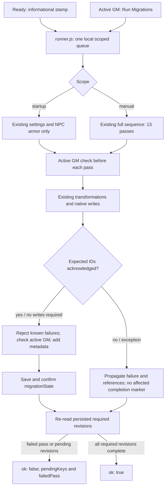

# Task 06 - Prevent false migration completion

**Date:** 25 October 2026.  
**Scope:** completion truth, execution coordination, native acknowledgements and existing AppV2 controls. Transformations and registry revisions are preserved.  
**Evidence boundary:** source validation only; every live Foundry case below is **NOT RUN**.

## Baseline and preservation

| Field | Evidence |
| --- | --- |
| Workspace | `C:/dev/uesrpg/uesrpg-3ev4-14.0.0` |
| Baseline | All **981 files** in Task 05's final SHA-256 manifest matched before editing. Tasks 01-05, including deferred performance work, are the baseline. |
| Backup | Ignored `release/backups/task-06-migration-readiness-20261024-224620/`: verified full `source/` copy, `pre-change.sha256.json` and `baseline.json`, created before edits. Timestamp is UTC; report date is local. |
| Branch / commit | Unavailable: Git metadata remains inaccessible (`not a git repository`). No branch, commit or PR created. |
| Node | `v24.13.0`, Windows; existing development dependencies. |
| Package / compatibility | `14.2.0`; existing minimum/verified `14.368`, maximum `14`; declarations unchanged. |
| World / remote CI | No Foundry world, native document test, remote CI run, installable build, archive, release or deployment. |

Task 05's broader performance objective remains deferred. This change adds no instrumentation, transformation, model schema migration, dependency, revision key or gameplay gate. Discovery found no gameplay consumer using `worldDataVersion` as completion. Its informational stamp stays separate from per-revision state.

## Canonical owners and execution

`state.js` owns saved state, revision interpretation, failure evidence and completion metadata. `revisions.js` remains the only revision registry. `runner.js` instantiates one local coordinator using the migration-owned `execution.js` callback helpers. Document-family modules still own transformations and native payloads. `utils/authority-proxy/shared.js` owns ID acknowledgement comparison and the throwing confirmation wrapper; existing strict embedded-document proxy options reuse the comparison.

Ready maintenance now requests its existing two passes through the runner: settings and NPC armor coverage. The full manual order remains: settings; ActiveEffects; system-template directives; Item-sheet compatibility; Actors; Items; NPC armor; combat legacy; AoE links; NPC threat keys; NPC threat options; Warfare Unit neutral lanes; warfare flags. Item compatibility still precedes older passes' complete-model validation. Item subpasses preserve their existing order and intermediate saves.

This is control flow, not an atomic database transaction. Later failure does not undo earlier writes. Inspect partial changes before explicit retry; no marker is cleared or revision lowered to force execution.

Same-scope local requests join one execution. A manual request queued behind startup runs its full sequence afterward, evaluating fresh state. A failed request does not poison the queue. The existing active-GM helper is checked at entry, before every pass, before aggregate success and before completion metadata/save operations. Native permissions remain in force. There is no cross-client completion promise, persisted global readiness flag, second registry or startup barrier.

Historical failure records remain intact on reads. Startup skips an existing maintenance pass if any of its keys reports failure; the settings pair shares a pass and waits together in that case. Only an explicit manual retry can replace failed records after successful work. Startup adds no document passes. Its pending-notice membership is unchanged and startup notices are restricted to the selected active GM.

## Unchanged 21-key inventory

All numbers and pending-notice membership are unchanged. “Startup pass” describes existing automatic work, not pending-notice membership.

| Revision key | Required | Pass module | Startup pass | Startup pending notice |
| --- | --- | --- | --- | --- |
| `activeEffectChangeTypes` | 1 | `active-effects.js` | No | Yes |
| `activeEffectDurationV14` | 2 | `active-effects.js` | No | Yes |
| `actors` | 1 | `actors.js` | No | Yes |
| `socialItemRetirementCleanup` | 1 | `items.js` | No | Yes |
| `itemLegacyRepair` | 2 | `items.js` | No | Yes |
| `itemSheetCompatibility` | 1 | `items.js` | No | Yes |
| `ruleElementRetirementCleanup` | 1 | `items.js` | No | Yes |
| `items` | 1 | `items.js` | No | Yes |
| `scrollCastingControls` | 1 | `items.js` | No | Yes |
| `scrollConsumeOnCast` | 1 | `items.js` | No | Yes |
| `combatLegacy` | 1 | `combat-legacy.js` | No | Yes |
| `aoeRegionLinks` | 1 | `aoe-region-links.js` | No | Yes |
| `npcThreatTemplateKeysV1` | 2 | `actors.js` | No | Yes |
| `npcThreatTemplateOptionsV1` | 2 | `actors.js` | No | Yes |
| `warfareUnitNeutralLanesV1` | 1 | `actors.js` | No | Yes |
| `warfareFlagsV1` | 1 | `warfare-flags.js` | No | Yes |
| `npcArmorCoverageDefaultsV1` | 1 | `items.js` | Yes | Yes |
| `spellDamageTypeNormalization` | 1 | `items.js` | No | Yes |
| `systemTemplateDirectiveCleanup` | 1 | `system-template-directives.js` | No | Yes |
| `timeDefaultsCompositeOrchestratorV1` | 1 | `settings.js` | Yes | No |
| `automationProfileRemovalDefaultsV2` | 1 | `settings.js` | Yes | No |

The existing `automationProfileRemovalDefaultsV1` remains a legacy settings interpretation input, not a new registry entry. Existing preservation of stored automation settings and legacy review semantics is unchanged. `reviewRequired` alone is advice, not failed transformation work.

## Completion truth and additive metadata

`getAppliedMigrationRevision` still reports the saved number with its existing numeric/object/text/Boolean interpretation. `isMigrationRevisionApplied` additionally rejects positive `failures` or `result.failed`. `getMigrationFailureCount` uses the larger counter when both describe the same work. Missing/nonpositive counters do not invent failure. Comparisons never rewrite records or historical attribution.

New successful markers retain pass metadata and receive `revision`, `appliedAt`, `systemVersion` and **`appliedBy`**, the selected GM's user ID. Historical records are not attributed retroactively. Marker construction refuses known failures before mutation; `extra` cannot override completion metadata. Saving preserves the existing JSON string setting and confirms both the assigned value and fresh read. There is no format version change.

| Before | After |
| --- | --- |
| A saved revision could override failure evidence. | Known failures keep the key pending with the recorded revision still visible. |
| Several Actor/AoE/warfare/combat catches swallowed errors. | Errors propagate with references, telemetry and/or original causes; the runner owns one aggregate failure notice per execution. |
| Combat could stamp despite false ChatMessage update results. | Failed chat updates collect UUIDs and prevent completion; rewrite/discovery rules are preserved. |
| Bulk update/delete acknowledgements were often ignored. | Every expected ID must be returned. IDs are captured before the call so payload mutation cannot shrink the expected set. |
| Fulfilled passes implied overall success. | Fresh persisted required revisions must also be complete; otherwise `ok: false`. |
| Startup and manual work had separate execution paths. | One local scoped queue retains startup coverage and full manual ordering. |
| Any GM could run; only success refreshed the control. | Selected active GM only; the invoking AppV2 displays running state and refreshes persisted status after either outcome. |
| Stamp hint claimed a compatibility gate. | Hint explicitly says the version stamp is informational. |

Strict confirmations cover revision-gated Actor, world/embedded ActiveEffect, Item update/delete, NPC armor, warfare Actor/Scene/Region and template-cleanup writes. Native Item subtype `ForcedReplacement` and template `ForcedDeletion` paths retain their payloads and existing postconditions. Ordinary Item-sheet updates reuse the existing confirmed-update helper. Generic Item normalization retains its default behavior; its batch confirmation is enabled only by revision-gated callers. Combat retains its ChatMessage helper. Settings defaults confirm assigned and re-read values before stamping.

Runner results preserve `ok`, `reason`, `err` and `elapsedMs` where applicable, adding `pendingKeys` and `failedPass`. Remaining revisions use `reason: "pending-revisions"`; authority loss uses `"not-active-gm"`. A final-state mismatch has `failedPass: null`; a thrown pass identifies its function name. Missing document references, telemetry and nested causes remain available. A simultaneous inspection error is retained as `stateError`. Completing revisions does not establish gameplay acceptance or resolve unrelated review advice.

## Official v14 API references

- [Document.update](https://foundryvtt.com/api/v14/classes/foundry.abstract.Document.html#update) permits an undefined result. [updateDocuments](https://foundryvtt.com/api/v14/classes/foundry.abstract.Document.html#updatedocuments), [updateEmbeddedDocuments](https://foundryvtt.com/api/v14/classes/foundry.abstract.Document.html#updateembeddeddocuments), [deleteDocuments](https://foundryvtt.com/api/v14/classes/foundry.abstract.Document.html#deletedocuments) and [deleteEmbeddedDocuments](https://foundryvtt.com/api/v14/classes/foundry.abstract.Document.html#deleteembeddeddocuments) return affected documents. The system compares IDs, not merely promise fulfilment.
- [ClientSettings.get](https://foundryvtt.com/api/v14/classes/foundry.helpers.ClientSettings.html#get) and [set](https://foundryvtt.com/api/v14/classes/foundry.helpers.ClientSettings.html#set) provide the current and assigned values. No private setting backend is added.
- [Users.activeGM](https://foundryvtt.com/api/v14/classes/foundry.documents.collections.Users.html#activegm) supplies the documented selection reused by the existing helper. [ready](https://foundryvtt.com/api/v14/functions/hookEvents.ready.html) is not converted into a global completion promise.
- [ApplicationV2.render](https://foundryvtt.com/api/v14/classes/foundry.applications.api.ApplicationV2.html#render) and [_prepareContext](https://foundryvtt.com/api/v14/classes/foundry.applications.api.ApplicationV2.html#_preparecontext) support the existing Handlebars AppV2 control and awaited refresh. No undocumented UI lifecycle hook is introduced.

## Deterministic tests and validation ledger

Task 04's historical baseline was **151 tests in ten suites**. Task 06 extends the existing `migrations.test.mjs` without dependencies, loaders, fixture generators, Foundry globals or document simulators. Direct production imports test revision/failure/pending decisions, failed-marker refusal, acknowledgement IDs and callback sequencing. Coverage includes empty/complete/single-pending state, legacy records, informational stamps, review advice, input preservation, partial acknowledgements, error references, authority predicates, failed inspection, retry and startup/manual ordering. These are decisions, not native settings writes, transformations or multiplayer execution.

Final commands ran locally under Node **v24.13.0**, starting 24 October 2026 at 23:04:19 UTC (25 October locally). Durations below are measured command wall time, including npm startup; they are not runtime performance benchmarks. Full logs, UTC timestamps and machine-readable measurements are retained in the ignored backup's `validation-ledger.json` and six `.log` files.

| Command | Exit | Wall time (ms) | Observed result |
| --- | --- | --- | --- |
| `npm test` | 0 | 923.502 | **195 tests in 14 suites; 195 pass, 0 fail/cancel/skip/TODO**. Node-reported suite duration: **210.1775 ms**. |
| `npm run lint` | 0 | 6,888.517 | Existing source/scripts/automation/tests/config lint passed. |
| `npm run syntax:check` | 0 | 29,920.880 | 799 JavaScript files syntax-checked. |
| `npm run schema:check` | 0 | 504.831 | Generated TypeDataModel seeds match `template.json`. |
| `npm run data:check` | 0 | 505.503 | Spell effects: 30 entries; strike enchantments: 13; generated JSON matches canonical catalogs. |
| `npm run validate` | 0 | 36,951.957 | Source/release-policy validation passed for 14.2.0; no build/archive produced. |

Validation checked 793 JavaScript files and 105 templates for references, 23 Markdown documents, 21 centralized revisions, and 7,129 import/export bindings across 782 runtime modules (204 dynamic imports). The import graph contains 4,002 edges and 776 reachable modules. CI safeguards, AppV2 form/part/accessibility source rules, authority boundaries, document API/render rules, localization and helper ownership passed.

**Coverage notices are not failures:** the same **25 existing** static binding coverage notices remain for dynamic-import promise chains, namespace escape and computed namespace access. The newly extended literal/name ownership rules likewise do not resolve arbitrary aliases or dynamic keys. Node's existing `MODULE_TYPELESS_PACKAGE_JSON` warning remains visible and unsuppressed. No source check establishes server acknowledgement, document persistence, multiplayer exclusion, crash recovery or v14 runtime compatibility. Remote CI remains unverified; its existing test gate and packaging exclusions are unchanged.

The post-change SHA-256 audit records **983 source/development files**: **960 baseline files unchanged, 21 scoped baseline edits and two new files**, with no missing files. All 981 backup copies match their original hashes. A separate protected-path audit checked 196 files with zero mismatches, including prior task reports, the unchanged registry, package/lock/system manifests, workflows, fixtures, Task 01 Item code, advancement and special-action owners, and sheet code. The five other unit files and generated schema/catalog artifacts are unchanged. `post-change.sha256.json` and `preservation-proof.json` retain the full inventory and changed-path list. This ledger text was finalized after command completion without further production/test/check changes.

## Reproducible live acceptance - every case NOT RUN

Use a **stopped, coherent copied-world backup** and disposable Foundry **v14.369+** world. Record exact system/Foundry/browser versions and begin without external modules. Export migration state and sanitized documents before each stateful case. Keep the original backup untouched. Use normal controls and controlled development failure injection; do not clear flags, lower markers or migrate a production campaign to manufacture evidence.

| Case | Procedure and required evidence | Status |
| --- | --- | --- |
| M06-NONE | Complete required revisions on a backed-up copy, then run twice. Check no required pending keys, no false failure, unchanged transformed data and attribution only for newly written markers. Empty document collections still require pass completion records. | NOT RUN |
| M06-STAMP | Compare current/old/absent version stamps with identical revision state. Status follows revisions alone. | NOT RUN |
| M06-HISTORY | Encounter positive `failures`/`result.failed` records with sufficient revisions. Open status, reconnect and allow startup; records remain intact and pending. Manually retry and inspect successful replacement or accurately reported remaining failure. | NOT RUN |
| M06-REVIEW | Exercise legacy automation review advice alone and combined with failures. Advice alone is not failure and does not reset stored settings. Failed revisions stay pending until their applicable pass succeeds. | NOT RUN |
| M06-ACTOR | Reject/partially acknowledge Actor, NPC threat and Warfare Unit writes. Inspect missing IDs, propagated error, pending revision and absence of aggregate success. | NOT RUN |
| M06-EFFECT | Reject world/Actor/Item ActiveEffect writes and serialization. Check references and both revision keys while preserving duration/change transformations. | NOT RUN |
| M06-ITEM | Reject/partially acknowledge ordinary, scroll, spell and rule-element migration batches. Exercise native forced subtype replacements and compatibility validation; failed postconditions remain pending. | NOT RUN |
| M06-DELETE | Reject/interrupt/partially acknowledge world and embedded retired Item deletion. Inspect survivors and pending status before manual retry. | NOT RUN |
| M06-ARMOR | Fail existing NPC armor writes during startup/manual runs. Preserve coverage rules and manual exclusions; inspect pending revision. | NOT RUN |
| M06-CHAT | Fail a legacy opposed ChatMessage update while others succeed. Retain UUID references; no combat marker/completion announcement; inspect and retry manually. | NOT RUN |
| M06-WARFARE | Reject/cancel Actor/Scene/Region flag writes. Verify references and pending status without automatic rollback. | NOT RUN |
| M06-DIRECTIVES | Fail/partially acknowledge forced system-template deletion. Verify existing postcondition checks and pending status. | NOT RUN |
| M06-SETTING | Reject/cancel/mismatch default-setting and completion saves, including commitment before acknowledgement loss. No aggregate success on failure, even if inspection finds complete revisions; inspect before retry. | NOT RUN |
| M06-RETRY | Inspect partial writes, repair as necessary and retry explicitly. Verify idempotence, original ordering and fresh completion; repeat with an unrepaired failure. | NOT RUN |
| M06-QUEUE | On one GM client, request manual work during paused startup and duplicate manual requests while queued/running. Full manual sequence follows; no lost request or duplicate aggregate notice for one execution. | NOT RUN |
| M06-GMS | Exercise multiple active GMs, assistant GM, no GM, owner and non-owner. Existing selected active GM alone may run/stamp; secondary clients receive no startup notice. Test competing clients separately from local queue decisions. | NOT RUN |
| M06-LOSS | Change/disconnect authority before each pass/save; interrupt startup before/after native commitment, reconnect and inspect. No completion claim from interruption; retry explicitly. | NOT RUN |
| M06-TOKENS | Repeat supported cases on linked/unlinked documents, including compatibility's existing token scan. Record UUIDs; no broader collection coverage is inferred. | NOT RUN |
| M06-APPV2 | Check selected/secondary GM permissions, running label, failed-record explanation and status refresh after success/failure. Reopen after reconnect or changes from another client. | NOT RUN |
| M06-REGRESSION | Repeat [Task 01 ranks](01-skill-rank.md#reproducible-live-acceptance---all-not-run), [Task 02 purchases/AppV2](02-xp-purchases.md#reproducible-live-acceptance---every-case-not-run) and [Task 04 recovery](04-special-action-idempotency.md#reproducible-live-acceptance---every-case-not-run). Task 05 performance remains unmeasured. | NOT RUN |
| M06-RESTORE | Stop clients/processors, reconcile pending purchases/outcomes and restore the coherent world copy. Verify settings and Actor/Item/ActiveEffect/Token/Scene/Region/ChatMessage snapshots agree. | NOT RUN |

Record fixture/environment, selected GM, exact UUIDs, before/after source, native acknowledgement/result, notification count, revision records and sanitized logs. Source checks never convert these cases to PASS.

## Remaining risks and rollback

Native callbacks, server acknowledgements, actual GM takeover, settings propagation, AppV2 rendering and token persistence remain unverified. The queue is local, not cross-client mutual exclusion. Authority can change during an awaited native write. No transaction, automatic undo or crash-recovery journal is added. Inspect partial transformations and retain coherent world backups. Passes keep their existing document collection coverage; compendia are not newly migrated. Existing malformed-state fallback and legacy settings review semantics are preserved; inconsistent persisted state may still need inspection rather than a successful retry claim.

Static safeguards now protect the state owner, registry declarations, literal state/stamp settings access, coordinator creation and direct named pass calls outside the subsystem. Existing duplicate-body and module-binding checks remain. Aliases, computed keys, external modules, arbitrary callbacks and native runtime behavior remain outside these checks; they are not a gameplay gate.

For source-only rollback, restore Task 06 changed source, UI/localization, validation checks, existing tests and documentation from the verified backup's `source/`; remove only new `src/core/migrations/execution.js` and this report. Preserve Tasks 01-05 and unrelated work. Verify restored files against `pre-change.sha256.json`; retain the backup.

After any later stateful testing, stop migration/purchase/outcome processors and restore a coherent **pre-migration world backup** with matching source. Restoring an individual marker or lowering revisions does not reverse transformations. Restore matching document/settings snapshots together. This Node/source-only work changes no world data and needs no world restoration itself.
