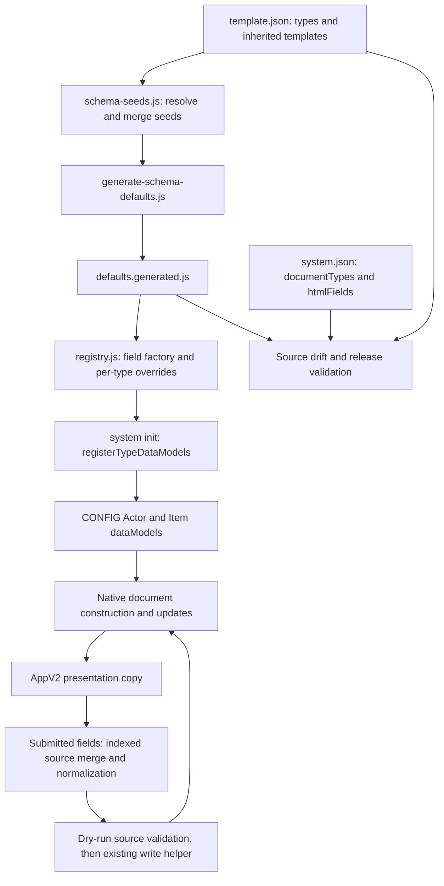

# Task 07 - TypeDataModel compatibility audit only

**Date:** 25 October 2026.  
**Result:** Audit complete; stricter schema validation deferred.  
**Scope:** architecture and compatibility evidence, with spell `system.damageInstances` as the first detailed candidate. Production code and schemas are unchanged. The broader Task 07 schema-strengthening objective remains pending.

## Baseline, provenance and evidence boundaries

| Field | Evidence |
| --- | --- |
| Workspace | `C:/dev/uesrpg/uesrpg-3ev4-14.0.0` |
| Preserved baseline | All **983 files** in Task 06's final source/development SHA-256 manifest matched before editing. Tasks 01-06 are preserved, including deferred Task 05 performance work. |
| Backup | Ignored `release/backups/task-07-typed-data-model-audit-20261025-065138/`: `source/docs/testing.md`, verified guide hash, `pre-change.sha256.json` and `baseline.json`, saved before editing. Timestamp is UTC. |
| Branch / commit | Unavailable: `git rev-parse --show-toplevel` still reports `not a git repository`. No branch, commit or PR created. |
| System / compatibility | `14.2.0`; declared minimum/verified `14.368`, maximum `14`; unchanged. Future native validation targets a disposable v14.369+ world. |
| Node | `v24.13.0`, Windows; existing dependencies. |
| Historical tests | Task 06 recorded 195 passing Node tests in 14 suites. This documentation-only audit does not rerun or extend them. They do not instantiate native Foundry models. |
| Native evidence | No Foundry client, world, document, model instance or compendium entry was opened, constructed, cleaned, validated or persisted. All native results are **NOT RUN**. |

The approved audit-only plan supersedes the bundle's proposed schema implementation for this task. Reading that document does not authorize a schema patch, database inspection, migration or live test. No LevelDB database was opened or modified. Pack declarations identify possible future sources; they provide no evidence of the shapes of actual pack records. No world/compendium export was supplied or collected.

This report uses three classifications: **source-confirmed behavior** follows inspected repository code or JSON; **potential risk** identifies a compatibility concern without reproducing failure; **unknown** requires native or representative-data evidence. Examples below are source-derived or deliberately synthetic and are labelled accordingly. They are not observed persisted records, executable fixtures or proof that Foundry accepts the input.

## Architecture and canonical ownership

The current architecture already uses TypeDataModels. [The registry](../../src/core/data-models/registry.js) is the single owner of per-type classes, generic field construction, targeted overrides, registration, defaults and cleaning wrappers. Generated subclasses override `defineSchema()` only; targeted field validators remain in that factory. `isTypeDataModelsEnabled()` unconditionally returns true; its export remains a compatibility helper.

[System initialization](../../src/system.js) registers one `init` handler, which calls [the existing init owner](../../src/hooks/init.js). That owner assigns the Actor/Item document classes, registers settings and calls `registerTypeDataModels()` before sheet registration. The registration assigns the existing classes to `CONFIG.Actor.dataModels` and `CONFIG.Item.dataModels`. This is source sequencing, not a claim about unobserved native construction timing.

The generated-seed authority is [template.json](../../template.json) through [schema-seeds.js](../../scripts/schema-seeds.js) and [generate-schema-defaults.js](../../scripts/generate-schema-defaults.js). Template inheritance is recursively resolved, missing/circular templates are rejected, objects are merged and inherited `templates` directives are omitted from the resolved seed. The generator checks by default and writes only with `--write`. Nothing was regenerated here.

[Release validation](../../scripts/build-release.js), through `validateSchemaDrift`, compares generated seeds with freshly resolved template seeds, compares type membership with the manifest, and verifies declared HTML paths exist in seeds. It does not execute native field cleaning, instantiate registered model classes, verify every field option against a real source record, or prove serialization compatibility. Exact client HTML-field lists and manifest lists were also compared by read-only inspection in this audit and match for the twenty current types.

### Type and override inventory

All current types are accounted for below. “Generic” means the existing seed-driven factory still applies; it does not mean a family has no model.

| Document type | Targeted overrides | HTML fields |
| --- | --- | --- |
| Actor: `Player Character` | Five resource schemas: `hp`, `magicka`, `stamina`, `action_points`, `luck_points` | `bio`, `journal`, `notes` |
| Actor: `NPC` | Same five resource families, with NPC seed members | `bio`, `journal`, `notes` |
| Actor: `Group` | Generic fields | `description`, `notes` |
| Actor: `Warfare Unit` | Generic fields; nested stats/profile/configuration remain broad objects | `description`, `notes` |
| Item: `equipment` | Decimal `enc` | `description` |
| Item: `item` | Decimal `enc` | `description` |
| Item: `container` | Decimal `enc` | `description` |
| Item: `armor` | Decimal `enc`; legacy category string/object validator | `description` |
| Item: `shield` | Decimal `enc` | `description` |
| Item: `weapon` | Decimal `enc`; structured-entry option enabled, but current weapon seed contains neither structured-entry key | `description` |
| Item: `spell` | Duration schema; `damageInstances` and `overTimeEntries` arrays of objects | `description` |
| Item: `trait` | Generic fields | `description` |
| Item: `power` | Generic fields | `description` |
| Item: `talent` | Generic fields | `description` |
| Item: `combatStyle` | Generic fields, including rank and equipment array | `description` |
| Item: `skill` | Generic fields | `description` |
| Item: `magicSkill` | Generic fields | `description` |
| Item: `ammunition` | Decimal `enc` | `description` |
| Item: `invocation` | Generic fields | `description`, `effect` |
| Item: `scroll` | Decimal `enc`; broad `spellData` snapshot and linked spell UUID | `description` |

The generic factory declares: null seeds as `AnyField` with null initial value; arrays as `ArrayField(AnyField)` with cloned initial values; objects as `ObjectField` with cloned initials; Booleans as `BooleanField`; numbers as `NumberField` with `integer` determined by the seed; configured prose as `HTMLField`; remaining values as `StringField`. It does not recursively convert every nested object into a fixed schema. These are declared options, not measured acceptance or coercion results.

| Override/family | Source-confirmed declaration and defaults | Compatibility boundary |
| --- | --- | --- |
| PC/NPC resources | `SchemaField` of numeric seed members, all current resource member seeds integral; initial values mostly 0, AP maximum 3. No explicit min/max is supplied by this helper. PC Luck includes `bonus`; NPC Luck does not. | Nullable/missing values, extra resource members, fractional input and negative resources require native evidence; do not infer rule validity from seed numbers. |
| Spell duration | `SchemaField`: numeric `value` initial 0/minimum 0; string `unit` initial `rounds`; broad `units` object with instant/rounds/minutes/hours/days/permanent labels. | The unit field has no explicit choices restriction here. Dynamic labels and unknown extra duration keys need round-trip checks. This is Item spell duration, not the ActiveEffect duration schema. |
| Structured entries | Spell `damageInstances` and `overTimeEntries`: `ArrayField(ObjectField)`, initial `[]`; no declared row schema. | A fixed three-key schema would be a substantive compatibility decision. No native evidence authorizes it. |
| Decimal encumbrance | Eight Item types above: number initial 0, `integer: false`, `min: 0`. | Decimal support is intentional. Do not infer the behavior of a malformed or negative persisted value without native validation. |
| Armor category | `item_cat`: `AnyField`, `nullable: false`, custom validator accepts string or the registry's non-array object predicate; initial category mapping retained. | Existing strings and label mappings are intentional. Null, arrays and mixed legacy forms require route-specific validation; this audit does not normalize them. |
| HTML and custom data | Listed prose fields use `HTMLField` and matching manifest declarations. Other object/array members remain broad. Document `flags` are outside the system-data seed factory. | Preserve rich content and custom flags; broad containers are not evidence that pruning/coercion never occurs. |
| Overtime and scaling | Legacy `overTime` and `scaling` are broad objects; `overTimeEntries` is an object array. Scaling `levels` is inside the broad `scaling` container. | Consumers retain legacy fallbacks and mixed representations. These families are context only, not part of a schema patch. |

## Cleaning paths and preservation limits

`getTypeDataModelDefaults()` tries `new Model({}).toObject()`. If that construction/serialization fails, it returns a cloned generated seed. Thus a returned defaults object does not itself prove successful native model construction.

`cleanSystemDataWithModel()` finds the existing model, clones object input, and recursively merges it over defaults before native construction. Its object predicate checks non-null object/non-array, rather than inspecting prototypes. Unknown document types return null in non-strict mode and throw in strict mode.

| Path | Declared flow | What cannot be concluded |
| --- | --- | --- |
| Non-strict cleaning | Invalid outer input becomes `{}`; `new Model(merged, {})` followed by `toObject(true)`; a construction/serialization exception warns and returns cloned defaults, or merged data if defaults are null. | This is not guaranteed input preservation. A fallback can discard authored values. No fallback was triggered or measured in this audit. |
| Strict cleaning | Invalid outer input throws; construction receives `strict: true`, `fallback: false`, `dropInvalidEmbedded: false`; source output is merged back into the cloned input with `inplace: false`. Errors propagate. | Strictness does not by itself disable cleaning. Merging source back is not proof that unknown keys inside arrays survive, nor that no array element can be removed. The constructor call does not explicitly set `dropInvalidElements`. |
| Item compatibility/normalization | [Existing Item migration owner](../../src/core/migrations/items.js), `_normalizeItemSheetSystem`, clones serialized source, repairs recognized shapes through `applyDefaults(...strict: true, coerce: true)`, then uses strict model cleaning. Recognized nonnegative scalar spell durations become duration objects. | This deliberately performs corrections before validation. It must not be presented as an identity round-trip or authorization for new corrections. Task 06's existing completion safeguards still apply. |
| Actor normalization | [Existing Actor owner](../../src/core/migrations/actors.js) uses the non-strict wrapper for invalid-system defaults and ordinary normalization. | An apparently narrow shared-schema change can affect these callers. This audit runs neither pass and changes no readiness state. |
| Item-sheet submission | Existing normalizer operates on submitted fields; source diff is checked using `updateSource` on a clone with `dryRun: true`, `fallback: false`, before existing persistence routing. | A successful dry-run does not prove server persistence, unchanged cleaning or export/reimport behavior. |

[applyDefaults](../../src/core/migrations/apply-defaults.js) recognizes contiguous numeric-keyed objects as legacy arrays in strict mode, including an empty object; sparse or named-key objects are rejected there. Missing/null array input becomes the seed array. Existing arrays are retained without per-row normalization by that helper. These are migration-helper rules, not native `ArrayField` guarantees. No new migration or coercion is proposed.

## Damage-instance data flow and integration inventory

| Stage | Existing owner and source behavior | Evidence boundary |
| --- | --- | --- |
| Default/model | Spell seed contains `damageInstances: []`; the registry creates an array of broad objects. No formula/type/label leaf schema is declared. | Source-confirmed configuration; native outcomes NOT RUN. |
| Add/remove | [Item AppV2](../../src/ui/sheets/v2/item-sheet.js) registers `addDamageInstance`/`removeDamageInstance`. Add checks editable spell type, clones the current array and appends `{formula: "", type: "none", label: ""}`; remove splices the selected index. Both use the existing array mutation queue and atomic Item write helper. | Handlers exist. No matching named buttons or indexed damage-instance inputs were found in checked-in templates. Usability and external/dynamic controls are unverified. |
| Indexed edit | [Form normalizer](../../src/ui/sheets/item/normalize-item-form-data.js), `_mergeIndexedFormEntries`, merges submitted leaves into cloned source rows. It rejects non-array existing containers, sparse appends and non-object/array existing rows. Formula/type/label normalization uses `String`; only submitted leaves are copied back. | Absent indexed inputs cause no indexed-array write. A whole-array payload is outside this indexed helper and still faces native validation. Additional source metadata is not intentionally deleted by this merge, but native preservation remains unverified. |
| Presentation | `_prepareContext()` starts from `document.toObject()`; [Item preparation](../../src/ui/sheets/item/prepare.js) filters truthy object rows and maps formula/type/label into strings on the presentation copy. Arrays satisfy its object filter. | Missing fields can look defaulted and malformed rows can be hidden. This rendering projection is not a persisted correction; additional metadata is not displayed. |
| Scroll summary | `_buildLinkedSpellSummary` performs a similar projection. [Scroll template](../../templates/v2/sheets/scroll-sheet.hbs) displays that summary's damage instances. | This confirms presentation code only. It does not prove those entries are applied by a cast. |
| Named projection helper | [getSpellDamageInstances](../../src/core/magic/magicka-utils.js) adds the primary legacy formula unless blank/`"0"`, then adds array rows with nonblank formulas. Extra formula text and labels are trimmed, type is lowercased/defaults to `none`, and extra metadata is omitted from its returned projection. | No named in-repository caller, facade re-export or runtime-API binding was found. The export may still be used externally; no runtime invocation is claimed. |
| Current casting paths | [Spell profile](../../src/core/magic/spell-profile.js) resolves the primary formula/type. `rollSpellDamage` uses strength components and the primary formula; [opposed resolution](../../src/core/magic/opposed/outcome-resolution.js) calls primary formula/type helpers. | Source searches do not establish that additional array entries affect current casting. Their gameplay role needs separate investigation, not a schema change to imply support. |
| External drop/copy | [Drop resolver](../../src/utils/dnd-parse.js) uses native Item resolution with existing UUID/collection fallbacks. PC/NPC sheets call [external creation](../../src/utils/dnd-external-create.js), which copies `toObject()`, removes `_id`, normalizes type and passes data to the existing embedded creation helper. Spell types bypass physical equipment-specific changes. | The source copy contains the system object; native cleaning, permissions and linked/unlinked persistence still need acceptance. Group drops retain their existing type allow-list. |
| Spell purchase/embedding | [Purchase planning](../../src/core/advancement/purchase-plans.js), `planSpell`, clones source and preserves its system data before existing purchase projection/embedded creation. [Item sanitization](../../src/utils/authority-proxy/sanitize.js) clones allowed `system`/flags data rather than imposing a damage-row schema. | Task 02 purchase protocol remains authoritative. No XP or embedded creation test was run. |
| Duplicate/export/import | No system override of `importFromJSON`/`exportToJSON` or damage-specific import/export transformation was found in searched source. These native routes need validation against the registered Item model and existing lifecycle. | Native duplication, compendium round-trip and JSON reload are NOT RUN; copying a JavaScript object does not prove them. |
| Migrations and other types | Strict Item compatibility passes through model cleaning after recognized legacy repairs. Weapon normalization explicitly removes its own legacy `damageInstances` field; weapons use separate damage lanes. | Do not extend spell semantics to weapons merely because their model options include structured entries. No pass was executed and no revision changed. |

The named-call/template searches covered `src/`, `templates/`, `scripts/`, `automation/` and existing tests. They do not resolve arbitrary computed dispatch, injected module templates, user macros or external consumers. The wiring gaps above are bounded source findings with unknown runtime impact, not a reproduced gameplay defect.

## Compatibility matrix - no native acceptance inferred

“Reader” below describes source projection when given that shape, not a native model's acceptance. The default is only the declared spell seed `[]`. This audit establishes no new accepted/rejected schema policy.

| Case / provenance | Example or shape | Source writer, migration or reader behavior | Native validation / unresolved question |
| --- | --- | --- | --- |
| D00 - seed | `[]` | Generated spell default; readers produce no additional entries. Primary legacy damage is separate. | NOT RUN: construction and serialization of default. |
| D01 - actual writer literal | `[{"formula":"","type":"none","label":""}]` | Add handler appends this object. Projection helper skips its blank formula. | NOT RUN: blank row persistence and reachable UI control. |
| D02 - synthetic normal row | `[{"formula":"1d6","type":"fire","label":"Extra"}]` | Indexed fields normalize submitted leaves to strings; projection helper returns a corresponding extra row. | NOT RUN: acceptance, exact storage and current casting use. |
| D03 - synthetic missing field | Omit `damageInstances` | Seed/helper defaults may supply `[]`; direct reader has no extras. | NOT RUN: native missing-key imputation and export behavior. |
| D04 - synthetic null container | `null` | Reader ignores it; indexed edits start from `[]`; strict `applyDefaults` fills the array default. | NOT RUN: direct native null cleaning/rejection. |
| D05 - synthetic malformed container | String, number or Boolean | Direct reader ignores non-arrays; indexed editing and strict legacy repair reject unrecognized shapes. | NOT RUN: native cast/validation/fallback behavior. |
| D06 - recognized legacy candidate | `{"0":{"formula":"1d6"}}`, or `{}` | Strict `applyDefaults` converts contiguous numeric keys to an array; indexed editing rejects a non-array source. | NOT RUN: whether actual exported records use this shape; direct native behavior. |
| D07 - synthetic sparse/named object | `{"1":{}}` or `{"extra":{}}` | Strict legacy array repair rejects it; no new correction is authorized. | NOT RUN: native result and real-data relevance. |
| D08 - synthetic missing row keys | `[{}]` or `[{"formula":"1d6"}]` | Presentation supplies display defaults; helper skips blank formulas or projects missing type as `none`. Unsubmitted keys need not become authored values in indexed edits. | NOT RUN: native optional-key preservation. |
| D09 - synthetic null/primitive rows | `[null, 3, false, "text"]` | Presentation excludes them; named helper obtains no formula and skips them. Indexed edits reject non-null primitive rows; null rows can be replaced by submitted object data. | NOT RUN: validation, fallback and element retention/removal. |
| D10 - synthetic array row | `[[]]` | Presentation's object filter includes it, then maps missing properties to display defaults; indexed edits reject an existing array row. | NOT RUN: native object-field treatment and any real occurrence. |
| D11 - synthetic numeric/Boolean leaves | `[{"formula":0,"type":7,"label":false}]` | Reader projection stringifies leaves; indexed edits stringify submitted leaves. Untouched source leaves are not deliberately normalized by that helper. | NOT RUN: native leaf preservation. No numeric-field replacement is authorized. |
| D12 - synthetic zero/negative text | Formula `"0"`, `"-1"`, `"-1d6"` | Extra helper entries are skipped only when formula text is blank; `"0"` extras are retained, unlike a `"0"` primary. No extra-formula lower bound is imposed there. | NOT RUN: formula evaluation, rules validity and actual cast behavior. |
| D13 - synthetic whitespace | Formula `" 1d6 "`, type `" FIRE "`, label `" Extra "` | Presentation String conversion differs from the named helper's trim/lowercase projection. | NOT RUN: persisted whitespace and round-trip parity. |
| D14 - synthetic custom type | Type `"custom-school"` | Named helper lowercases nonblank text and does not apply a choices list. | NOT RUN: model acceptance and downstream damage interpretation; do not invent a restrictive enumeration. |
| D15 - synthetic metadata | Row includes `{"extension":{"source":"audit-example"}}` | Indexed merge starts from source and retains unsubmitted members; render/helper projections omit them. | NOT RUN: native pruning, array replacement and strict merge-back preservation. |
| D16 - synthetic object leaves | Formula/type/label is an object or nested array | String conversions can produce text such as `"[object Object]"`; that is not evidence of a valid formula or persisted shape. | NOT RUN: rejection/coercion boundaries. |
| D17 - synthetic whole-array update | Replace, reorder, clear or append via `system.damageInstances` | Outside the indexed merge helper; existing document validation and write paths apply. | NOT RUN: length/order/metadata preservation and partial-update behavior. |

No row above is an observed world or compendium example. Future sanitized exports must establish which shapes are legitimate historical data before a validator can reject or rewrite them.

## Official v14 API verification

Only official v14 API documentation supplies API claims here. Source declarations describe this system's use, not guarantees about unmeasured effects.

| Reference | Documented API and audit implication |
| --- | --- |
| [TypeDataModel](https://foundryvtt.com/api/v14/classes/foundry.abstract.TypeDataModel.html), [defineSchema](https://foundryvtt.com/api/v14/classes/foundry.abstract.TypeDataModel.html#defineschema) | Public class/schema surface for document subtype data. The current registry extends this architecture. |
| [SchemaField](https://foundryvtt.com/api/v14/classes/foundry.data.fields.SchemaField.html), [ArrayField](https://foundryvtt.com/api/v14/classes/foundry.data.fields.ArrayField.html), [ObjectField](https://foundryvtt.com/api/v14/classes/foundry.data.fields.ObjectField.html) | Public constructors distinguish schema, array and object containers. Their availability alone does not prove a fixed row schema preserves legacy data. |
| [NumberField](https://foundryvtt.com/api/v14/classes/foundry.data.fields.NumberField.html), [StringField](https://foundryvtt.com/api/v14/classes/foundry.data.fields.StringField.html), [BooleanField](https://foundryvtt.com/api/v14/classes/foundry.data.fields.BooleanField.html), [AnyField](https://foundryvtt.com/api/v14/classes/foundry.data.fields.AnyField.html) | Public scalar/general field types used by the factory. `AnyField` documents a serializable option; the current generic construction does not explicitly set it. Do not infer its default or substitute a new policy. |
| [HTMLField](https://foundryvtt.com/api/v14/classes/foundry.data.fields.HTMLField.html) | Public prose field; the documentation also requires manifest declarations for persisted HTML sanitation. Current lists match by source inspection; server behavior is NOT RUN. |
| [DataField.clean](https://foundryvtt.com/api/v14/classes/foundry.data.fields.DataField.html#clean), [validate](https://foundryvtt.com/api/v14/classes/foundry.data.fields.DataField.html#validate) | Public cleaning precedes construction/update validation. Field validation can return failure or throw according to options. Strict validation must not be equated with unchanged input. |
| [Cleaning options](https://foundryvtt.com/api/v14/interfaces/foundry.data.types.DataModelCleaningOptions.html), [validation options](https://foundryvtt.com/api/v14/interfaces/foundry.abstract.types.DataModelValidationOptions.html) | Public options document copying, missing-key handling, pruning, fallback and invalid-element controls. `dropInvalidElements` and `dropInvalidEmbedded` have different purposes. Defaults and exact route behavior remain empirical questions. Server-internal sanitation controls are not used. |
| [toObject](https://foundryvtt.com/api/v14/classes/foundry.abstract.TypeDataModel.html#toobject), [validate](https://foundryvtt.com/api/v14/classes/foundry.abstract.TypeDataModel.html#validate), [updateSource](https://foundryvtt.com/api/v14/classes/foundry.abstract.TypeDataModel.html#updatesource), [update options](https://foundryvtt.com/api/v14/interfaces/foundry.abstract.types.DataModelUpdateOptions.html) | Public source/transformed export and validation/update surfaces. Source export is the default; local source updates can mutate supplied change data. Future checks must use separate clones and compare source with transformed output. |

No protected cleaning/validation internals are invoked, subclass overrides added or Foundry APIs introduced. This audit does not infer unknown-key survival, implicit numeric/string casting or partial-array behavior from previous Foundry versions.

## Findings and decisions for later work

| ID | Classification | Finding | Evidence required before corrective work |
| --- | --- | --- | --- |
| T07-S1 | Source-confirmed behavior | One seed generator/registry already covers all 4 Actor and 16 Item types, with targeted overrides. | Preserve these owners; no replacement model system is justified. |
| T07-S2 | Source-confirmed behavior | Damage rows have broad object fields; writer/projection behavior differs by route. | Supported export corpus and native field-by-field comparison before choosing additional constraints. |
| T07-R1 | Potential risk | Fixed row schemas, leaf coercion or pruning could alter custom metadata, formulas or partial legacy entries. | Prove key, value, type, count and order preservation through native construction and persistence. |
| T07-R2 | Potential risk | Non-strict model/default fallback may conceal failed construction and return seed values. Strict merge-back does not establish nested-array preservation. | Deliberately failing native inputs with input/output/failure capture; no automatic data replacement justified. |
| T07-R3 | Potential risk | Presentation can hide malformed rows or show fields that were not authored; editing semantics differ from display. | Reopen, partial-submit, unrelated-edit and close tests against stored source. |
| T07-R4 | Potential risk | Shared validation changes can affect Item compatibility repairs, Actor normalization and native creation beyond one sheet. | Full caller acceptance plus Task 01/02/06 regressions before a schema patch. |
| T07-W1 | Source-confirmed gap; runtime impact unknown | Registered damage-instance actions have no matching named controls in checked-in templates. | Determine intended UI reachability and confirm in a native sheet; any UI correction is a separate task. |
| T07-W2 | Source-confirmed gap; runtime impact unknown | No named repository caller/facade binding uses `getSpellDamageInstances`; checked casting paths use primary/strength helpers. | Confirm intended mechanics and actual casts with/without additional entries before any gameplay correction. |
| T07-U1 | Unknown | Actual legacy world/compendium shapes and native model/serialization outcomes. | Sanitized exports and the procedure below; source samples cannot fill this gap. |

No gameplay defect or data-loss reproduction is claimed. A later patch must select one evidenced family, specify preservation/rejection behavior explicitly, and obtain a separate decision. If persisted malformed data needs correction, use a separate previewable, version-gated migration in the existing Task 06 registry. This audit adds no revision and does not lower or clear completion markers.

## Future native validation procedure - not executed

1. Stop the source world and retain a coherent copied-world backup, including settings, Actors, embedded Items/effects, Tokens, ChatMessages and relevant compendia. Work in a disposable **Foundry v14.369+** world with external modules initially disabled. Record exact build/system/browser versions, selected user, module list and backup reference.
2. Collect sanitized spell exports through supported Foundry controls. Include known legacy documents and ordinary/custom content; label provenance with source build and document type, without private notes or player identifiers. Keep source files immutable. Use the synthetic D00-D17 cases above as additional probes, not substitutes for historical exports. Do not parse or edit LevelDB files.
3. For every case and route, retain an untouched original and a separate clone per operation. Exercise the registered spell model in the native environment, public cleaning/validation methods, and the existing defaults/cleaning wrappers with their actual current options. Record whether default construction used a fallback. Do not replace Foundry with fake classes/globals or add a test loader.
4. Compare original input, input clone after the call, field-clean output, validation result/failures, `toObject(true)` source and `toObject(false)` transformed output. Check additional keys, value types, whitespace, null/missing fields, numeric values, array order/length and flags. Record strict and non-strict behavior separately; test explicit documented no-fallback/no-invalid-element-removal validation as a distinct diagnostic, not an assumed current constructor policy. Never call private/internal routines.
5. Persist only in the copied world using existing authorized document controls/APIs. Compare source immediately after acknowledgement, after close/reopen and after another client reload. Repeat world Item, embedded Item, linked token and supported unlinked token contexts. Track the exact target UUID and unauthorized attempts.
6. Exercise current AppV2 controls if reachable. First determine whether damage-instance add/edit/remove controls exist in the actual environment. If absent, record that UI case as blocked by reachability; do not add controls or call a private action handler to manufacture a PASS. Direct supported document updates and native model checks remain separate cases. Test unrelated edits, partial indexed edits, whole-array replacement, deletion/reordering, stale writes and close behavior where supported.
7. Test world/actor copy, native duplication, compendium import, export/reimport and scroll-linked presentation separately. Use existing purchase paths when acquiring a spell; retain Task 02 operation/resource evidence. Do not infer preserved data from an equal-looking sheet.
8. Before any later schema proposal, compare the same corpus and environment against both implementations. Require explicit preservation of all legitimate historical source values and metadata, no new silent resets, no changed damage result and no unrelated writes. Unknown shapes or intentionally changed acceptance need a separate decision. Restore the coherent copied world after stateful testing; never undo transformations by editing revision flags.

Use the following ledger for each execution: `Case/route | provenance/environment | original input | options | expected contract | observed cleaning/validation/source/transformed/persisted outputs | PASS/FAIL/NOT RUN | sanitized evidence`. Expected contracts for unsupported shapes must be decided from evidence before a restrictive patch, not invented by this audit.

| Native acceptance case | Required coverage | Status |
| --- | --- | --- |
| MODEL-BASE | Default construction, source/transformed serialization and strict/non-strict wrappers; distinguish fallback output from successful construction. | NOT RUN |
| MODEL-CORPUS | Sanitized valid historical and custom exports; every D00-D17 probe; count/order/key/type preservation and malformed inputs. | NOT RUN |
| MODEL-DIRECT | Authorized direct nested/dotted updates, partial rows, whole arrays, append/reorder/remove and rejected writes; compare stored values. | NOT RUN |
| MODEL-APPV2 | Verify actual control reachability; add/edit/remove, unrelated edits, rapid input, submit/close, reopen and actionable rejection. | NOT RUN |
| MODEL-COPY | Copy between Actors, duplicate, compendium import and JSON export/reimport; retain source metadata and flags. | NOT RUN |
| MODEL-PERM | GM, authorized owner and non-owner; changed ownership and second-client reload without unauthorized writes. | NOT RUN |
| MODEL-TOKEN | World/embedded Items, linked/unlinked tokens, separate UUIDs and independent snapshots. | NOT RUN |
| MODEL-CAST | Primary-only versus additional entries, zero/negative/custom formulas and type labels, actual casting/scroll behavior and resulting documents. Do not infer mechanics from an unused helper. | NOT RUN |
| MODEL-CONTEXT | Duration, overtime legacy fallback, scaling, nullable resources, decimal encumbrance, armor legacy categories, HTML and arbitrary flags: regression inventory only, no simultaneous schema redesign. | NOT RUN |
| MODEL-REGRESSION | [Task 01 ranks](01-skill-rank.md#reproducible-live-acceptance---all-not-run), [Task 02 purchases/AppV2](02-xp-purchases.md#reproducible-live-acceptance---every-case-not-run), [Task 06 completion](06-migration-readiness.md#reproducible-live-acceptance---every-case-not-run), plus [Task 04 recovery](04-special-action-idempotency.md#reproducible-live-acceptance---every-case-not-run) where casting touches outcomes. | NOT RUN |
| MODEL-RESTORE | Stop processors and restore coherent pre-test documents/settings/world; verify original source and revision state. | NOT RUN |

## Source validation and preservation ledger

The audit used read-only source/JSON inspection and official documentation. No native probe, Node suite, fixture generator, schema generation, dependency installation or performance measurement was performed. The existing source validator checked the new report and guide link, without a release build or archive.

| Check | Result | Actual evidence |
| --- | --- | --- |
| Pre-change source inventory | PASS | 983/983 Task 06 manifest entries matched; zero mismatches before editing. |
| Guide backup | PASS | Copy verified against SHA-256 `23f03959afd0c4e44be0b1d8dfcfa9e9b25646c5dba320cadc013d433d1c6e1e`. |
| Read-only type/seed inspection | PASS | Existing seed resolver and manifest show four Actor and sixteen Item types; both structured-entry arrays occur only in the current spell seed; HTML lists match by inspection. No native model was evaluated. |
| `npm run validate` | PASS, exit **0** | Node **v24.13.0**, started **2026-10-25T07:02:08.3976014Z**; measured command wall time **38,711.256 ms**. Source/release-policy validation passed for 14.2.0. |
| Documentation and existing safeguards | PASS | 24 Markdown documents; 799 syntax-checked JavaScript files; 793 JavaScript files and 105 templates checked for references; 21 centralized migration revisions. Schema seed drift and catalogs (30 spell effects, 13 strike enchantments), localization, AppV2 structural rules, authority/ownership boundaries and CI safeguards passed their existing source checks. |
| Module graph/bindings | PASS with existing coverage limits | 782 modules, 4,002 edges, 776 reachable modules; 7,129 import/export bindings and 204 dynamic imports. **25 static coverage notices**, identical to Task 06; zero added/removed notices. |
| Node regression suite | NOT RUN in Task 07 | Task 06's 195 passing tests in 14 suites remain historical evidence. No tests or fixtures changed; no native model compatibility is inferred. |
| Native cleaning, validation, persistence and acceptance | NOT RUN | No Foundry world/client, model instance or stateful test used. Every future case above remains NOT RUN. |
| Remote CI / release / performance | NOT RUN | Local validation does not establish remote execution, an installable build, runtime compatibility or performance. |

The static coverage notices concern dynamic-import promise chains, namespace escape and computed namespace access. They are analysis limits, not failures; neither those checks nor schema-seed equality establish unknown-key retention, field coercion, server sanitation or a successful native round-trip. Separate lint/test commands were not rerun for the documentation-only scope. The validator's own syntax/schema/catalog checks are recorded as such.

The final source/development inventory contains **984 files**: **982 baseline files unchanged**, one changed baseline file (`docs/testing.md`, one added link row), and one new report. There are no missing files, unexpected additions or protected-file changes. Unchanged groups include all **820 `src/` files**, **107 templates**, **10 test/fixture files**, **3 workflow/issue files**, **7 scripts**, **4 automation files**, the eight inventoried root files, localization/styles and the prior documentation, including reports 01-06. Production code, model/default generators and generated artifacts, manifests, compatibility declarations, forms and migrations therefore match the Task 06 baseline byte for byte.

Full output and timestamps are retained under the ignored backup in `validate.log` and `validation-ledger.json`. `post-change.sha256.json` and `preservation-proof.json` record current hashes and the complete comparison; the backup guide still matches its pre-change hash. This ledger was finalized after validation without further code, test, guide-link or API changes.

## Rollback and completion boundary

Only this report and one link in `docs/testing.md` belong to Task 07. Rollback restores `docs/testing.md` from the ignored backup's `source/docs/testing.md`, verifies its pre-change hash and removes only this new report. Keep the backup and Tasks 01-06. No world restoration is needed for this documentation-only task because no world/model data was exercised.

If stateful testing is later authorized and executed, use its separate coherent pre-test world backup for restoration. No production schema, default, form, interface, dependency, persisted field, generator, migration revision, compatibility declaration or version changes here. No release, deployment or later task is included.

Audit complete; stricter schema validation deferred.
