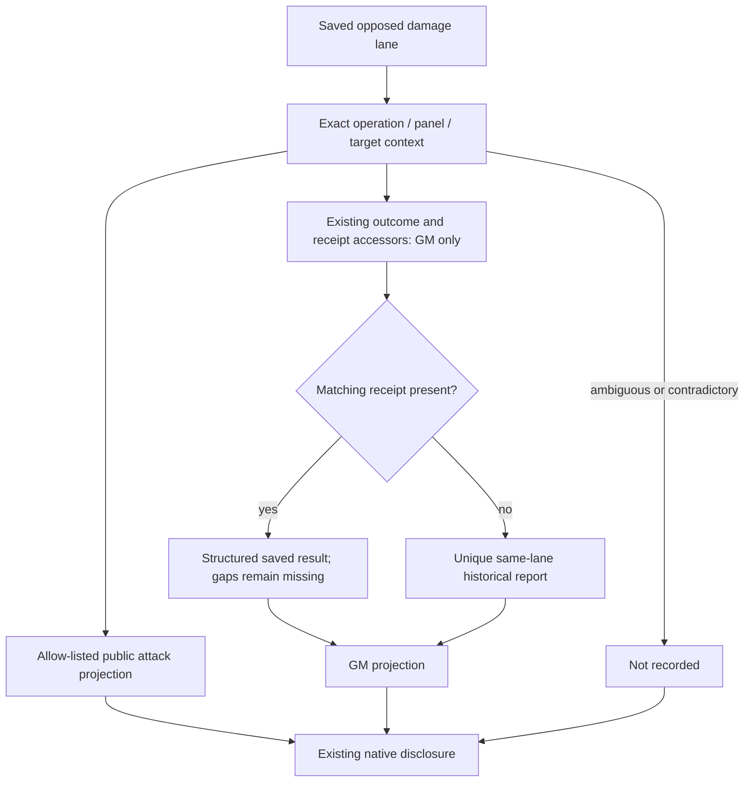

# Task 08 - Recorded damage explanations in opposed panels

**Date:** 25 October 2026.  
**Result:** Source implementation complete; native acceptance **NOT RUN**.  
**Selected scope:** public weapon-roll explanation and GM application evidence in existing opposed panels. Standalone cards, opposed-test calculations and derived-stat explanations remain separate work.

## Baseline and evidence boundaries

| Field | Evidence |
| --- | --- |
| Workspace | `C:/dev/uesrpg/uesrpg-3ev4-14.0.0` |
| Baseline | All **984 files** matched Task 07's final SHA-256 inventory before editing. Tasks 01-07 are preserved; Task 05 measured optimization and Task 07 stricter schemas remain deferred. |
| Backup | Ignored `release/backups/task-08-damage-explanations-20261025-073114/`: seven original affected files under `source/`, their original hashes in `pre-change.sha256.json`, and `baseline.json`, saved before production edits. Timestamp is UTC. |
| Branch / commit | Unavailable: Git still reports `not a git repository`. No branch, commit or PR created. |
| Versions | System `14.2.0`; declared Foundry minimum/verified `14.368`, maximum `14`; unchanged. Future native acceptance targets a backed-up v14.369+ world. |
| Node | `v24.13.0`, Windows, existing locked dependencies. No dependency or module-type change. |
| Historical tests | Task 06's 195 passing Node tests are baseline evidence. Task 07 changed documentation only. Current command results are recorded below. |
| Native evidence | No Foundry client/world, native Document, compendium database or player export was opened or changed. Every live case is **NOT RUN**. |

The approved Task 08 plan controls this patch; the archive supplies context. The selected existing-evidence scope does not authorize snapshots, schema/persistence changes, a new application mode or later tasks. Claims below are **source-confirmed** unless explicitly described as observed local command results, potential risks or native unknowns.

## Before and after

The source already had public spell disclosures, an opposed damage panel, GM-only report injection, Actor damage receipts and disclosure scroll anchoring. The previous GM formatter coerced absent or invalid values to zero. Its report lookup could fall back to the first report from another target. Some saved source/reduction notes were assembled from Actor armor/toughness after consequential application stages; they cannot establish every original input's provenance.

The new view uses allow-listed saved values. Public weapon details show formula, Roll A/B totals, recorded attack result, location and components without selecting a winning roll or evaluating dice. GM details prefer the exactly matched receipt and expose structured reductions, applied components and recorded resources where available. Missing values read **Not recorded**. A report cannot be substituted from another target. These are source changes, not a reproduced Foundry bug or observed native fix.

An illustrative synthetic record has raw damage `8`, total reduction `3`, applied component `5`, HP `14/20` and recorded loss `5`. The view copies those individual fields; it does not derive one from another. Omitting raw damage now displays **Not recorded**, while an explicit raw `0` remains `0`. Synthetic unit inputs also deliberately contain inconsistent values to prove that the projection preserves evidence rather than repairing it. None is an observed world/compendium record or a mechanics validation fixture.

## Ownership and data flow

| Owner / caller | Responsibility |
| --- | --- |
| [explanation.js](../../src/core/combat/damage/explanation.js) | The single dependency-free owner of numeric recognition, public/GM projection and source-lane matching. No Foundry globals, DOM, Actor/equipment/effect reads, dice or document writes. |
| [template-helpers.js](../../src/core/combat/opposed/cards/template-helpers.js) | Existing `_buildDamagePanel` calls the new public formatter. Keeps its export/options, compact summary, controls and spell disclosure. The public formatter is also reused for older stored markup. |
| [combat-chat-render.js](../../src/core/combat/chat-handlers/combat-chat-render.js) | Existing render augmentation selects one source lane, hydrates historical public markup locally and formats the GM model. Reuses native disclosure/scroll handling. Retires first-target report fallback. |
| [chat-outcome-application-service.js](../../src/application/combat/chat-outcome-application-service.js) | Existing `getChatOutcomes` / `getChatOutcomeReceipt` remain the identity/receipt accessors. Changes only presentation signatures and a native visibility guard in `augment`. Execution, recovery, queues, receipt IDs and persistence are unchanged. |
| ApplyDamageService, resolver, calculators, receipt writers | Unchanged. Remain the calculation/application/persistence owners. No alternate damage algorithm or receipt store. |
| [consolidation-checks.js](../../scripts/consolidation-checks.js) | Adds canonical projection owners and literal AST safeguards against projection runtime/calculation/write dependencies and restoring first-target fallback. |

No new public runtime API is registered. The four new internal exports are `recordedDamageNumber`, `projectWeaponDamageExplanation`, `selectDamageExplanationLane` and `projectGmDamageExplanation`. The additional public-HTML formatter is an internal ES-module export for the two existing rendering paths. All models are transient presentation data; none is written to a flag.

## Field provenance and fallback

| Displayed family | Saved source | Restrictions |
| --- | --- | --- |
| Public formula, A/B rolls, attack result, location | Damage lane `damageString`, `rollATotal`, `rollBTotal`, `finalDamage`, `hitLocation` | No fallback to `applyPayload`, GM reports, Actor state or dice. No inference about which roll won. Formula is escaped text; saved roll HTML is not used by the new weapon explanation. |
| Public components | `damageComponents[].displayLabel/sourceLabel/source`, `damageType`, `amount` | Explicit fields only; no copied metadata/UUIDs/private properties. These are recorded lane components; the existing application synchronizer can replace them with resolved components. They are not asserted to be an immutable original-roll snapshot. |
| GM total and components | Exact receipt `result.damage`, `result.components[]` | Copies raw damage, DoS/weapon bonus, structured armor/resistance/toughness/penetration/total reductions, final damage and final applied value. No sums, differences, clamps or rule evaluation. |
| GM report fields | The same receipt's `result.gmDamageReport`; uniquely matched lane `gmDamageReport` only when no receipt remains | Historical fallback is labelled. An incomplete receipt never borrows an older report. Contradictory known panel keys suppress the evidence and completion status. |
| HP / temporary HP | Recorded old/new/settled fields and structured report `hp` / `tempHp` | Prefer recorded settled values where present. Loss and maximum are displayed only if recorded; no loss inferred from before/after values. A report with no HP remains without HP. |
| Buffers and status | Saved buffer detail/report rows, receipt status, recorded report booleans/threshold | No resource reconstruction, defeated inference or completion inferred from values. `partial` displays **Needs review**; processing, pending, waitingGM and failed retain their meaning. |
| Opaque notes | Existing `sourceNotes`, `reductionNotes`, `traitNotes` | Not projected as verified original inputs. Stored strings are untouched; no parsing or regeneration of embedded numeric claims. |

Finite numbers and decimal numeric strings, including zero and negative values, are recognized for display. Blank strings, booleans, arrays, arbitrary objects, malformed numbers, formulas and non-finite values become unavailable. This does not clean or normalize persisted data. Old report builders sometimes saved default zero; that historical zero cannot be retrospectively distinguished from a recorded measurement and is displayed as stored, with the historical provenance notice.

All supplied lane constraints must agree and leave exactly one candidate. A declared application target takes precedence over original defender aliases, which matters for counterattacks. A stale panel/operation, conflicting target or ambiguous shared Actor/Token context cannot authorize fallback to another lane. The canonical receipt accessor is used only after unique matching. A receipt's missing final result may use its saved health-stage result; an explicitly present incomplete final result is not filled from historical evidence.

## Visibility, lifecycle and persistence

The existing hook registration is unchanged. Both augmentation boundaries check native `message.visible` and `message.isContentVisible` before adding content. The GM path checks `game.user.isGM` before reading receipts or inserting private HTML. Non-GMs receive only the public attack projection; existing whisper/blind policy and application permissions are preserved.

GM HTML stays client-local and is never included by the shared card formatter. Older weapon panels are hydrated locally without updating ChatMessage content. New/ordinary card renders naturally include the public disclosure through the existing formatter. Healing/effect panels and public spell explanations retain their existing behavior. No new listener, cache, setting, AppV2 surface, persisted field, model revision or migration is introduced.

Existing GM report data already resides in some shared ChatMessage flags. This patch does not remove or newly distribute that data, and client-side DOM gating is not proof of confidentiality of existing flags. Native payload/privacy behavior remains an explicit acceptance concern. The new public projection never traverses these reports, receipts or arbitrary apply payloads.

Only the existing local receipt/view signatures are extended to include projected damage evidence. This lets a changed structured result at the same status request a display refresh through the current queue. Opening/closing a disclosure adds no gameplay call, effect scan or sheet render request. Existing DOM scroll anchoring is reused; narrow wrapping and focus outlines are limited to these disclosures. Keyboard, layout, render counts and visible latency remain unmeasured.

| Official v14 reference | Usage / status |
| --- | --- |
| [ChatMessage visibility](https://foundryvtt.com/api/v14/classes/foundry.documents.ChatMessage.html#visible) | Documented public accessor for current-user message visibility. |
| [ChatMessage content visibility](https://foundryvtt.com/api/v14/classes/foundry.documents.ChatMessage.html#iscontentvisible) | Documented public accessor; a visible shell does not imply visible content. |
| [renderChatMessageHTML](https://foundryvtt.com/api/v14/functions/hookEvents.renderChatMessageHTML.html) | Existing documented public hook with an HTMLElement, allowing final customization before adding the message to the log. No additional hook registered. |

No new Foundry API usage beyond these documented read accessors is introduced. No Roll construction/evaluation or ApplicationV2 lifecycle is added. Existing native DOM details remain the presentation control.

## Validation ledger

The new suite directly imports the production helpers without Foundry globals. Its **53 cases in four groups** cover numeric/malformed data, explicit zero, multiple components, input preservation, public/private field separation, exact identities, duplicate targets, counterattack victims, stale keys, historical/pruned receipts, missing HP, incomplete/processing/failed evidence and changing presentation signatures. It does not instantiate a Document, simulate multiplayer, render a DOM or execute damage.

Focused development checks passed: 51 initial cases and targeted lint, then 53 cases after counterattack/conflicting-panel cases were added. The final complete command ledger is recorded below. Node's existing `MODULE_TYPELESS_PACKAGE_JSON` warning is retained; it is not a Foundry deprecation or a failed test.

Final source checks were run concurrently; wall durations include npm/process startup and CPU contention. They are command evidence, not application-performance measurements. Logs and per-command JSON results are saved as `final-*.log` / `final-*.result.json` under the backup directory. An earlier complete validation pass also succeeded before the final historical-card/fallback presentation adjustments.

| Command | Observed result | Wall duration (ms) | Exit | Status |
| --- | --- | ---: | ---: | --- |
| `npm test` | **248 tests / 18 suites**, 248 passed, zero failures/skips/cancellations/TODO; runner duration **632.9882 ms** | 1439.9026 | 0 | PASS |
| `npm run lint` | Full existing production/tooling/test lint | 8163.9585 | 0 | PASS |
| `npm run syntax:check` | 801 JavaScript files | 32054.4015 | 0 | PASS |
| `npm run schema:check` | Generated TypeDataModel seeds match `template.json` | 1431.7677 | 0 | PASS |
| `npm run data:check` | 30 spell effects and 13 strike enchantments match their owners | 1112.2820 | 0 | PASS |
| `npm run validate` | Release/source, documentation, UI, migration and ownership safeguards | 39308.3600 | 0 | PASS |
| Hash/AST preservation audit | Expected seven modifications / three additions; protected files and execution code unchanged | Not a runtime benchmark | 0 | PASS |
| Remote CI / staged release / native Foundry | Not executed | Not measured | Not applicable | NOT RUN |

Release validation checked 794 JS files / 105 templates for references, 783 runtime modules / 4010 graph edges / 777 reachable modules, 25 Markdown files, the unchanged 21 migration revisions, and 7141 import/export bindings including 204 dynamic imports. Its **25 coverage-limit notices** are identical to the Task 07 baseline: dynamic-import promises, passed namespaces and one computed namespace access remain outside static export checks. These notices are limitations, not failures. No new warning category, suppressed diagnostic or generated-data rewrite was used.

Static ownership checks inspect literal AST constructs and named imports/exports. They cannot prove arbitrary JavaScript purity, follow every dynamic binding/alias or establish document-write behavior at runtime. Hash/AST preservation evidence is recorded separately from validation failures. Remote CI, installable packaging execution and native performance/compatibility remain unverified.

## Native acceptance procedure - every case NOT RUN

Use a stopped complete copied-world backup and disposable Foundry **v14.369+** world. Record exact system/Foundry/browser builds, users, modules, fixture UUIDs and restoration reference. Start with modules disabled; prepare a PC/NPC, weapon/ammunition/effect variants, a linked token, two unlinked tokens, owners/non-owner/GM, and sanitized historical cards. Export/hash affected documents before and after each stateful case. Use existing supported controls and application modes.

| Case | Procedure / expected evidence | Status |
| --- | --- | --- |
| DX-01 ordinary weapon | Roll/apply one unmitigated attack. Compare every displayed field with the saved lane and exact receipt. Public attack result and GM applied result have distinct labels. | NOT RUN |
| DX-02 components | Repeat with multiple damage types, ammunition and existing strike effects. Verify recorded amounts/types and no second evaluation or charge consumption when opening details. | NOT RUN |
| DX-03 mitigation | Exercise armor, penetration, resistance, toughness, immunity and rule-defined zero/negative results. Compare stored structured inputs and results; missing fields never become zero. | NOT RUN |
| DX-04 counter / block | Exercise counterattack and shield/AoE block branches. Match the actual damage victim, not original defender aliases. Fully blocked outcomes retain their controls/status and recorded attack explanation. | NOT RUN |
| DX-05 resources | Exercise temporary HP and supported buffers, wound/death aftermath and any recorded settled HP change. Compare before/after/settled fields; no inferred loss/HP or fabricated maximum. | NOT RUN |
| DX-06 receipt interruption | Stop before/after HP commitment, during aftermath and before card synchronization. Partial/processing/failed statuses stay explicit. Missing receipt fields never borrow a previous report or announce completion. | NOT RUN |
| DX-07 historical data | Reopen old cards with no report, incomplete values, defaulted zeros, missing receipt/pruned history and unique legacy reports. Expect safe render, historical notice and Not recorded gaps. | NOT RUN |
| DX-08 identity | Exercise multiple defenders, same Actor across linked tokens, two unlinked actors, stale panel/operation references, conflicting targets and missing/deleted targets. No first-target substitution. | NOT RUN |
| DX-09 changed sources | Change equipment/effects after resolution. Reopen details and confirm evidence remains saved values, with no live rescans/recalculation or fabricated source attribution. | NOT RUN |
| DX-10 users / modes | GM, acting player, target owner and non-owner under every existing application mode, with/without active GM. Public model contains no target mitigation/HP/effect detail; permissions/controls remain native. | NOT RUN |
| DX-11 whisper / blind | Repeat public, whispered, blind and self contexts; include a visible message shell with hidden content. Inspect actual HTML and network/document data separately. Do not infer flag confidentiality from hidden DOM. | NOT RUN |
| DX-12 replay / reconnect | Reopen/reload/reconnect and replay completed application through existing controls. Explain the recorded result without applying damage, rerolling, writing flags or consuming resources again. | NOT RUN |
| DX-13 accessibility | Keyboard Enter/Space toggles, focus outline, long custom names/formulas, narrow pane and translated labels. Opening/closing should retain scroll position without a full-sheet render. | NOT RUN |
| DX-14 refresh / cost | Change saved evidence at unchanged status through controlled native recovery. Confirm current queue refreshes the explanation. With identical diagnostics, use three warm-ups and twenty measured disclosure repetitions; record writes, render counts and visible latency, with no unmeasured speedup claim. | NOT RUN |
| DX-15 unchanged surfaces | Check public spell/healing/effect panels, standalone cards and normal apply controls. Scope changes should remain confined to opposed direct-damage presentation. | NOT RUN |
| DX-16 earlier regressions | Execute linked [Task 01 ranks](01-skill-rank.md), [Task 02 purchases/AppV2](02-xp-purchases.md), [Task 04 special-action recovery](04-special-action-idempotency.md) and [Task 06 migration completion](06-migration-readiness.md) cases relevant to the fixture. | NOT RUN |
| DX-17 restoration | Stop processors and restore the coherent copied-world snapshot; verify Actor/Item/ActiveEffect/Token/ChatMessage state agrees. | NOT RUN |

Record scenario ID, input, expected result, observed result, status, relevant operation/UUIDs and sanitized evidence. Passing source checks does not establish native privacy, lifecycle compatibility, accessibility, crash recovery or performance. No live fixture generator, browser harness, simulator or dependency is added.

## Preservation and rollback

The post-change SHA-256 inventory contains **987 files**: **977 baseline files unchanged**, seven expected modifications and three expected additions; no baseline file is missing. Every preserved original matches its pre-change hash. `preservation-proof.json` and `post-change.sha256.json` contain the detailed evidence; `audit-source.cjs` reproduces the scoped comparison.

Unchanged files include the damage calculators/resolver, ApplyDamageService, receipt writers, advancement/purchase/special-action/migration execution, all schemas/generated artifacts, version/dependency manifests, workflows, templates, earlier tests/fixtures and prior reports. The modified outcome service is additionally checked with parsed source ranges: **31 existing functions** outside its two view-signature builders remain textually identical after line-ending normalization, and its service object is identical apart from the native visibility guard in `augment`. Thus the source evidence distinguishes presentation edits within that file from unchanged execution ownership.

The seven modified files are the three existing presentation owners listed above, `lang/en.json`, `styles/uesrpg.css`, `scripts/consolidation-checks.js` and `docs/testing.md`. The three additions are the projection module, unit suite and this report. No unexpected change, deletion or invalid original backup was found.

Restore the seven changed originals from this backup's `source/` at their same relative paths. Remove only the new `src/core/combat/damage/explanation.js`, `tests/unit/damage-explanations.test.mjs` and this Task 08 report. Verify the restored source against `pre-change.sha256.json` and rerun source validation. Existing CI gates, test packaging exclusions, generated artifacts and prior reports are preserved.

This presentation patch changes no stored format or resource-write path and needs no world restoration by itself. New public HTML uses existing disclosure classes. After later stateful damage acceptance, stop gameplay/processors and restore matching Actor, Item, ActiveEffect, Token and ChatMessage snapshots together from the copied world. Do not edit receipt history or resource values to reverse a presentation change.

No release, deployment, version bump, dependency change, compatibility declaration, migration or later-task implementation is included.
