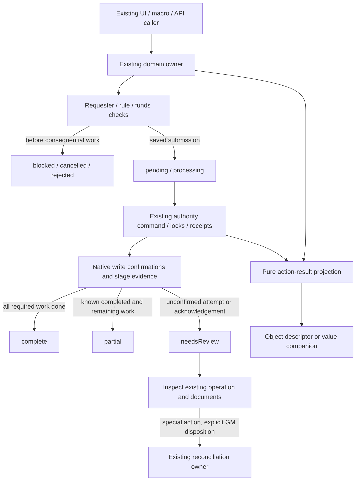

# Task 09 - Consistent action results and deferred-work handoffs

## Scope and baseline

The selected expanded scope covers special actions, damage/healing, casting, Item activation/consumption and their applicable chat, sheet, quick-menu, macro and HUD boundaries. The common contract extends existing object returns; companions preserve Boolean, nullable and native Document return types. Existing action-facing `ok`/`success` fields now reflect confirmed completion, as selected. The [contract guide](../action-results.md) is the canonical consumer reference.

Implementation remains **source validation only**. No Foundry world or native documents were opened or changed. Tasks 05 and 07 receive concrete resumption gates below; optimization and stricter schema validation remain deferred. No later numbered task, version bump, compatibility declaration, dependency change, publishing, deployment or release artifact is included.

Before editing, all **987 files** matched Task 08's final SHA-256 manifest. Node is **v24.13.0**. The Task 08 baseline of **248 tests / eighteen suites** was historical until rerun. Branch and commit are **unavailable**: Git cannot read this checkout as a repository. A complete source/development snapshot and the pre-change SHA-256 inventory are preserved under the ignored directory:

`release/backups/task-09-action-results-20261025-105718/`

The snapshot contains Tasks 01-08, including their reports, test gates, recovery protocols and audit deferrals. `baseline.json` records zero baseline mismatches. `source/` contains all original files, and `pre-change.sha256.json` is the rollback inventory. Implementation proceeded through shared evidence/authority, special actions, damage, magic, activation/consumption, caller propagation, checks and documentation checkpoints; no Git commit is claimed for these checkpoints.

## Canonical ownership and protocol

[action-results.js](../../src/application/action-results.js) is the sole version/status/commitment construction owner. It has no imports, runtime globals, Documents, DOM, dice, persistence or authority dispatcher. It accepts explicit domain facts and projects bounded text, allow-listed references and child descriptors. It neither calculates outcomes nor decides permissions. Its accessors reject unsupported/inconsistent descriptors.

The descriptor has version, owner, scope, status, `ok`, `accepted`, commitment, references, existing authority code, plain-text reason/warnings and optional target descriptors. These are **transient result fields**, not a new Actor journal or gameplay flag format. The existing authority command carries the descriptor in its existing response `data` slot; the generic transport remains unchanged. Existing gameplay receipt compaction excludes the descriptor.

`complete` includes rule-defined terminal no-effect/manual results within the named scope. `pending`/`processing` can retain confirmed cost evidence while consequences remain unfinished. Cancellation/rejection after a confirmed write becomes partial; uncertain evidence takes precedence and requires review. Batch results retain target evidence and cannot inherit success from only the last target.

Commitment comes from acknowledgements recorded at the existing write owner or reliable recorded stage results. Current HP/AP, condition presence, elapsed time, truthy objects and observed diffs cannot establish commitment. Historical replay can remain terminal under its existing owner while exposing no separate positive write acknowledgement. Reconciliation is completion of a GM-recorded manual disposition; old stage evidence is retained and does not authorize re-execution.

Document acknowledgement handling follows the documented [Document update API](https://foundryvtt.com/api/v14/classes/foundry.abstract.Document.html#update) and [embedded update/delete APIs](https://foundryvtt.com/api/v14/classes/foundry.abstract.Document.html#updateEmbeddedDocuments), through existing system helpers. The [User query API](https://foundryvtt.com/api/v14/classes/foundry.documents.User.html#query) supplies transport delivery/timeout behavior. It does not establish an atomic gameplay transaction. No new Foundry API or undocumented lifecycle is introduced.

## Caller and effect inventory

| Family / boundary | Implementation and evidence |
| --- | --- |
| Shared result contract | `createActionResult`, `getActionResult`, `withActionResult`, aggregation, receipt/evidence projection and exception context in the single pure owner. Exceptions keep their original identity/cause and existing throw/return boundary. |
| Sealed chat application | Existing `combat.applyOutcome`, requester validation, authority choice, queues, locks and receipts remain. `execute` adds the response descriptor/data slot. `applyResult` preserves domain state over transport flattening and inspects receipt/card evidence after a query failure. Explicit pre-execution permission/invalid/stale/expired refusals stay rejected. `apply` remains Boolean. |
| Special actions | All ten existing implementations remain behind `combat.special`: Arise, Bash, Blind Opponent, Disarm, Feint, Force Movement, Grapple, Resist, Trip and In Close. Opposed/source discovery, standalone submission, Advantage automation, sheet Arise and GM review retain Task 04 identities, checkpoints, immutable intent and recovery decisions. Public `success` is false for pending work. |
| Advantage bookkeeping | `onAutoWinAccepted` records existing source markers after accepted submission. `onAutoWinSuccess` is reserved for confirmed completion. The existing marker callers move to acceptance without repeating the action. |
| Special test launch | Grapple/In Close/other non-Arise sheet launches return pending with acknowledged card references and confirmed activation-cost evidence. Missing creation/update acknowledgement retains review evidence. Existing test/rule selection and subsequent Task 04 processing are unchanged. |
| Damage/healing service | All four `ApplyDamageService` entrypoints have companions. Invocation context records health write attempt/acknowledgement at `commitHealthUpdate`; committed execution is no longer asserted just because a result exists. Known zero-heal/temp-HP no-ops retain legacy null plus complete companion. Campaign gates, aftermath, Actor/ESM/runtime aliases and protected replay remain. |
| Magic health wrappers | Absorption and typed components aggregate recorded execution evidence. Absorption/no-effect is terminal; component failures cannot inherit the last successful component's completion. Inline chat consumers use companions so nullable no-op and unconfirmed writes differ. Damage formulas, mitigation and resource payloads are preserved. |
| Spell casting | Direct/opposed/unopposed native workflows retain Message/null returns and gain companions. Casting service object returns carry the descriptor and correct message IDs (`Message.id`). Caster costs, target application and output acknowledgement are distinct. Origin/conjuration/effect submissions report pending via read-only invocation callbacks, stripped before stored payload construction. |
| Casting costs | Native AP spending now checks a missing acknowledgement even outside strict callers. Magicka debit checks confirmation; restraint refund exposes confirmation and reports failures through the existing automation-failure array. Costs/formulas, spend order and existing AP rollback branches remain. |
| Scroll / enchanted Item | Scroll quantity/delete success requires the existing helper's positive acknowledgement. The original consumption rule is retained, including consumption on hook cancellation/other failed attempts when configured. Enchantment companions keep native returns and reuse workflow result owners. |
| Item / feature activation | Existing validation, normalization, usage-before-resource order, explicit usage rollback, target selection, feature dispatch and ItemMacro remain. Usage/resource/flag writes expose evidence. Feature transfers, racial status/healing and Inspire Heroism submissions report target/pending state; an accepted attack card is pending. Result text no longer announces completion while managed consequences wait. |
| Potion / coating | Existing per-Item activation coordination remains. Potion consumption, queued effects and direct confirmed steps remain distinct. Coating/create/remove/quantity acknowledgement gaps report review; known completed work stays partial. Existing coating cleanup/rollback branches remain in their original order. No new refund or retry is introduced. |
| Quick Use Item | Existing AP owner result is combined with potion/coating result. Selected Aim cleanup requires acknowledgement. Ordinary non-alchemy use retains its existing report-only behavior; no quantity rule is added. Dialog cancellation before work is cancelled; a callback that started but supplied no result requires inspection. |
| UI / HUD / macros | Item sheet, shared PC/NPC magic listeners, feature handlers, quick menu, chat controls and selected HUD actions propagate results. Shared spell-roll routing calls the existing dialog/workflow helpers directly, preserving PC/NPC routing. HUD no longer hardcodes true for scroll/feature/macro dispatch. External ItemMacro completion describes dispatch only and cannot verify arbitrary external effects. |
| Related managed adapters | The existing outcome boundary reports ability/status, magic consequences/origin/spell, alchemy potion/spell/poison/toxin, warfare loss and resource adapters from their existing receipt/stage evidence. No replacement effect calculator or dispatcher is added. |

Pure planners, ordinary edits, XP purchase/migration contracts, unrelated roll/dialog dispatch and derived-stat explanations retain their existing owners. This is not a universal conversion of every UI callback into a gameplay completion API. Standalone cards do not gain a new idempotency journal.

## Compatibility and failure boundaries

| Boundary | Before | After / preserved behavior |
| --- | --- | --- |
| Special submission / HUD | Saved/queued work could report `success: true` or hardcoded `ok: true`. | Descriptor distinguishes accepted/pending/application; eligible legacy flags mean completion. Macro branching may change intentionally. |
| Casting object result | `result !== null` treated a native Message as completed application and read `messageId` from it. | Correct native `id` reference plus pending/partial/complete scope evidence. Native workflow callers still receive Message/null from original methods. |
| Damage execution | Ordinary results and any receipt unconditionally claimed committed. | Actual invocation confirmation or explicit recorded acknowledgement only; protected historical replay does not invent one. |
| AP update | Non-strict missing acknowledgement could return true. | False/review companion; strict failure still throws with original error context. No spend calculation changes. |
| Scroll quantity/deletion | Awaited write was reported consumed without checking its result. | `consumed`/`removed` become true only after confirmation; unresolved quantity is `null` rather than an invented new quantity. |
| Mixed/targeted work | Card creation or one target could conceal unfinished effects. | Pending targets and known/uncertain failure evidence aggregate. |
| Query timeout / acknowledgement loss | Transport failure could be read as application failure. | Inspect existing durable evidence; unresolved dispatch is review. No automatic resubmission/card recreation. |
| GM reconciliation | Transport could lose domain fields; retained partial stages could obscure terminal disposition. | Descriptor survives the data slot; valid existing GM disposition is terminal while original evidence remains. No automatic gameplay repair. |
| HUD ItemMacro | Incorrect argument wrapping could report dispatch without passing the Item. | Uses existing `(item, options)` signature; companion reports dispatch, with external effects explicitly outside verification. |

Expected guard/cancellation results are defined where selected owners have evidence. Existing UI error boundaries still catch exceptions; if a required action returns no evidence to the HUD, the conservative result is review. No missing result authorizes an automatic retry. Existing authority error codes and native ownership restrictions remain authoritative.

Each route retains its existing notification owner. Casting services own casting failures, scroll callers only announce preflight errors not already handled, and pending work does not trigger a failure toast merely because `success` is false. Chat application and GM review retain their existing owner. Spending/application notifications are not replayed as proof of completion.

No world data was read or changed. No new Actor/Item/ChatMessage persisted format, migration revision, readiness gate, retention rule, compensation workflow or cross-client completion promise is added. The response data slot and existing automation failure records receive only their intended result/evidence content.

## Validation ledger

Checks run locally on Windows / Node **24.13.0** using the existing installed locked dependencies. Logs and per-command JSON results are retained in the ignored backup. Remote CI was **NOT RUN**; both existing workflow test gates and packaging exclusions are unchanged.

| Check | Result | Exit | Observed duration |
| --- | --- | --- | --- |
| `npm test` | 313 tests / twenty suites; 313 pass, zero failures/skips/TODOs. Task 09 adds 65 tests in two groups. | 0 | 1,725.796 ms; 758.2864 ms Node runner |
| `npm run lint` | PASS | 0 | 11,134.441 ms |
| `npm run syntax:check` | 803 JavaScript files | 0 | 38,306.098 ms |
| `npm run schema:check` | Generated TypeDataModel seeds match `template.json` | 0 | 1,528.779 ms |
| `npm run data:check` | 30 spell effects / 13 strike enchantments match their owners | 0 | 1,204.566 ms |
| `npm run validate` | PASS, including source/packaging/links/ownership safeguards | 0 | 47,010.134 ms |
| Native Foundry / multiplayer / privacy / performance | NOT RUN | n/a | n/a |

All six final checks above passed after source and documentation completion. Command durations are elapsed observations with independent checks allowed to run concurrently; they are not performance benchmarks. `verified-*.log`, `verified-*.result.json` and `validation-ledger.json` preserve the raw evidence. Earlier checkpoint logs are historical, separate from this final ledger.

Tests directly import the production contract and the Node-safe HUD forwarding helpers. They use inline plain-state facts and callbacks: all statuses, accepted versus complete, retained paid costs, no-effect, uncertain writes, references/text, immutable inputs, scope aggregation, receipt states/interruption/replay, authority data round-trip, existing stale code, corrected legacy fields, target/batch outcomes, missing handler evidence and terminal GM dispositions. No Foundry globals, Documents, framework simulator, custom loader, dependency or world fixture is introduced. The prior 248 tests remain unchanged.

`MODULE_TYPELESS_PACKAGE_JSON` remains the existing warning from the mixed package layout. No module configuration or warning suppression is changed. Static import/export coverage has **25 existing notices**, compared after normalizing line numbers; computed/dynamic namespace bindings remain outside the validator's proof. These notices are coverage limits, separate from failures. Source checks do not execute native document acknowledgements, queries, effects, permissions, chat visibility or concurrent clients.

Ownership checks protect the pure result owner/status constants and reject hardcoded successful scroll/activation returns in the HUD. Existing damage entrypoint, special-action owner, migration, purchase, AppV2 and packaging safeguards remain. Literal AST checks are not whole-program purity or alias analysis. The final graph contains 784 runtime modules, 4037 static/literal-dynamic edges and 778 reachable modules; 7213 bindings and 210 dynamic imports were inspected. Links were checked in 27 Markdown documents.

## Native acceptance - every case NOT RUN

Use a stopped coherent copied-world backup and disposable Foundry **v14.369+** world. Record exact builds, users, active authority, modules/diagnostics, source values, before/after exports, operation/request/message/receipt UUIDs and observed descriptor/legacy flags. Start without optional modules. Inspect durable evidence before each deliberate retry; never infer success from current values or erase an unresolved record.

| Case | Procedure and expected evidence | Status |
| --- | --- | --- |
| AR-01 statuses and funds | Exercise sufficient, exact and insufficient AP/MP/uses/quantity; campaign gates, invalid references and explicit user/hook cancellation. Compare `ok`, `success`, accepted, scope, costs and recorded commitment. Preserve scroll hook-cancellation consumption behavior. | NOT RUN |
| AR-02 all special actions | Exercise all ten actions through opposed cards, Advantage auto-win/free selections and sheet Arise/test launches; manual/immunity/no-effect and cancellation. Pending acceptance must not announce applied effects or repeat source markers. | NOT RUN |
| AR-03 special recovery | Repeat Task 04 duplicate ID, changed intent, legitimate new result, Bash/Grapple preparation, In Close and child-card interruption cases. Confirm existing identities/receipts/checkpoints remain the recovery owner. | NOT RUN |
| AR-04 damage/healing | Run all four damage service methods plus Actor, ESM, runtime and magic wrappers: zero/prevented damage, immunity/absorption, ordinary/temporary healing and exact replay. Compare descriptors to native update acknowledgements and stored receipts. | NOT RUN |
| AR-05 aftermath and components | Mix damage types, absorption, pending aftermath, missing/deleted targets and one failed target/component. Verify no last-target success or current-resource inference, and no new refund/retry. | NOT RUN |
| AR-06 casting | Direct, opposed and unopposed; self/targeted/AoE, origin/conjuration/upkeep, success/failed test/backfire, restraint refunds, scroll and enchanted Item costs. A pending card/effect is accepted rather than complete. | NOT RUN |
| AR-07 Item activation | Talent/trait/power, ordinary activated Item, attack workflow, usage/resource/flag failure, existing usage rollback, racial grants/status/healing and Inspire Heroism. Compare combined/target state and final card wording. | NOT RUN |
| AR-08 alchemy/quick use | Potion no-effect/backfire/direct/queued effects, weapon replacement coating, split ammunition, source/potion quantity failures, existing cleanup, Aim removal and cancelled dialogs. Verify confirmed consumption alone does not claim effect completion. | NOT RUN |
| AR-09 callers and macros | PC/NPC Item/Actor sheets, hotkeys/favorites, quick menu, HUD, direct ESM and runtime APIs; preserve original Boolean/null/Document return types and inspect companions. Repeat with optional ItemMacro; verify dispatch scope and no duplicate notifications. | NOT RUN |
| AR-10 authority | GM/owner/non-owner, multiple/no active GM, original requester permission changes, linked/unlinked tokens and competing clients. Read authority data descriptor rather than transport status alone. | NOT RUN |
| AR-11 acknowledgement boundaries | Reject/interrupt before and after every AP/MP/usage/quantity/update/delete/create/card/receipt/aftermath acknowledgement. Query timeout after dispatch must trigger inspection, not a second card or resource action. Record both known committed and uncertain writes. | NOT RUN |
| AR-12 reconciliation/reload | Reload/reconnect, processor/authority changes, pruned completed receipt, partial/unsupported historical evidence and GM manually resolved/abandoned dispositions with reason and fresh identity checks. Presentation repair never restarts effects. | NOT RUN |
| AR-13 privacy/AppV2 | Whisper/blind, content visibility, owner/non-owner, submit/close, interrupted sheets, rapid input and two open sheets. Confirm existing client-local GM damage explanation/privacy boundaries and close-without-resubmit behavior. | NOT RUN |
| AR-14 earlier regressions | Reuse [Task 01](01-skill-rank.md), [Task 02](02-xp-purchases.md), [Task 04](04-special-action-idempotency.md), [Task 06](06-migration-readiness.md) and [Task 08](08-explainable-combat-calculations.md) cases for ranks, purchases, recovery, migrations and damage explanation. | NOT RUN |
| AR-15 restoration | Stop processors/purchases; reconcile pending operations, then restore matching Actor/Item/ActiveEffect/Token/ChatMessage/settings snapshots together and verify coherent resources/history. | NOT RUN |

## Deferred performance and schema gates

The [resumption handoff](../action-results.md#resuming-the-deferred-work) is concrete documentation under the selected source-only approach. Task 05 still requires agreed acceptance criteria, matched cold versus warmed measurements (three warm-ups, twenty measured warmed runs), correctness parity and explicit group/warfare/visible-latency/signature-timing gaps. No bottleneck, optimization or speedup is established here.

Task 07 still begins with spell `system.damageInstances`, sanitized historical exports, cloned native strict/non-strict cleaning/validation/serialization/persistence comparisons and metadata preservation. Writer-control reachability and runtime consumers remain questions for empirical validation. No TypeDataModel/schema/default/generator/form change or corrective migration is authorized by this result contract.

Both earlier broader objectives remain pending. Native acceptance is NOT RUN; no numbers or compatibility evidence are manufactured from Node test duration.

## Preservation and rollback

The final inventory contains **991 files**: **933 unchanged baseline files**, **54 expected modifications** and **four additions**. No baseline file is missing, no unexpected change/addition was found, and all **987 original backup files** match their pre-change hashes. `scope.json`, `preservation-proof.json` and `post-change.sha256.json` contain the exact allowed/restoration inventory. `audit-source.cjs` reproduces the comparison.

The Task 01 Item creation owner, purchase planners/journals, migration owners/registry, model schemas/defaults/generators, generated artifacts, version/dependency manifests, workflows, previous tests/fixtures and Tasks 01-08 reports retain their original hashes. Parsed source comparisons additionally confirm **13 special-action preparation/effect/managed-adapter function bodies**, **three Task 08 presentation owners** and **81 NPC sheet methods outside spell-result routing** are unchanged after line-ending normalization. The six touched damage/cost files retain the same ordered **90 binary arithmetic-expression source forms**, ignoring whitespace. This is a narrow source-preservation check, not native rule execution or a runtime compatibility proof.

Rollback is the whole Task 09 checkpoint: restore every original listed in `scope.json` / `preservation-proof.json` from this backup's `source/` to the same relative path, and remove only these additions:

- `src/application/action-results.js`
- `tests/unit/action-results.test.mjs`
- `docs/action-results.md`
- `docs/task-reports/09-action-result-contracts.md`

Verify the restored source against `pre-change.sha256.json` and rerun the existing Node/source checks. Restore all imports/callers together; do not leave companion callers pointing at removed methods. This source-only implementation requires no world restoration by itself.

After later stateful acceptance, stop clients/processors and purchases, inspect/reconcile pending evidence and restore a coherent copied-world backup, including matching Actor, Item, ActiveEffect, Token, ChatMessage and settings snapshots. Returning legacy Boolean semantics does not reverse AP/HP/MP/quantity or gameplay writes. Do not lower migration revisions or delete receipts to reverse transformations. Tasks 01-08 remain the restored baseline.
