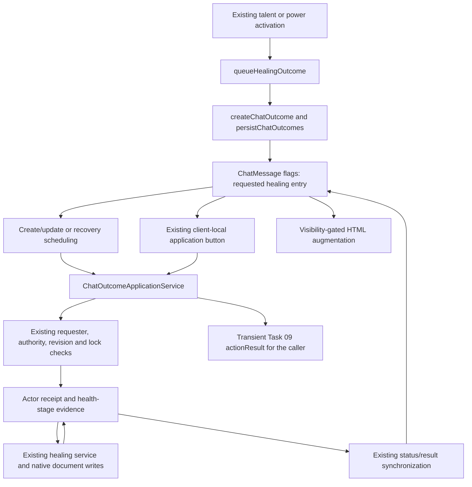

# Task 10 - Typed ChatMessage outcome compatibility audit

**Date:** 25 October 2026.  
**Result:** Investigation only; defer typed ChatMessage adoption.  
**Candidate:** Newly created standalone healing cards from `queueHealingOutcome`.  
**Scope:** Architecture, compatibility requirements and a future native validation procedure. Production behavior and persisted formats are unchanged.

## Baseline, preservation and evidence

| Field | Evidence |
| --- | --- |
| Workspace | `C:/dev/uesrpg/uesrpg-3ev4-14.0.0` |
| Baseline | All **991 files** in Task 09's final source/development SHA-256 manifest matched before editing; zero missing, changed or additional files in that inventory. Tasks 01-09 are preserved. |
| Backup | Ignored `release/backups/task-10-typed-chat-audit-20261025-122317/`: original `source/docs/testing.md`, verified guide hash, `pre-change.sha256.json` and `baseline.json`, saved before editing. Timestamp is UTC. |
| Branch / commit | Unavailable: `git rev-parse --show-toplevel` reports `not a git repository`. No branch, commit or PR is claimed. |
| System / declared compatibility | `14.2.0`; minimum/verified `14.368`, maximum `14`; unchanged. Future native procedures target a disposable v14.369+ v14 world. |
| Local environment | Windows, PowerShell, Node **v24.13.0**; existing installed locked dependencies. |
| Historical tests | Task 09 recorded **313 passing tests in twenty suites**. This documentation-only task does not rerun or extend them. They do not instantiate native ChatMessages or TypeDataModels. |
| Native evidence | **NOT RUN**: no Foundry client/world, model construction, message creation/update, export/import, gameplay application or runtime benchmark was executed. No world or compendium data was collected. |

The approved audit-only plan bounds the bundle's conditional subtype proposal. The attached task supplies context; it does not authorize a schema implementation, historical message rewrite, new validation policy or live test. Tasks 05 and 07 retain their deferred performance and stricter-schema objectives. Task 10's broader subtype adoption remains deferred.

**Source-confirmed behavior** below means checked-in implementation, not runtime reproduction. **Potential risk** identifies a transition hazard without claiming a demonstrated defect. **Unknown** requires native evidence or an external integration inventory. All illustrated values are source-derived examples or synthetic probes, never observed player/world/compendium records. No LevelDB database was opened or modified.

## Existing owners and message lifecycle

| Boundary | Source owner / consumers | Source-confirmed behavior and audit consequence |
| --- | --- | --- |
| Model declaration and registration | [registry.js](../../src/core/data-models/registry.js), [init.js](../../src/hooks/init.js), [system.json](../../system.json) | The manifest and registry cover four Actor and sixteen Item subtypes. `registerTypeDataModels` runs in init; no system ChatMessage subtype/model is declared or registered here. The registry's current document-name branches are Actor/Item-specific; its helpers must not be assumed to support ChatMessage. |
| Model seeds and drift checks | `defaults.generated.js`, `scripts/schema-seeds.js`, `scripts/generate-schema-defaults.js`, [build-release.js](../../scripts/build-release.js) | Existing generated-seed/manifest/template comparisons cover Actor and Item. They do not instantiate or validate a prospective ChatMessage model. This audit changes neither generators nor their scope. |
| Entry construction | [outcome-application-policy.js](../../src/core/config/outcome-application-policy.js) | `createChatOutcome` requires an adapter, recipient and supported kind, generates entry metadata, clones payload and starts at `pending`. `chatOutcomeFlags` supplies the version-1 envelope. This is not complete type-specific validation of a healing payload. |
| Healing writer | [chat-outcome-application-service.js](../../src/application/combat/chat-outcome-application-service.js), `queueHealingOutcome` / `persistChatOutcomes` | The healing helper creates one entry and a small escaped source-label HTML body. Its observer is removed from payload options and called after persistence. It returns the native Message. New standalone creation supplies speaker, content, `whisper: []` by default and `style: OTHER`; it does not explicitly supply `type` or `system`. Envelope revision is initially absent. |
| Existing-message writes | `persistChatOutcomes`, `synchronize`, [authority-proxy.js](../../src/utils/authority-proxy.js), [sanitize.js](../../src/utils/authority-proxy/sanitize.js) | Appends and status/result synchronization use the current ChatMessage lock and native-write helper. Unsupported envelopes are not overwritten. Sanitizers, allowed flag lanes and sealed transition permissions know the existing paths; adding `system` cannot be assumed to pass through them. |
| Other flag writers and discovery | `core/alchemy/runtime.js`, `core/combat/special-actions-helper.js`, `special-action-outcomes.js`, `chat-handlers/combat-chat-actions.js`, `core/mass-warfare/clash/auto-roll.js` | These also construct, discover or update the shared envelope. Opposed combat/magic keep their own inline damage state and schema accessors. They remain inventory context, outside the healing candidate. Moving the entire envelope to a subtype would expand scope across these workflows. |
| Readers and application authority | `getChatOutcomes`, `findOutcome`, `canApplyChatOutcome`, `ChatOutcomeApplicationService`; [authority-intents.js](../../src/utils/authority-intents.js) | Readers combine supported flag entries, inline opposed outcomes and special-action discovery. Application uses sealed `combat.applyOutcome`, the original requester, expected revision, selected active GM or existing owner fallback, queues and locks. A model is not a replacement permission check or execution owner. |
| Healing consequence | [chat-outcome-executors.js](../../src/application/combat/chat-outcome-executors.js), [apply-damage-service.js](../../src/application/combat/apply-damage-service.js) | The existing `healing` adapter executes a `health` stage through `ApplyDamageService.applyHealingResult`, retaining current amount handling, no-effect behavior and aftermath. No new calculator is needed or introduced. |
| Actor evidence | [post-application.js](../../src/core/combat/damage/post-application.js), `readDamageReceipts` / `updateDamageReceipt` | Actor `damageApplications` stores application/stage evidence, processor identity/session and compact results. The top-level healing receipt ID is `outcome:<message.id>:<entry.id>`; the adapter's health application receives the associated `:health` reference. Receipt retention has existing synchronization/special-action conditions; it is not a new subtype-owned journal. |
| Synchronization and recovery | `synchronize`, `scheduleMessage`, `processOutcome`, `ChatOutcomeApplicationService.reconcile` | Receipts synchronize entry status/error/result and advance envelope revision when changed. Existing complete/partial card states also protect against replay after receipt pruning. Startup and reconnect use the existing scan/scheduler. Task 04's extra operation metadata and reconciliation safeguards apply specifically to special actions; do not claim identical guarantees for every adapter. |
| Hooks and rendering | [combat-chat-register.js](../../src/core/combat/chat-handlers/combat-chat-register.js), [register-chat.js](../../src/hooks/init/register-chat.js), service `augment` | Guarded create/update hooks schedule persisted outcomes; delete forgets presentation state; ready/user-connected hooks recover. `renderChatMessageHTML` augments existing DOM. The service checks both `visible` and `isContentVisible` first. Its controls are client-local, not another saved result. No subtype template currently renders this healing payload. |
| Buttons and context menus | [combat-chat-actions.js](../../src/core/combat/chat-handlers/combat-chat-actions.js), [combat-chat-context.js](../../src/core/combat/chat-handlers/combat-chat-context.js) | Delegated `data-ues-chat-outcome` buttons call `applyResult`. Special-action review is a separate action and is not a general healing reconciliation control. Existing ChatLog subclasses use protected context/listener overrides and preserve superclass calls. Roll-application context entries require positive native roll totals; the simple healing card has no roll supplied by its writer. |
| Presentation and privacy | Service `outcomePresentation` / `augment`, [combat-chat-render.js](../../src/core/combat/chat-handlers/combat-chat-render.js), [damage/explanation.js](../../src/core/combat/damage/explanation.js) | Current controls, localized states and Task 08's public/GM damage explanation boundary remain. Neither a schema nor escaped display text establishes field-level confidentiality. New copies of receipt/resource/GM evidence would require a separate privacy review. |
| API, macro and integration boundaries | [api/index.js](../../src/api/index.js), [runtime-registration.js](../../src/api/runtime-registration.js), init runtime API, Token Action HUD and ItemMacro callers | Existing public damage/healing Result companions and action-result accessors remain. Runtime `game.uesrpg.application.damage` exposes service operations, including healing; it does not expose a new typed-healing emitter. No checked-in automation/template/API consumer was found that requires a healing ChatMessage subtype. External macros/modules reading flags remain unknown. Context debug inspection can expose existing flags locally; use sanitized evidence. |
| Migrations | [migration registry](../../src/core/migrations/revisions.js), runner and existing combat migration paths | No revision is added or changed. Historical chat readers and completion semantics remain. A subtype evaluation is not permission to rewrite old messages or treat `worldDataVersion` as readiness. |



The diagram describes existing source routes, not observed cross-client ordering or a transaction. Hook delivery across clients does not provide exclusive execution. Model construction and HTML rendering must not initiate an independent healing consequence.

## The three evidence layers

| Layer | Owner and identity | Meaning / transition requirement |
| --- | --- | --- |
| Persisted requested outcome and card state | `flags.uesrpg-3ev4.chatOutcomes`, envelope `version: 1`, generated entry `id`; application reads current envelope revision, defaulting to zero when absent | Stores what was queued, its recipient/options, eligibility and synchronized state. The healing entry is initially a requested amount, not proof that HP changed. Preserve existing flag readers and card terminal protections. |
| Persisted execution evidence | Target Actor `flags.uesrpg-3ev4.damageApplications`; message/outcome receipt reference, stage keys, confirmed results and processor evidence | Existing execution/recovery source. Current HP, a matching-looking message or successful rendering cannot replace this evidence. Do not copy the journal or arbitrary before/after Actor data into a model merely to validate presentation. |
| Transient action result | [action-results.js](../../src/application/action-results.js), returned through existing owners and authority response `data` | Versioned status/commitment/reference projection for callers: accepted/pending, complete, partial, review, etc. `getActionResult` and companions do not define a ChatMessage schema. Existing gameplay result compaction excludes this descriptor; persisting it would introduce a different contract. |

For this candidate, the generated entry ID and its message/Actor receipt association are the actual source identity. Task 04's source-generation/selection-slot operation metadata must not be invented for ordinary healing cards. A future model would have to preserve the existing association rather than mint another operation during construction, rendering, reload or export.

## Healing callers and isolated consequences

| Caller in [racial-talents.js](../../src/core/traits/racial-talents.js) | Healing card | Other existing behavior outside this candidate |
| --- | --- | --- |
| Histskin | Queues Endurance Bonus healing only when that bonus is positive; source label `Histskin` | Marks the talent used for its current short-rest period. This usage write is distinct from eventual HP application. |
| Malacath's Fury | Queues positive Endurance Bonus healing; source label `Malacath's Fury` | Separately queues its existing temporary characteristic/resistance effect and marks long-rest usage. These are not fields to merge into a healing-only model. |
| Adrenaline Burst interaction in Adrenaline Rush | Queues the recorded constant healing amount `5`; source label `Adrenaline Burst` | Existing combat/out-of-combat stamina/effect behavior uses separate managed outcomes and notification rules. It is not covered by the proposed healing candidate. |

The current `onOutcome` observer hands the acknowledged Message back to activation reporting. That reporting can remain pending while costs/usage or other targets are already confirmed. The audit does not alter talent formulas, action order, resource costs, usage markers, compensation or notifications.

### Source-shaped illustration - not an exported record

The following illustrates the writer's initial flag structure for Adrenaline Burst in a non-automatic application setting. Identifiers are placeholders, not native test results; other ChatMessage fields are omitted. `revision`, results and receipts have not been fabricated.

```json
{
  "flags": {
    "uesrpg-3ev4": {
      "chatOutcomes": {
        "version": 1,
        "entries": [{
          "version": 1,
          "id": "<generated-entry-id>",
          "autoEligible": false,
          "adapter": "healing",
          "kind": "healing",
          "sourceActorUuid": "<actor-uuid>",
          "targetUuid": "<same-actor-uuid>",
          "label": "Adrenaline Burst",
          "payload": { "source": "Adrenaline Burst", "amount": 5 },
          "status": "pending"
        }]
      }
    }
  }
}
```

## Candidate field and compatibility matrix

This table evaluates possible constraints; **it is not an approved schema**. No defaults, normalization, coercion, rejection rules, subtype name or new persistence path are introduced. Native cleaning and validation results for every row are **NOT RUN**.

| Existing fields / flags | Consumers | Possible schema constraint and unresolved policy | Historical fallback | Visibility | Update frequency | Migration necessity |
| --- | --- | --- | --- | --- | --- | --- |
| ChatMessage `type`, `system`, `style`, speaker, content | Core rendering/serialization; existing card surface | A declared subtype could pair `type` with a TypeDataModel in `system`. `style` remains a separate core field. No current healing `system` payload exists to validate. | Keep ordinary messages and flag-based rendering readable. Never derive a result from old HTML. | Native message permissions/mode plus current augmentation guards; type is not an ACL. | Core fields at creation; content may be updated separately. | None for audit or historical cards. Future emission would be a persisted-format change requiring its own decision. |
| Envelope `version`, `entries`, optional `revision` | Outcome readers, persistence, merge, expected-revision checks | Version/array/number fields are candidates. Preserve absent initial revision versus effective read value zero; do not create revisions on render. Unsupported versions need an explicit later policy. | Existing version-1 paths; unsupported envelopes remain unsupported and unmodified. | Shared card data, subject to message visibility; not a new private store. | Creation and existing append/synchronization writes. | No history rewrite. |
| Entry `version`, `id`, `adapter`, `kind` | Adapter selection, buttons, receipt identity | Version and fixed healing adapter/kind are plausible constraints for this one workflow. Required identity must survive serialization unchanged. No new ID during cleaning. | Read existing flags; do not reinterpret missing identities as new executable work. | Controls gated by visibility and application permission. | Normally fixed at creation. | None for existing entries. |
| `sourceActorUuid`, `targetUuid` | Authority, Actor resolution, application and display | String shape is only a structural check. Resolution, missing/deleted target and current permissions remain domain checks. Preserve synthetic-token Actor UUID semantics. | Existing UUID paths and failure handling; no guessed Actor/token replacement. | Do not expand to Actor names, HP, ownership or private snapshots to make a self-contained message. | Fixed requested recipient for these callers. | None. |
| `payload.amount` | Healing executor and existing healing service | A numeric field could identify malformed input. Finite/range/integer/string/null/default policies need evidence. Test zero, negative, fractional and numeric-string inputs without inventing a new healing rule or silent reset. | Existing reader/application behavior; no HTML-derived amount or historical normalization. | Requested healing amount is part of existing card data; actual HP/resource evidence is separate. | Fixed at initial submission for this route. | No cleanup authorized. |
| `label`, `payload.source`, additional options | Escaped body/controls and existing healing options | Plain text fields could express known shapes. The helper accepts remaining options in payload; a closed schema may drop future/external options. Inventory before restricting. | Preserve existing labels/options and unknown metadata in historical messages. | Escape display text; do not assume a text field grants privacy or HTML sanitation for arbitrary content. | Usually creation-only. | None. |
| `autoEligible` | Automatic application selection and campaign setting | Boolean candidate; retain the saved submission eligibility and existing current-mode checks. Never make old cards automatic by filling a default. | Missing/unsupported metadata does not acquire eligibility merely through model construction. | Not authority; requester/target checks still apply. | Saved at creation; application consults current mode. | None. |
| `status`, `error`, synchronized `result` | Receipt synchronization, presentation and replay protection | State/result validation could help maintenance, but adapter result variants and partial/failed states must be inventoried first. Do not equate pending, applied, failed, partial and transient `complete`. | Existing card/receipt accessors remain; no older result substituted for incomplete evidence. | Recorded results may contain resource or GM-oriented fields. A new typed copy requires explicit minimization and native privacy evidence. | Changes at existing application/synchronization checkpoints. | No status rewrite or replay authorization. |
| Actor receipt ID, stages, processor/session, health result | Application/recovery owner, Task 09 result projection | Reference provenance may be useful; duplicating receipts/stages is not justified. The model must not become another recovery owner. | Use existing receipt/card protections and retention rules. Missing evidence is not permission to apply again. | Actor permission and current presentation boundaries remain. | Existing native application checkpoints. | No new journal or retention policy. |
| Unknown legacy flags and external metadata | Existing/third-party readers, copy/export tools | Unknown-key preservation and model pruning/fallback behavior are unresolved. Minimal field typing does not prove full round-trip compatibility. | Keep historical flag readers and supported metadata intact. | Inspect each user's permitted exports/data; no field-level privacy promise inferred. | Route-dependent. | No bulk migration or deletion. |

## Official v14 API verification

Only official v14 documentation is used as API authority. Entries were consulted during this audit; documented capability does not establish native behavior for this system. No new Foundry API usage or subclass override is introduced.

| Reference | Classification and relevant guarantee / limit |
| --- | --- |
| [Document subtypes](https://foundryvtt.com/api/v14/modules/foundry.documents.html) | Public architecture documentation lists ChatMessage as subtype-capable and documents manifest `documentTypes` plus model registration. Unregistered subtypes are prohibited. Existing flag storage is also supported; a subtype is not mandatory. |
| [CONFIG.ChatMessage](https://foundryvtt.com/api/v14/variables/CONFIG.ChatMessage.html) | Public configuration includes `dataModels: Record<string, typeof TypeDataModel>`. This establishes registration support, not a requirement to replace the document class or global template. |
| [BaseChatMessage.defineSchema](https://foundryvtt.com/api/v14/classes/foundry.documents.BaseChatMessage.html#defineschema) | Public static schema entry separates `type`, `system`, flags, style, content and visibility fields. Its documentation distinguishes server core-schema validation from client-side system TypeDataModels. Manifest sanitation requirements must be considered for sensitive field kinds. |
| [TypeDataModel](https://foundryvtt.com/api/v14/classes/foundry.abstract.TypeDataModel.html), [defineSchema](https://foundryvtt.com/api/v14/classes/foundry.abstract.TypeDataModel.html#defineschema) | Public subclass/overridable static schema surface for document subtypes. No private/internal schema cache or lifecycle method is used. Native construction behavior remains untested. |
| [SchemaField](https://foundryvtt.com/api/v14/classes/foundry.data.fields.SchemaField.html), [ArrayField](https://foundryvtt.com/api/v14/classes/foundry.data.fields.ArrayField.html), [NumberField](https://foundryvtt.com/api/v14/classes/foundry.data.fields.NumberField.html) | Public field types can express structure. Their availability alone does not demonstrate preservation of all accepted payload values or extra keys. |
| [DataField.clean](https://foundryvtt.com/api/v14/classes/foundry.data.fields.DataField.html#clean), [validate](https://foundryvtt.com/api/v14/classes/foundry.data.fields.DataField.html#validate), [validation options](https://foundryvtt.com/api/v14/interfaces/foundry.abstract.types.DataModelValidationOptions.html) | Public validation/cleaning APIs and documented fallback/drop-invalid options. Defaults, coercion and pruning must be recorded per native route. Strict validation must not be described as unchanged input. |
| [TypeDataModel.toObject](https://foundryvtt.com/api/v14/classes/foundry.abstract.TypeDataModel.html#toobject), [updateSource](https://foundryvtt.com/api/v14/classes/foundry.abstract.TypeDataModel.html#updatesource), [validate](https://foundryvtt.com/api/v14/classes/foundry.abstract.TypeDataModel.html#validate) | Public source/transformed serialization and local validation/update methods. Source output defaults to true; updateSource may mutate supplied changes and does not itself persist a Document. Use independent clones. |
| [ChatMessage.create](https://foundryvtt.com/api/v14/classes/foundry.documents.ChatMessage.html#create), [update](https://foundryvtt.com/api/v14/classes/foundry.documents.ChatMessage.html#update), [toObject](https://foundryvtt.com/api/v14/classes/foundry.documents.ChatMessage.html#toobject) | Public inherited document operations. Keep the current acknowledged-write owners; model validation is not application commitment. |
| [ChatMessage.export](https://foundryvtt.com/api/v14/classes/foundry.documents.ChatMessage.html#export) | Public chat-log text export. It is not documented as a lossless document-data export/import protocol. Compare it separately from `toObject(true)` / `toJSON` source serialization and supported data-copy routes. |
| [visible](https://foundryvtt.com/api/v14/classes/foundry.documents.ChatMessage.html#visible), [isContentVisible](https://foundryvtt.com/api/v14/classes/foundry.documents.ChatMessage.html#iscontentvisible), [canUserModify](https://foundryvtt.com/api/v14/classes/foundry.documents.ChatMessage.html#canusermodify) | Public current-user visibility and modification interfaces. Content can be hidden even when a message is visible. Native/document permission checks remain independent of a payload schema. |
| [renderChatMessageHTML](https://foundryvtt.com/api/v14/functions/hookEvents.renderChatMessageHTML.html), [updateDocument](https://foundryvtt.com/api/v14/functions/hookEvents.updateDocument.html) | Public hook events. Rendering customizes pending HTML; document updates notify connected clients. Neither is exclusive application authority. |
| [ChatLog._getEntryContextOptions](https://foundryvtt.com/api/v14/classes/foundry.applications.sidebar.tabs.ChatLog.html#_getentrycontextoptions), [_attachLogListeners](https://foundryvtt.com/api/v14/classes/foundry.applications.sidebar.tabs.ChatLog.html#_attachloglisteners) | Documented **protected** subclass overrides used by the existing context integration, not public methods for arbitrary external calls. No context-menu migration is required by this audit. |
| [User.query](https://foundryvtt.com/api/v14/classes/foundry.documents.User.html#query) | Public authority transport used by the existing intent owner. A response timeout is not proof that healing did not occur and does not authorize duplicate submission. |

No documented guarantee reviewed establishes that a subtype would hide private payload fields, preserve every external flag reader, reduce runtime overhead or improve recovery. Those are evidence questions. No prior-version or community behavior is substituted for missing documentation.

## Findings and go/no-go decision

| ID | Classification | Finding / required evidence |
| --- | --- | --- |
| T10-S1 | Source-confirmed behavior | There is already one shared outcome application owner with existing flag readers, authority intent, receipts, UI controls and recovery hooks. Preserve it rather than add a parallel executor. |
| T10-S2 | Source-confirmed behavior | Standalone healing has a small known writer shape, but requested amount and confirmed application are different evidence. A typed payload must not manufacture completion or replace receipt provenance. |
| T10-S3 | Source-confirmed behavior | Actor/Item model generation and drift checks do not cover ChatMessage. Future adoption would need an intentional extension of the existing registration/validation ownership, not a second registry assumed to be tested by current schema checks. |
| T10-R1 | Potential risk | Mirroring editable fields/statuses in both `system` and flags could create conflicting sources and extra writes. A later design must prove a single authority and compatible projection/update behavior before emission. |
| T10-R2 | Potential risk | Required fields, defaults or closed nested schemas could change legacy metadata, numeric inputs, missing identities or automatic eligibility. Native round-trip and rejection evidence is required before choosing constraints. |
| T10-R3 | Potential risk | Copying execution results, snapshots or transient descriptors could duplicate private data and stale state. Inventory exact exposed fields and preserve current GM/public boundaries. A schema is not a security boundary. |
| T10-R4 | Potential risk | Existing update sanitizers and flag merge protections do not establish support for a new `system` payload. Buttons, concurrency, status synchronization and authority loss need end-to-end checks without changing existing execution rules. |
| T10-R5 | Potential risk | Source copy/reimport can produce a different Message identity while receipts refer to the original. Exporting or duplicating a completed card must not be interpreted as a fresh deliberate healing action. No copy/import semantics are invented here. |
| T10-U1 | Unknown | Actual historical payload corpus, third-party macro/module dependencies and native sanitation/coercion/serialization results. No exports or live sessions were inspected. |
| T10-U2 | Unknown | Creation/update cost, visible latency, payload-size tradeoffs and a demonstrated maintenance/validation benefit over current flags. No measurements are available. |

**Decision: defer adoption.** Official API support is established at the documentation level. Backward compatibility, native privacy/recovery behavior and a real benefit are unverified, so the implementation gate is not satisfied. No runtime defect, security finding, speedup or compatibility claim is established by this audit.

A later proposal must identify a concrete invalid-shape/maintenance problem, demonstrate that the proposed model improves it, decide exact preservation/rejection policies from a sanitized corpus, and prove one authoritative result with compatible historical flag access. It must select only this outgoing workflow, define how emission can be stopped while test messages remain readable, and obtain a separate decision before changing production. History migration is not needed for this audit and is not authorized as a shortcut for adoption. Suspected defects require separate corrective work.

## Future native validation procedure - every case NOT RUN

This procedure is a handoff, not an executed test or authorization to introduce a prototype. Start with current flag-based behavior; only compare a subtype implementation after the separate evidence/design decision above.

1. Stop the source world and preserve a coherent copied-world backup including settings, Actors, embedded Items/effects, linked/unlinked Tokens and ChatMessages. Use a disposable **Foundry v14.369+** v14 world. Record exact Foundry/system/browser versions, hardware, users, modules, diagnostics and backup reference. Disable external modules initially. Do not inspect or edit LevelDB directly.
2. Collect sanitized, supported source exports of current and historical healing messages and associated receipt references. Include Histskin, Malacath's Fury and Adrenaline Burst, separating their non-healing writes. Preserve immutable originals and provenance. The illustrative JSON above is not a substitute for this corpus.
3. Retain a separate clone for each native construction, cleaning, validation, update and serialization call. Compare the untouched original, mutated input clone, validation result/failures, `toObject(true)` source and `toObject(false)` transformed data. Record actual options, fallback, missing keys, value types and additional metadata. Do not add a Foundry simulator, loader, fixture generator or test framework.
4. Probe missing/null/blank amount/source/identity, empty arrays, truncated entries/envelopes, wrong containers, unknown versions/adapters, additional metadata, numeric strings, finite zero/negative/fractional values and deliberately malformed/non-finite in-memory inputs. Non-finite values are not a valid JSON export fixture. Record observed acceptance/coercion/rejection; this audit does not preapprove stricter rules or silent defaults. Historical unsupported data must not be rewritten or made executable by filling identity/eligibility.
5. Exercise creation and existing-message updates using documented APIs and current authorized helpers. Record exact Message/Actor/Token UUIDs and acknowledged writes. Compare source after acknowledgement, after reopen and after a different client reload. If an expected copy/import control does not exist, mark that route unsupported or NOT RUN rather than invent a UI or a lossless chat-log import claim.
6. Check visible/content-hidden/public/whisper/blind contexts as active GM, owner, non-owner and multiple owners, including no active GM and the emitting GM offline. The present healing helper does not forward whisper/blind as document options; assess native modes with supported test-world document controls separately. Do not put visibility keys into its generic payload and assume they change permissions. Inspect permitted serialized data as well as rendered HTML, with no copied private receipt/resource data.
7. Exercise existing application controls in GM, owners and automatic modes. Deliver duplicate requests for the same saved identity, stale revisions and concurrent requests; reopen/render without submitting, reload during application, lose acknowledgement and change authority. Inspect durable receipts before retrying. Cover completed/partial/pruned-receipt card states and missing targets. Do not use current HP or an equal-looking card as commitment evidence. Do not claim a general healing review UI exists because special-action review does.
8. Test buttons, context menus, native chat-log text export, source serialization, supported duplication/import paths, module/macros and HUD/Item activation results independently. A new Message ID is not evidence of a fresh deliberate action. Inspect localized status text, escaping, narrow panes, keyboard interaction and preservation of message visibility. Rendering/model preparation must make zero independent gameplay writes.
9. Record each case as `Case/route | provenance/environment | exact input/options | expected contract | observed validation/source/transformed/persisted/UI data | PASS/FAIL/NOT RUN | sanitized evidence`. Unsupported or ambiguous behavior requires a separate decision; it is not a pass. Restore a coherent copied-world snapshot after stateful tests.

| Case | Required coverage / expected invariant | Native result |
| --- | --- | --- |
| CHAT-TYPE-BASE | Known valid healing inputs, registration, creation and source/transformed output; existing flags and receipt references survive. | NOT RUN |
| CHAT-TYPE-INVALID | Missing, malformed, truncated, untrusted and additional data; record exact validation/cleaning/fallback behavior without silent historical repair. | NOT RUN |
| CHAT-TYPE-LEGACY | Historical base/flag cards, unsupported metadata and completed/partial evidence remain readable; no bulk update or new application. | NOT RUN |
| CHAT-TYPE-CALLERS | Three healing callers and activation descriptors; non-healing effects, usage, costs and notification ordering retain existing rules. | NOT RUN |
| CHAT-TYPE-VISIBILITY | GM/owner/non-owner, public/whisper/blind/content-hidden modes and permitted serialized data; no new private field exposure. | NOT RUN |
| CHAT-TYPE-AUTHORITY | All application modes, no/multiple active GM, competing owners, original requester and permissions changed mid-flight. | NOT RUN |
| CHAT-TYPE-TOKENS | Linked and supported unlinked Token Actors; only the intended Actor receives the healing and matching receipt. | NOT RUN |
| CHAT-TYPE-REPLAY | Duplicate/stale requests, completed replay, pruned receipts and repeated render/reload; no independently duplicated health application. | NOT RUN |
| CHAT-TYPE-INTERRUPTION | Before/after receipt and health-stage writes, health commitment before card sync, acknowledgement loss and reconnect/GM takeover; retain and inspect evidence. | NOT RUN |
| CHAT-TYPE-EXPORT | Chat-log text export separately from source serialization and supported copy/import/reload; preserve provenance without reinterpreting a copied card as a new action. | NOT RUN |
| CHAT-TYPE-UI | Existing buttons/context menus, localization, escaping, keyboard/narrow-pane behavior and public/GM explanation boundaries. | NOT RUN |
| CHAT-TYPE-INTEGRATIONS | Supported macros, APIs, HUD and selected module subset; original return types and Task 09 statuses remain meaningful. | NOT RUN |
| CHAT-TYPE-PERF | Matched creation/update measurements, payload size, writes/renders and visible behavior as described below. | NOT RUN |

Reuse [Task 04's special-action acceptance](04-special-action-idempotency.md#reproducible-live-acceptance---every-case-not-run), [Task 07's model compatibility procedure](07-typed-data-model-audit.md#future-native-validation-procedure---not-executed), [Task 08's privacy/presentation matrix](08-explainable-combat-calculations.md#native-acceptance-procedure---every-case-not-run) and [Task 09's action-result acceptance](09-action-result-contracts.md#native-acceptance---every-case-not-run). Task 04's review/recovery guarantees remain action-specific. The [canonical testing guide](../testing.md) retains Task 01 ranks, Task 02 purchases and AppV2 submit/close regressions; a messaging prototype must not weaken them.

### Future matched measurements - NOT RUN

Record flag-based creation and status/result update separately. Keep cold first-use/reload observations separate from warmed trials. For each warmed scenario use **three warm-ups and twenty measured repetitions**, identical cloned input shapes and equivalent pre-application world state. Repeat the same method on a separately approved candidate with identical hardware/browser, network, users, modules and diagnostics. Reset or restore fixture state coherently; never repeat health application on an unreset actor just to obtain a timing sample.

Capture awaited documented creation/update duration, source payload byte size, actual document writes, renders and visible-update latency with the exact measurement method. Summarize median/p95 and variation; inspect raw samples. Counts and durations for bookkeeping versus health application must remain distinguishable. Existing `outcome.application`, stage, receipt-persist, refresh and render diagnostics provide partial coverage when enabled; they do not isolate future model validation cost or establish visible latency. `runSheetBenchmark` measures open sheets and is not a ChatMessage creation/update benchmark. No new instrumentation or diagnostics were added here.

Agree correctness, compatibility and acceptable overhead criteria before any prototype comparison. A shorter awaited call does not establish a user-visible improvement or a reason to adopt a model. **All measurements, samples, overhead comparisons and performance conclusions are NOT RUN; no benchmark values are populated.**

## Validation ledger and preservation proof

| Check | Result | Exit / duration |
| --- | --- | --- |
| Task 09 manifest comparison before edits | PASS: all 991 source/development files match; no additional files in the inventoried directories. | Hash inspection only |
| Guide backup and hash | PASS: original `docs/testing.md` copied and verified before edits. | SHA-256 `03aea5b2b011095a1c4dba57bd1a0f4ee16b5e1c6b00f6df2296c1fee9e7d781` |
| `npm run validate` | PASS locally: source safeguards, 803 JavaScript syntax checks, reference checks for 795 JavaScript files / 105 templates, 28 Markdown documents, centralized revisions and existing schema/catalog consistency. | Exit **0**; **43,205.093 ms** |
| `npm test`, standalone lint/syntax/schema/catalog commands | NOT RUN for this documentation-only task; no tests or production inputs changed. Task 09's 313-test result is historical evidence. | Not rerun |
| Native Foundry / remote CI / runtime benchmarks | NOT RUN. | No native or remote execution claimed |
| Final source/development hash comparison | PASS: **990 baseline files unchanged**, only the guide changed, this report added, zero missing/unexpected changes; **992** final inventory entries. The guide differs only by the new Task 10 row/link. | SHA-256 inventory and scope proof |

`validate.log` and `validate.result.json` are retained in the ignored backup. The import graph remains 784 runtime modules / 4,037 static or literal-dynamic edges, 778 reachable modules, 7,213 checked bindings and 210 literal/computed dynamic imports. The **25 existing module-binding coverage-limit notices are unchanged** from Task 09 after line-number normalization. They describe dynamic-import promises, escaping namespaces and computed member access outside static export checks; they are coverage limits, not validation failures. No new notice is introduced.

`post-change.sha256.json`, `preservation-proof.json` and `validation-ledger.json` retain the final source/development inventory, exact two-file change boundary and observed command evidence. Production, tests, workflows, manifests, generated artifacts and prior reports match their baseline hashes.

The inventory scope matches Task 09: root development files and `.github`, `automation`, `docs`, `lang`, `scripts`, `src`, `styles`, `templates`, `tests`. It excludes ignored backups/build/dependency directories and binary asset/pack trees. No binary asset or database inspection is represented by those hashes; this task issued no writes to them. Report and guide links are repository-relative for portable source handoffs.

Validation examines checked-in source, static/literal import relationships, ownership safeguards, schema/catalog consistency, packaging policy and local documentation paths. It does not execute Foundry or verify remote links, heading fragments, computed runtime resolution, third-party readers, native schema construction, privacy, permissions, concurrency, interruption recovery, output acknowledgement or performance. Existing coverage-limit notices must be recorded separately from failures.

## Change boundary and rollback

Only this report and one testing-guide link are authorized to differ. No subtype, model/schema/default, generator, form, interface, renderer, flag, receipt, migration revision, readiness state, dependency, workflow, test or fixture is introduced or changed. No release artifact, version bump, compatibility declaration, publishing, deployment or later task is included.

For rollback in this unchanged baseline, restore `docs/testing.md` from `release/backups/task-10-typed-chat-audit-20261025-122317/source/docs/testing.md` and remove only `docs/task-reports/10-typed-chat-outcomes.md`. Verify the restored guide against the saved pre-change hash. If subsequent documentation work exists, preserve it and revert only the Task 10 link rather than overwrite later edits. Keep ignored evidence for review. This audit made no world changes, so it requires no world restoration.

A future stateful prototype would need a different rollback: stop new subtype emission and processors, preserve readability of any already-created test subtype messages, and restore matching Actor/Item/ActiveEffect/Token/ChatMessage/settings snapshots where necessary. Do not remove a model registration while saved test messages still depend on it, or edit receipt/revision markers to reverse gameplay. That prototype and its persistence/rollback design require a separate decision.

Audit complete; typed ChatMessage adoption deferred.
