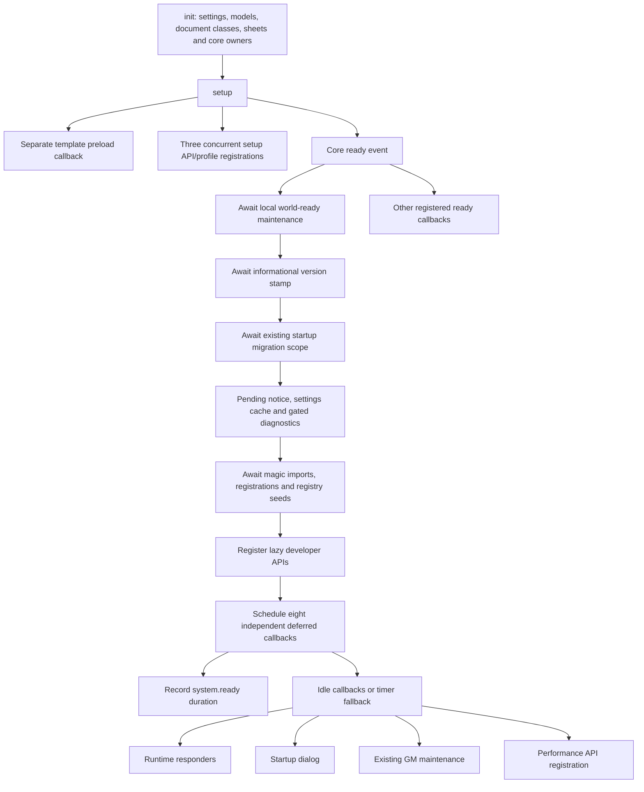

# Task 11 - Startup and combat-refresh performance audit only

**Date:** 25 October 2026.  
**Result:** Investigation only; startup and combat-refresh optimization deferred.  
**Scope:** Existing startup dependencies, deferred work, combat-sheet refresh, diagnostic coverage and future native benchmarks. No production or instrumentation change.

## Baseline and evidence boundaries

| Field | Evidence |
| --- | --- |
| Workspace | `C:/dev/uesrpg/uesrpg-3ev4-14.0.0` |
| Preserved baseline | All **992 files** in Task 10's final source/development SHA-256 manifest matched before editing. No missing, changed or additional files in the inventoried directories. Tasks 01-10 are preserved. |
| Backup | Ignored `release/backups/task-11-startup-combat-audit-20261025-163325/`: original `source/docs/testing.md`, verified guide hash, `pre-change.sha256.json` and `baseline.json`, saved before edits. Timestamp is UTC. |
| Branch / commit | Unavailable: `git rev-parse --show-toplevel` reports `not a git repository`. No branch, commit or PR is claimed. |
| System / compatibility | `14.2.0`; declared minimum/verified `14.368`, maximum `14`; unchanged. Future live procedures target a disposable Foundry v14.369+ v14 world. |
| Local environment | Windows, PowerShell, Node **v24.13.0**, existing installed locked dependencies. |
| Historical unit evidence | Task 09 recorded **313 passing tests in twenty suites**. This documentation-only task does not rerun or extend them. They do not measure startup, native Hooks, listener retention or DOM updates. |
| Native and performance evidence | **NOT RUN**. No Foundry session/world was opened, no startup/combat action was executed, and no listener count, timing sample, memory profile or benchmark was collected. |

The approved audit-only plan bounds the bundle's gated optimization candidates. Its instructions do not authorize scheduling changes, a global event broker, a readiness flag or a live test. Tasks 05, 07 and 10 retain their deferred objectives. Task 11's broader performance objective remains pending.

**Source-confirmed behavior** means checked-in code, without native reproduction. **Potential risk** describes a condition to test, not a demonstrated defect. **Unknown** needs runtime evidence. The counts below describe source declarations and procedure parameters, not observed runtime performance. No world/compendium records were inspected, and no LevelDB database was opened or modified.

## Startup ownership and dependency map

The entrypoint is [system.js](../../src/system.js). Its ready callback has an explicit local sequence; other registered ready callbacks remain separate. This source ordering does not establish a global cross-client completion barrier.

The optional setup Promise is launched with `void Promise.all(...)` and its own catch; it is not joined by the main ready callback. Deferred callbacks are scheduled independently, without a shared completion Promise or concurrency limit. The diagram's branches are relationships, not measured overlap or a guarantee of callback arrival order.

| Phase / classification | Actual boundary and owner | Guard, failure handling, users and writes |
| --- | --- | --- |
| Critical before feature use: init | [init.js](../../src/hooks/init.js), `initHandler`, called synchronously by the entrypoint | Registers settings, Actor/Item models, document/Combat classes, sheets, AppV2 chat, authority/XP owners, condition/time/combat subsystems and APIs. Selected registrations catch/log errors; others can propagate. Diagnostic imports are launched separately. Configuration/registration is distinct from later callbacks that mutate documents. |
| Setup: presentation and API availability | Template preload registered by init; `registerWarfareProfiles`, `registerSystemRuntimeApi`, `registerSystemMacroApis` launched together by the entrypoint | Setup callback applies chat-composer preference, then starts the three async registration functions without awaiting them at hook level. Macro registration imports enchanting, character generation, treatment, XP, alchemy and travel owners, then binds their APIs; binding an API does not execute those actions. Profile loading has its own warning catch. |
| Required startup maintenance in the selected GM's scope | [run-world-ready-maintenance.js](../../src/hooks/ready/run-world-ready-maintenance.js), [migration runner](../../src/core/migrations/runner.js) | This callback awaits version stamping, then the existing startup migration runner. Stamping and migration passes use the active-GM helper. Only current settings passes and NPC armor coverage are startup migrations. Historical failed records remain pending until explicit manual retry. The runner rechecks authority and persisted completion. |
| Local maintenance follow-up | Pending-migration notice, settings-cache initialization and gated policy diagnostics | Pending notices are active-GM-only; cache initialization is local. Stamp failures are logged. The startup runner can return failure without throwing, and this wrapper does not turn that into a gameplay barrier: it continues its existing follow-up. `worldDataVersion` remains informational. |
| Required when using the corresponding magic features | [register-magic-runtime.js](../../src/hooks/ready/register-magic-runtime.js) | Shares an in-flight Promise and a successful-registration Boolean. It awaits eighteen module imports together, then calls the existing synchronous initialization exports and registry seeds in source order. Failed registration clears the in-flight reference in `finally`; the successful flag is set only after return. It does not await future hook-triggered gameplay work. |
| Diagnostic/developer API availability | [register-ready-runtime-api.js](../../src/hooks/ready/register-ready-runtime-api.js) | Registers GM-only lazy zone/rune rebuild, boundary-queue and round-start-registry helpers. Registration itself does not run those helpers. Some exposed helpers perform work when explicitly invoked; do not use them as passive measurements or automatic retries. |
| Currently deferred runtime responders | Four deferred service initializers below | They are currently deferred by source. Some are needed when their feature is used; the scheduling label does not prove it is safe to invoke that feature before registration. No additional delay is proposed. |
| Noncritical presentation / existing maintenance / diagnostics | Remaining four deferred tasks below | Each has its own existing role/setting/write behavior. They must not be grouped as harmless UI-only work. |

### Magic registration inventory

The awaited magic wrapper calls, in order: spell-tick engine, spell-effect expiration, upkeep, spell-owned authority, origin-AE lifecycle, zone-tick handler, overtime engine, rune triggers, condition triggers, summon binding, Mindlock, bound Items, conjuration, Soul Trap, Disintegrate, Drain, resource restoration and cloak-tick handling. It then seeds zone, rune and cloak registries. The magic opposed-workflow module is also imported. The functions are the existing owners, not duplicate scheduling candidates.

Zone/rune/cloak seeds rebuild local registries and install incremental ActiveEffect hooks; spell expiration also seeds tracked effects. Summon/bound-Item/conjuration initializers register guarded hooks whose later callbacks launch asynchronous gameplay work with existing error handling. Spell expiration registers owned world-time/combat consumers and selected-GM event handlers. These registration/seed calls are not proof that subsequent effect/resource work has completed or that every live document is migration-ready.

### Eight deferred tasks

The canonical scheduler is [register-system-deferred-tasks.js](../../src/hooks/ready/register-system-deferred-tasks.js). `registerOnce("hooks:ready-deferred-tasks", ...)` prevents repeat scheduling within that client's registry. The scheduler selects `requestIdleCallback` when present; its fallback schedules `setTimeout(cb, 0)`. The idle request supplies a default `timeout: 1000`. That is a scheduling option, not a measured latency guarantee or completion deadline. Handles are not retained here, and no all-tasks join, automatic retry or cancellation policy is added.

| Label | Dependency / actual completion boundary | Guard / users | Immediate work and write boundary |
| --- | --- | --- | --- |
| `utility-spells` | Await module import, then call `initializeUtilitySpellsService` | Local `_initialized`; all clients | Registers `uesrpg.spell.castResolved`; later utility actions have their own document/effect consequences. The initializer itself does not execute a spell. |
| `characteristic-defense` | Await import, then call `initializeCharacteristicDefenseService` | Local `_initialized`; all clients | Current initializer is intentionally a guarded no-op/debug message. Characteristic defense is integrated into outcome resolution. It must not be counted as a second defense processor. |
| `alchemy-runtime` | Await import, then call `initializeAlchemyRuntime` | Existing `runtimeInitialized` in `alchemy/runtime/hooks.js`; all clients | Registers damage-applied and combat-update callbacks. Future poison/coating/tick actions remain under their existing owners and handled-domain guards. Duplicate registration returns false after a warning. |
| `strike-runtime` | Await import, then call `initializeStrikeOnHitRuntime` | Local `_hookRegistered`; all clients | Registers the damage-applied responder with the existing handled-domain exclusion. Later strike execution is asynchronous; initializer timing does not measure it. |
| `startup-dialog` | Await import and `startupHandler.default()` | Runs only when `noStartUpDialog === false`; no GM-only test in this handler | Uses the current DialogV2 helper and template. The awaited dialog can include the time until user dismissal; it is not pure CPU or service-initialization latency. No world write is performed by the shown handler. |
| `token-hud-upgrade` | Await import and `runTokenHudStatusUpgradeMaintenance` | `game.user.isGM`, existing `conditionsHudUpgradeV2Done` world setting | May wait for its combat/canvas-safe startup window, upgrade existing status effects and set the completion setting. It can return early/skipped, and it catches errors internally. Its GM test is not the selected-active-GM test used by Task 06's runner. |
| `active-effect-integrity` | Await import and `runActiveEffectIntegrityNormalization` | `game.user.isGM`; scans world Actors and their owned Items' effects | Normalizes effects using existing native-write helpers, then awaits expired-spell cleanup. Cleanup itself uses selected-active-GM authority and can delete effects through its existing paths. Cleanup errors are caught/logged internally before a normal return. |
| `perf-api-init` | Await import, then call `initializePerfApi` | Local API binding for all clients; recording gated by `timePerformanceDebug` | Registers `game.uesrpg.perf`; it does not run a benchmark. API registration and available diagnostic data are different milestones. |

The outer deferred wrapper records `ok: true` when its callback resolves and `ok: false` when it throws. It ignores returned domain results. A role skip, already-completed maintenance, dialog dismissal or internally caught error can therefore produce a resolved wrapper. This is **source-confirmed diagnostic meaning**, not evidence that maintenance succeeded. The audit does not change reporting or error propagation.

### Separate ready callbacks and overlap boundary

| Existing owner | Ready-time behavior relevant to the audit |
| --- | --- |
| [hook registry](../../src/hooks/_internal/hook-registry.js) | `registerOnce` keeps a client-local Set under `game.uesrpg._internal.hooks`, runs its registration callback and adds the key after synchronous return. It does not await asynchronous registrations, track task completion or coordinate other clients. |
| `hooks/init/register-migrations.js` | Despite the file/function name, the current ready callback applies the UI font and optionally loads gated skill-TN/Actor-selection diagnostics. It is not another document migration runner. |
| `core/conditions/index.js` and round-start candidate registry | Reassert status configuration, optionally report registry warnings and reseed local candidate/combat caches at ready. They also register normal document lifecycle maintenance of those caches. |
| `core/time/time-service.js` | Rechecks optional calendar adapters and installs supported ingress at ready, after initial time/combat hooks are registered. Module-dependent availability must be recorded. |
| `core/combat/chat-handlers/combat-chat-register.js` | Independently starts existing outcome recovery at ready and reconnect. Recovery may perform selected-authority receipt/card/application work; it is not joined by the entrypoint's maintenance sequence. Task 04/09 protections remain authoritative. |
| `core/mass-warfare/campaign/hooks.js` | Binds the existing army-campaign app API at ready; does not advance a campaign merely by registering. |
| Embedded-delete guard and gated debug/memory modules | Separate UI/notification or diagnostic initialization. Their presence depends on existing guards/settings. They are not a measured memory-leak fix or a substitute for per-sheet disposal. |

No global ordering among asynchronous descendants is inferred from hook registration order. In particular, ordinary UI opening, outcome recovery and deferred GM maintenance need native overlap tests. The two `isGM` maintenance guards above are not evidence that competing GMs actually issue duplicate writes; that is a potential race to investigate separately. This audit adds no startup barrier, cross-client promise, migration scope or serialized maintenance owner.

## Combat-sheet refresh and cleanup

The shared owner is [combat-tracker-refresh.js](../../src/ui/sheets/v2/shared/combat-tracker-refresh.js), with render queues in [sheet-runtime-helpers.js](../../src/ui/sheets/v2/shared/sheet-runtime-helpers.js).

| Stage | Source-confirmed behavior | Native evidence still needed |
| --- | --- | --- |
| Registration | PC and NPC `_onRender` call `registerCombatTrackerSheetRefresh(this)`. A stored `_uesrpgCombatTrackerRefreshHooks` object prevents duplicate registration while present. Each instance registers one attack-tracker and one combat-time callback. | Actual per-client listener deltas over repeated partial/full render, reopen and detached/multiple windows. Two declared hooks are not a leak. |
| Attack-tracker matching | Builds sheet targets from the document and tracker context, falling back through existing Actor resolution helpers. Matches candidate Actor ID **or** UUID against collected sets; checks both payload Actor and source Actor. | Multiple unlinked token Actors can require finer provenance than a shared base ID. Broad matching is a potential extra-refresh/identity risk, not a reproduced incorrect write. |
| Authority hints | Non-token sheets can retain explicit token/combatant, authority/ambiguity and trace hints when the payload relates to their Actor. A changed nonempty combat ID clears a stale hint. Existing context builders consume it. | Correct hint selection/clearing with multiple unlinked tokens, combat switches, missing/deleted targets and authority changes. A presentation hint does not itself authorize a write. |
| Combat-time filtering | Requires `source: "combat"`, rejects a supplied non-post phase, requires a current combat and matching supplied combat ID, then scans membership against tracked Actor IDs/UUIDs. | Unrelated combats and Actors, no combat, source/phase variants actually emitted by current owners, multiple combatants and token contexts. |
| Refresh request | Returns for missing sheet element or limited document; otherwise clears `_uesrpgCombatCache`, then awaits `_queueRenderParts(["combat"])`, with named-part render as the fallback. | Correct limited-view behavior, real part selection and no unintended gameplay/document writes. Other native/system update routes can also request rendering. |
| Queue | Shared WeakMap state unions requested parts, uses the existing animation-frame drain and serializes renders. Invalid requested parts or failed partial rendering can use the existing full-render fallback. UI-state capture/restoration is integrated with each sheet's own preservation. | Requests versus completed partial/full renders, coalescing ratio, fallback counts, visible latency and focus/scroll under rapid input. A queued Promise settling is not independent proof that the DOM successfully updated. |
| Close | PC/NPC `_onClose` clear queued parts, caches and form state, call `unregisterCombatTrackerSheetRefresh`, and preserve the superclass call. Unregistration calls `Hooks.off` for the stored IDs and clears the instance's hook object. | Listener counts return to the pre-open baseline; no retained instances or late display updates after close. Exceptions or an already-running render require native testing. |
| Queue cancellation | `clearQueuedRenderPartsState` marks the sheet closed/cancelled, cancels a pending animation frame, clears parts, settles queued/active resolvers and deletes map state. It does not abort a native render Promise already in flight. | Close while queued and while rendering; subsequent reopen and new instance behavior. Cleanup source alone does not establish collection or absence of a close race. |

### Other sheet classes and event ownership

| Surface | Actual coverage |
| --- | --- |
| PC / NPC | The only checked-in callers of this shared two-hook combat-refresh registrar. They reuse their existing shared render queue. |
| Item | No registration of this combat-refresh pair. Its existing render revisions, scroll/UI state and close/form behavior remain separate; it must not be counted as another subscriber merely because it is an open sheet. |
| Group | No shared combat-refresh pair. It has its own member Actor/Item lifecycle hooks and summary cache; close removes those hook IDs and clears queue/form state. See Task 05's separate member-invalidation risks. |
| Warfare Unit | No shared combat-refresh pair. It observes commander `updateActor`, clears that hook/cache and queue/form state on close. |

Existing [combat-boundary orchestration](../../src/core/time/combat-boundary-orchestrator.js), [boundary-work scheduling](../../src/core/time/boundary-work-scheduler.js) and TimeService own gameplay boundaries. The sheet observer is presentation infrastructure. [Consolidation checks](../../scripts/consolidation-checks.js) allow the current presentation observer while restricting additional `uesrpg.combatTimeChanged` ownership. A second round listener, global dispatcher or independent render scheduler would require separate evidence and design; none is introduced.

## Timings, counters and gaps

| Existing diagnostic | What its source measures / retains | Limit for this task |
| --- | --- | --- |
| `system.init.initHandler` | Synchronous `initHandler` plus entrypoint Handlebars-helper registration, when the performance setting is available/enabled | Excludes module loading before entry and asynchronously imported diagnostics; not full client startup. Keep diagnostics stable before recording. |
| `system.ready` | This callback's awaited maintenance and magic wrapper, developer API binding and deferred scheduling | Excludes deferred callback completion, independent ready callbacks and setup work that remains outstanding. It is not time to usable gameplay. |
| `system.ready.deferred.<label>` | Duration from deferred callback invocation through its awaited task wrapper; one completion/failure record | Includes dynamic import and any awaited internal waits/user interaction. No explicit scheduling/request/start timeline or all-tasks completion record. Resolved wrapper does not prove successful domain work. |
| Shared sheet traces | Under `sheetPerfTrace` and/or `timePerformanceDebug`, preparation/render lifecycle and named phases; health-refresh correlation where applicable | Does not automatically time every hook match, queue wait, fallback, close outcome or visible pixel update. Lifecycle-handler duration is not the whole render-call/paint duration. |
| Attack-tracker diagnostics | Debug-gated `sheet-refresh` records include matching and Actor/token/authority provenance. The diagnostic owner retains the latest **20** recent events. | Tail history is not a full run, census of listeners, CPU profile or proof of native identity correctness. Logging itself changes diagnostic cost; match settings between comparisons. |
| Time/boundary/application spans | Existing TimeService, boundary queue, application/receipt and owned-stage diagnostics provide related work context | Not a complete startup or every-native-write census. Attribution and feature coverage must be recorded; missing data must remain missing. |
| Performance buffer/export | [perf-tracker-support.js](../../src/utils/perf-tracker-support.js) retains **500** records. `exportBatch` defaults to **100**, caps at **200**, and exposes cursor/`hasMore`/`overwritten`. | Export promptly without resetting away startup evidence. Mark overwritten/truncated samples unusable for whole-run counts; do not treat them as lower activity. |
| `runSheetBenchmark` | Selects one currently rendered sheet per supported PC/NPC/Item class and times awaited `render()` calls; bounded repetition count | Does not exercise 1/5/10 subscribers, cold startup, group/warfare coverage, targeted event delivery or visible latency. No additional capability is assumed. |
| `runBenchmark` | Existing GM-only routine resets the performance records, advances real combat turns and includes a delay between advances | Stateful and not a pure round-boundary or startup timer. Not every Next Turn crosses a round. It must never be used in the live campaign or allowed to discard startup samples. |
| Documented `Hooks.events` accessor | Allows read-only inspection of current listener arrays in a native client | Actual listener counts remain NOT RUN. Count each client separately; do not patch hook dispatch, add a broker or broadcast synthetic ready/round events to manufacture evidence. |

No scheduling-delay, complete-task-lifetime, overlap, hook-cost, listener-retention, render-coalescing or visible-latency measurements were added. No observed memory leak, bottleneck, speedup or ranking of the two optimization candidates is claimed.

## Official v14 API verification

Only official v14 API documentation is used as Foundry authority. These entries were consulted during the audit; no new Foundry API usage or lifecycle override is introduced.

| Reference | Classification / documented boundary |
| --- | --- |
| [Hooks.on](https://foundryvtt.com/api/v14/classes/foundry.helpers.Hooks.html#on), [off](https://foundryvtt.com/api/v14/classes/foundry.helpers.Hooks.html#off), [once](https://foundryvtt.com/api/v14/classes/foundry.helpers.Hooks.html#once), [events](https://foundryvtt.com/api/v14/classes/foundry.helpers.Hooks.html#events) | Public static registration, ID-based removal, once registration and read-only inspection surface. Preserve returned hook IDs and explicit disposal. |
| [Hooks.call](https://foundryvtt.com/api/v14/classes/foundry.helpers.Hooks.html#call), [callAll](https://foundryvtt.com/api/v14/classes/foundry.helpers.Hooks.html#callall) | Public dispatch APIs document registration-order invocation and Boolean/void results. They do not provide a documented Promise joining every async descendant or exclusive authority among clients. |
| [ready](https://foundryvtt.com/api/v14/functions/hookEvents.ready.html) | Public core hook after setup. Its core-ready milestone must not be redefined as proof that all system-launched optional/deferred work or migrations have completed. |
| [ApplicationV2.render](https://foundryvtt.com/api/v14/classes/foundry.applications.api.ApplicationV2.html#render), [close](https://foundryvtt.com/api/v14/classes/foundry.applications.api.ApplicationV2.html#close) | Public application operations. Render returns a Promise for the rendered application; visible-update timing is a separate measurement. |
| [HandlebarsRenderOptions.parts](https://foundryvtt.com/api/v14/interfaces/foundry.HandlebarsRenderOptions.html#parts), [HandlebarsApplication](https://foundryvtt.com/api/v14/classes/foundry.HandlebarsApplication.html) | Public named-template-part rendering configuration for the mixed application. Existing `render({ parts: ["combat"] })` is evaluated against this documented architecture. |
| [ApplicationV2._onRender](https://foundryvtt.com/api/v14/classes/foundry.applications.api.ApplicationV2.html#_onrender), [HandlebarsApplication._preparePartContext](https://foundryvtt.com/api/v14/classes/foundry.HandlebarsApplication.html#_preparepartcontext) | Documented **protected** subclass lifecycle overrides, not methods for an external benchmark to call directly. |
| [ApplicationV2._preClose](https://foundryvtt.com/api/v14/classes/foundry.applications.api.ApplicationV2.html#_preclose), [_onClose](https://foundryvtt.com/api/v14/classes/foundry.applications.api.ApplicationV2.html#_onclose) | Documented **protected** overrides: pre-close is awaited; post-close steps are not awaited by the close process. A close acknowledgement alone cannot establish that an independently running render/task has settled. |

The idle/timer/frame calls described above are source-visible browser scheduling choices, not new Foundry lifecycle APIs. No private Foundry hook registry, undocumented AppV2 internals or prior-version behavior is used as evidence. Supported public APIs and explicit cleanup paths do not establish native correctness or performance by themselves.

## Findings and decision gates

| ID | Classification | Finding / required follow-up |
| --- | --- | --- |
| T11-S1 | Source-confirmed behavior | Canonical startup, migration, boundary, sheet queue and hook-disposal owners already exist. Preserve them; no replacement framework is justified. |
| T11-S2 | Source-confirmed behavior | Eight tasks are scheduled independently after local maintenance/magic registration. Current ready/deferred spans have narrower meanings than overall availability or domain success. |
| T11-S3 | Source-confirmed behavior | PC/NPC instances guard registration and explicitly remove two hooks on close. That establishes cleanup intent and source paths, not observed listener or heap counts. |
| T11-R1 | Potential risk | Setup API imports, other ready callbacks, deferred service registration, maintenance and early user actions can overlap. Test first feature use and exact dependencies before changing concurrency or delay. |
| T11-R2 | Potential risk | Token-HUD/integrity maintenance use any-GM checks in some outer paths, while selected-GM helpers and Task 06 migrations have narrower authority. Competing GMs and native writes require inspection; no duplicate-write defect is claimed. |
| T11-R3 | Potential risk | ID-or-UUID matching can be broader than unique synthetic-token provenance. Test affected versus unrelated sheet refresh and authority hints before choosing a dispatcher or changing identity rules. |
| T11-R4 | Potential risk | Closing a sheet settles queue bookkeeping without cancelling an already-running native render. Test reopen, retained references, input and late updates before changing lifecycle cleanup. |
| T11-R5 | Potential risk | Dialog user time, safe-window waits, swallowed maintenance errors, disabled diagnostic gates or overwritten buffers can make timing/status interpretation misleading. Record these separately; do not optimize from an unqualified total. |
| T11-U1 | Unknown | Native task overlap, cold/warm availability, memory/listener retention, hook CPU cost, completed render counts and visible latency. No numerical baseline exists from this audit. |

**Decision: defer both candidates.** Candidate A is sequencing/concurrency inside the current deferred-ready owner. Candidate B is event distribution for open PC/NPC sheets while reusing their queue. Neither is warranted by the available evidence. Suspected correctness/reporting issues are separate corrective proposals, not changes bundled into a performance audit.

Before any later patch, agree numerical thresholds for usable-startup latency or event-to-visible-update latency, acceptable p95/variance and resource overhead, plus zero-regression correctness criteria. Obtain matched baseline measurements with complete provenance and diagnose the relevant phase. A tiny matching-cost reduction does not justify a global dispatcher. Evaluate A and B independently, with independent rollback. No numerical improvement threshold or optimization is approved by this report.

## Future native benchmark procedure - every case NOT RUN

### Environment, fixtures and availability

1. Preserve a stopped, coherent copied-world backup: settings, Actors, Items/effects, linked/unlinked Tokens, Combat and ChatMessages. Use a disposable **Foundry v14.369+** v14 instance. Record exact source hash/system/core builds, browser/OS/hardware, network, canvas/scene, module list, UI dimensions, selected user, diagnostic settings and restore reference. Begin with external modules disabled; repeat only an explicitly recorded compatibility subset. Do not modify databases directly.
2. Prepare separate controlled **0/5/20-Actor** startup snapshots using native controls and sanitized versions of the existing fixture descriptions. Record Actor, Item, effect, Token and Combat counts. Record opened/restored sheet counts separately; a world containing twenty Actors does not imply twenty open sheets. Sheet restoration is tested only if actually supported, not assumed. Prepare distinct 1/5/10-sheet event workloads, including PC and NPC, unrelated Actors and two unlinked tokens sharing a base Actor. Item/Group/Warfare windows are separate controls, not subscribers to this hook pair.
3. Define an external start marker and capture method before each run, such as the browser's navigation/performance recording. Define usable gameplay as native UI availability plus successful fixture-appropriate representative actions and required feature availability. The empty-Actor fixture can use chat/UI and registered-service checks; Actor fixtures also require opening a representative sheet and an ordinary action, with native acknowledgement/evidence. Do not substitute the `system.ready` span, dialog closure or "scheduled" for this availability probe. Record pending migrations accurately rather than clear them to make a timing pass.
4. Enable selected existing diagnostics before the capture session and keep them identical in comparisons. Record console logging and any debug observers/memory monitor separately. Retain startup records before any API reset or turn benchmark. If available counters cannot attribute a requested phase/write/render, record the gap as unknown; this audit authorizes no extra wrappers/listeners/instrumentation to fill it.

### Startup measurements

Use **twenty measured repetitions per condition**, with **three discarded warm-ups for warmed conditions**. No warm-up is used to relabel a cache-warmed run as cold. Treat client cold-cache navigation, warm-cache client reload/reconnect and server restart as separate conditions. Record the exact cache-clearing/profile/reload method, whether server process and world caches persisted, and whether the same source/fixture state was restored. Do not pool these conditions.

For each trial retain start/ready-span/usable-probe observations, available deferred labels and durations, import/cache conditions, dialog interaction, safe-window waits, exceptions, actual writes and pending state. User time in the startup dialog must be recorded separately. Capture task start/end/overlap with the available native browser profile and existing diagnostics where attribution is possible; the current records alone do not provide a complete scheduled/start/end timeline. Mark unobservable intervals unknown. Compute median/p95 only from complete, comparable samples; retain sample count and variation. No performance values are populated here.

Interrupt/reload at existing maintenance and registration boundaries in the copied world, then inspect pending state and native documents before retrying. Test inactive/no/multiple GM, absent optional modules/services, slow import/browser conditions and explicit manual migration requests queued during startup. Do not auto-run additional migrations or lower markers. Repeated-registration cases should use normal reload/render/reopen and existing supported entrypoints; do not broadcast synthetic `ready` events to manufacture a pass.

### Combat-refresh measurements and correctness

For **1, 5 and 10 relevant PC/NPC sheets**, record each client's initial `Hooks.events` lengths, open-instance/Actor/token identities and expected matching sheets. Use normal attack-tracker-producing actions and actual round transitions through existing controls; record emitted source/phase/trace provenance. A turn advance that does not cross a round is a different sample. No fake event dispatcher is added.

After three warm-ups, collect twenty measured repetitions per condition from identical restored gameplay state. Record listener-count deltas, observed matching/nonmatching callbacks, requested/coalesced/completed partial and full renders, fallbacks, queue delay where observable, native write counts and event-to-visible-update latency. Awaited render duration and visible latency must be reported separately. Export bounded batches promptly using current cursor/overflow indicators; discard incomplete whole-run samples, preserving their failure reason. The twenty-event attack diagnostic tail cannot by itself reconstruct a whole multi-sheet run.

Exercise repeated renders, close, reopen, close before the queued frame and close during a render. Verify listener counts return to baseline, no stale instance continues to refresh, new instances subscribe normally, and focused inputs/selection/scroll remain coherent. Memory/retention conclusions require actual native profiling, not a count of source registrations. Test limited views, ownership changes, combat switches and ambiguous unlinked-token contexts. Compare resources, effects, attack counters and combat results with the unchanged baseline; rendering must not independently apply consequences.

The existing `runSheetBenchmark` may supply a separate warmed render-call control, but it does not replace these workloads. The turn-advancing `runBenchmark` is stateful, resets records and includes waits: use only in the disposable world when that exact action is wanted, and restore matching state afterward. It supplies neither a startup baseline nor automatic round-only timing.

| Native case | Required coverage / invariant | Result |
| --- | --- | --- |
| START-COLD / START-WARM | 0/5/20-Actor snapshots, documented cache/server conditions, twenty samples and warmed warm-ups; usable gameplay is independently established. | NOT RUN |
| START-TASKS | All eight deferred labels, applicability/skips, late API availability, dialog/user time, task overlap, internally caught errors and maintenance writes. | NOT RUN |
| START-EARLY-USE | Open UI and use enabled features before/while deferred registration completes; required handlers and existing results remain consistent. | NOT RUN |
| START-FAILURE | Interrupted/reloaded startup, slow imports/browser, missing optional service and registration exceptions; no silent claim of complete work. | NOT RUN |
| START-MIGRATION | Pending/failed historical records, explicit manual retry queued during startup, active-GM loss and no additional migration scope. | NOT RUN |
| START-AUTHORITY | Multiple/no/inactive GM and owner/non-owner perspectives; inspect exact settings/effect/Actor write acknowledgements and provenance. | NOT RUN |
| REFRESH-SCALE | 1/5/10 PC/NPC sheets, normal attack event and real round boundary; compare matched callbacks and actual partial/full renders. | NOT RUN |
| REFRESH-IDENTITY | Unrelated Actors/combats, linked and two supported unlinked token Actors, hints, ambiguity, combat switch and deleted targets. | NOT RUN |
| REFRESH-CLOSE | Repeated render, close/reopen and close while queued/in-flight; baseline listener counts, no stale refresh and valid new instance. | NOT RUN |
| REFRESH-UI | Limited-view privacy, ownership changes, rapid input, focus/selection/scroll, submit/close and existing full fallback. | NOT RUN |
| REFRESH-CORRECTNESS | Existing effects, resources, AP/attack counters and combat results; no duplicate gameplay outcome from rendering or event distribution. | NOT RUN |
| OTHER-SHEETS | Item, Group and Warfare controls use their actual lifecycle/observers; they are not counted as additional shared combat subscribers. | NOT RUN |
| DIAGNOSTICS | Stable settings/logging, complete buffered exports, independently identified missing counters/intervals and no overwritten-sample performance claim. | NOT RUN |
| RESTORE | Stop processors/clients and restore a coherent copied-world snapshot after stateful tests; preserve operation and migration evidence. | NOT RUN |

Reuse [Task 05's benchmark/correctness procedure](05-appv2-sheet-performance.md#future-benchmark-procedure---not-executed), [Task 06's migration matrix](06-migration-readiness.md#reproducible-live-acceptance---every-case-not-run), [Task 04's special-action recovery matrix](04-special-action-idempotency.md#reproducible-live-acceptance---every-case-not-run) and [Task 09's action-result acceptance](09-action-result-contracts.md#native-acceptance---every-case-not-run). The [testing guide](../testing.md) also retains Task 01 rank, Task 02 purchase and AppV2 submit/close cases. Use those canonical cases instead of a competing implementation of their rules.

Record `Case/condition | environment/source and fixture hashes | user/Actor/token identities | input/action | expected invariant | observed timing/count/source/UI evidence | PASS/FAIL/NOT RUN | sanitized evidence/restore reference`. A future optimization needs matched measurements against this unchanged baseline and a separate decision. All runtime results, sample sets, medians/p95, listener/write/render counts, memory outcomes and speedup claims are **NOT RUN**.

## Validation ledger and preservation proof

| Check | Result | Exit / duration |
| --- | --- | --- |
| Task 10 final manifest before edits | PASS: all 992 source/development files match; no additional inventoried files. | SHA-256 comparison |
| Guide backup | PASS: copied before edits and verified. | SHA-256 `1e9cb1172c4335dd7f405768bb3079c65e6272097f53f5adfed3e357f760aa86` |
| `npm run validate` | PASS locally: 803 JavaScript syntax checks, reference checks for 795 JavaScript files / 105 templates, 29 Markdown documents, existing source/ownership safeguards, schema/catalog consistency and 21 centralized revisions. | Exit **0**; **41,498.608 ms** |
| Unit suite and standalone lint/syntax/schema/catalog commands | NOT RUN for this documentation-only task. The 313-test result is historical Task 09 evidence. No tests or production inputs changed. | Not rerun |
| Foundry, benchmarks and remote CI | NOT RUN. | No native, benchmark or remote execution claimed |
| Final source/development hash comparison | PASS: **991 baseline files unchanged**, only the testing guide changed, one report added, zero missing/unexpected changes; **993** final entries. The guide differs only by the new nonfunctional-lane Task 11 link. | SHA-256 inventory and scope proof |

The full log and command metadata are preserved as `validate.log` and `validate.result.json` under the ignored backup. The graph remains 784 runtime modules / 4,037 static or literal-dynamic edges, with 778 reachable modules, 7,213 checked bindings and 210 literal/computed dynamic imports. The **25 existing module-binding coverage-limit notices are unchanged** from Task 10 after line-number normalization. Dynamic-import promises, escaping namespaces and computed member access remain outside some static export checks; these are coverage limits, not validation failures.

Final `post-change.sha256.json`, `preservation-proof.json` and `validation-ledger.json` retain the source/development inventory, exact two-file change boundary, link checks and local command evidence. Production, tests, workflows, manifests, generated artifacts and prior reports match their baseline hashes. Local report/guide checks also verified 36 repository-relative links and 15 linked Markdown heading fragments, with zero errors; remote link availability is not a source-validator guarantee.

The inventory scope follows Task 10: root development files plus `.github`, `automation`, `docs`, `lang`, `scripts`, `src`, `styles`, `templates`, `tests`. It excludes ignored backups/build/dependencies and binary asset/pack trees. No binary/LevelDB inspection is represented by these hashes; this task writes only the two documents and ignored evidence. Links within documentation remain repository-relative.

Source validation covers local document paths, source syntax/reference/ownership safeguards, existing schema/catalog consistency and packaging/CI policy. It does not run Foundry, validate native lifecycle timing, detect memory leaks, measure performance, prove cross-client order/permissions/recovery, execute remote CI or verify third-party modules. Static import/export coverage limits and documentation-link limitations must be recorded separately from failures. Validation wall time is not a startup benchmark.

## Rollback and completion boundary

Only this report and one nonfunctional-lane testing-guide link are changed. Production, instrumentation, scheduling, queues, forms, interfaces, schemas, persisted data, dependencies, tests, workflows, manifests, generated artifacts and prior reports are preserved. No new scheduler, dispatcher, startup readiness service, migration, release artifact, version bump, compatibility declaration, publishing, deployment or later task is included.

Rollback restores `docs/testing.md` from `release/backups/task-11-startup-combat-audit-20261025-163325/source/docs/testing.md` and removes only `docs/task-reports/11-startup-combat-event-performance.md`. Verify the restored guide hash. If later guide edits exist, preserve them and revert only this link. Keep ignored inventories/logs for review. This audit requires no world restoration because it made no world changes.

Later stateful benchmarks need their own coherent copied-world backup and restoration. Any future candidate A/B source rollback is independent; stopping processors and preserving/restoring matching document state remains necessary after stateful testing. Neither receipt edits nor lowered migration revisions reverse gameplay transformations. The broader Task 11 optimization objective remains pending.

Audit complete; startup and combat-refresh optimization deferred.
